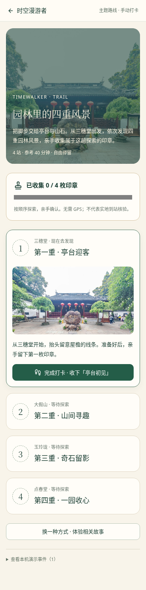
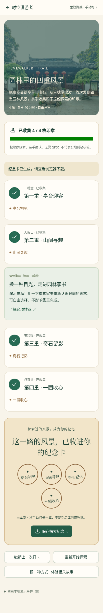
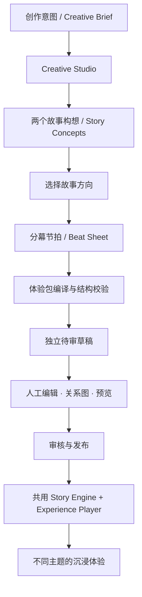
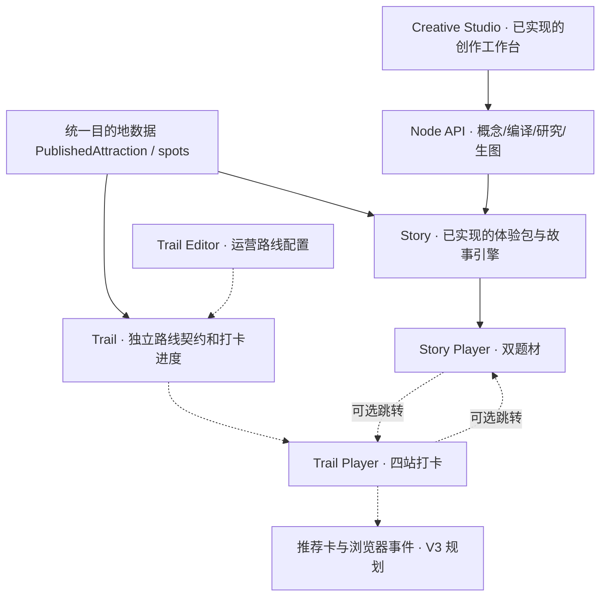

<div align="center">

# 时空漫游者 · TIMEWALKER

### 让世界成为你的故事

**Turn places into stories. Make every journey an experience.**

以真实目的地为舞台，让旅行者走进一段有情节、有选择、有记忆的沉浸式故事。

**沉浸式故事 Story · 主题路线 Trail · AI 创作与运营工作台**

[双模式产品](#-从一个景点导览走向一套旅行体验引擎) · [故事样板](#-两段故事同一套引擎) · [路线规划](#-trail-主题路线打卡v3-新增方向) · [立即体验](#-立即体验) · [开发路线](#-v3-后续开发路线) · [文档索引](#-文档索引)

</div>

---

## ✨ 从一个景点导览，走向一套旅行体验引擎

传统景点导览告诉游客「这里有什么」，普通攻略告诉游客「可以去哪里」。**时空漫游者（Timewalker）** 更进一步：把真实目的地组织成值得体验的故事，以及可以亲自完成的主题探索路线。

**Trip Experience Engine（智能旅行体验引擎）** 是这背后的统一内容生产与运行底座。我们希望为游客提供两种互补、可以独立使用的体验，并让客服和目的地运营人员通过 Web 工作台制作、配置和分发这些体验。

| 产品模块 | 面向谁 | 创造的价值 | 本分支状态 |
|---|---|---|---|
| **Story · 沉浸式故事** | 游客 | 有情节的章节、轻量选择、观察与个人记录 | ✅ 豫园、天文馆双样板可运行 |
| **Trail · 主题路线打卡** | 游客 | 按顺序探索地点、手动集章、完成纪念卡 | ✅ 豫园四站路线、进度恢复与纪念卡已实现 |
| **Creative Studio · 智能创作** | 创作者 | 故事构想、分幕编译、素材制作、人工编辑与发布 | ✅ Web 链路已实现；真实供应商联调待完成 |
| **Trail Editor · 运营路线配置** | 客服、目的地运营人员 | 选点、编排顺序、配置推荐、交付可分享路线 | ✅ 编辑、开发态发布与 JSON 导出已实现 |

### 商业化逻辑：展示可配置能力，不虚构收益

我们希望形成「**故事产生探索动机 → 路线组织线下体验 → 推荐内容获得适当展示和点击机会**」的链路。真实成交、佣金与线下客流增长依赖未来的商户合作和实际运营，**不属于本次 Hackathon Web 演示可以证明的事实**。本阶段展示的是可编辑、可发布、可操作、可记录的体验流程；没有合作商户时仅展示明确标注的演示推荐。

> **当前统一方案**：[25 · 双模式产品方案与后续开发规划](docs/timewalker_hackathon/docs/25-时空漫游者-双模式产品方案与开发规划.md)；团队分工参阅 [开工速览](docs/timewalker_hackathon/docs/团队开工速览与任务分工.md)。过去的单故事方案和 Agent 平台设计作为历史参考保留。

## 🎬 两段故事，同一套引擎

<table>
  <tr>
    <th width="50%">🏮 豫园 · 历史人文</th>
    <th width="50%">🌌 上海天文馆 · 深空科幻</th>
  </tr>
  <tr>
    <td></td>
    <td></td>
  </tr>
  <tr>
    <td><strong>《一封穿越四百年的家书》</strong><br />沿园林亭台与山石，进入一段关于时间、牵挂与传承的虚构家书故事。选择自然或匠心视角，观察细节，留下自己的旅行手账。</td>
    <td><strong>《来自宇宙尽头的讯息》</strong><br />以「家园—宇宙—征程」三个展区为线索，接收一段来自未来的虚构讯号。选择追寻起点或目的地，记录观测，生成专属航行记录。</td>
  </tr>
  <tr>
    <td><a href="tour-hub-web/public/data/attractions/yuyuan-timewalker.json">查看体验包</a> · <a href="#-立即体验">进入故事</a></td>
    <td><a href="tour-hub-web/public/data/attractions/shanghai-planetarium.json">查看体验包</a> · <a href="#-立即体验">进入故事</a></td>
  </tr>
</table>

两份样板**真实复用相同的体验包契约、故事状态机和播放器**，但使用不同的视觉主题、开场形式、文案与结局记录。豫园采用暖色书信叙事；天文馆采用深蓝讯号界面。它们是两段艺术化故事，而不是历史事件重演或科学影像纪录片。

<table>
  <tr>
    <th>旅行结束后 · 园林手账</th>
    <th>旅行结束后 · 深空航行记录</th>
  </tr>
  <tr>
    <td></td>
    <td></td>
  </tr>
</table>

## 🗺 Trail · 主题路线打卡（V3 新增方向）

> **V3 首条纵向闭环已交付。** `/trail/:id`、独立契约、运营编辑与实际静态发布均已实现；`/tour/:id` 继续保留经典地图导览。实现与验证见 [26 · Trail 开发交接](docs/timewalker_hackathon/docs/26-Trail实现与开发交接.md)。

首条样板是**豫园四站主题探索**。游客可以直接从首页进入，按「三穗堂 → 大假山 → 玉玲珑 → 点春堂」顺序浏览地点、手动确认到站、收集印章，最终获得一张纪念卡。全程不要求真实 GPS、防作弊、扫码或到店验证。

运营人员可从原有景点包选 3–6 个地点，用上下移按钮调整顺序，编辑说明和一个可选推荐位。开发态发布会写入静态文件/索引并重新读取校验，成功后提供可由另一个浏览器打开的链接；静态托管降级为 JSON 导出，不冒充发布。推荐标明编辑/演示/合作属性，本机事件面板记录实际展示与点击，不是跨设备经营报表。

**故事和路线之间只做可选关联**：豫园家书故事结束后可以选择「继续探索四站路线」，路线页也可以跳转回家书故事。它们共享目的地内容，但各自可以独立完成。

| 设计决定 | V3 第一版 |
|---|---|
| 内容契约 | 独立 `TrailDefinitionV1` 文件，引用现有 `PublishedAttraction.spots`；不修改故事 V1 |
| 游客入口 | 已实现 `/trail/:id`，本机保存打卡进度 |
| 运营入口 | 已实现 `/publish/trails/new`、`/publish/trails/:id` |
| 发布方式 | 开发态静态文件发布或 JSON 导出，不建设生产 CMS |
| 推荐与埋点 | 1 个可选推荐卡，记录打卡和点击的演示事件 |
| 暂不建设 | 佣金支付、交易归因、GPS 核销、复杂积分、第二条 Trail |

完整契约、路线联动与验收见 [25 号方案 §4–9](docs/timewalker_hackathon/docs/25-时空漫游者-双模式产品方案与开发规划.md)。

<table><tr><th>四站探索</th><th>集章纪念卡</th></tr><tr><td></td><td></td></tr></table>

[查看运营编辑界面](docs/screenshots/timewalker-trail-editor.png)

## ▶️ 立即体验

当前可体验**两部完整故事 + 豫园四站 Trail + 故事创作/路线运营工作台 + 经典地图导览**。固定故事、Trail 和路线配置不需要 AI 模型或地图密钥。

```bash
git clone https://github.com/melxy1997/hackathon-trip-guide.git
cd hackathon-trip-guide
git switch feature/timewalker-dual-samples
cd tour-hub-web

# 建议 Node.js 24
npm ci
npm run dev:full
```

打开 **http://localhost:5174**。`npm run dev:full` 会同时启动前端（5174）与本机模型网关（8787）；即使尚未配置模型，两个固定故事样板和本地模板 Builder 仍可使用。

| 入口 | 地址 | 可以体验什么 |
|---|---|---|
| 故事发现页 | [`/`](http://localhost:5174/) | 浏览两种主题的沉浸体验 |
| 豫园故事 | [`/experience/yuyuan-timewalker`](http://localhost:5174/experience/yuyuan-timewalker) | 家书、双分支、观察、旅行手账 |
| 深空讯号 | [`/experience/shanghai-planetarium`](http://localhost:5174/experience/shanghai-planetarium) | 科幻故事、展区推进、航行记录 |
| 创作与发布 | [`/publish`](http://localhost:5174/publish) | Creative Studio、模板 Builder 与人工发布流程 |
| 经典地图导览 | [`/tour/yuyuan`](http://localhost:5174/tour/yuyuan) | 保留最初的高德地图导览能力 |
| 豫园路线打卡 | `/trail/yuyuan-four-sights` | 四站集章、刷新恢复、推荐、纪念卡 |
| 运营路线编辑 | `/publish/trails/new` | 选点、排序、编辑与真实开发态发布 |

在故事 URL 后添加 `?director=1` 可以开启演示控制台；**当前故事地点推进使用模拟事件**，不依赖实际 GPS。天文馆使用手动进入展区的交互，不声称具备室内精准定位。

## 🧩 一段沉浸体验由什么组成？

- **叙事章节**：开场、人物与悬念、分支、观察、结局，配合图片和旁白逐步展开。
- **轻量互动**：一个选择就能改变后续章节；观察任务支持在图片上标记细节、写下感想或手动确认。
- **个人记录**：系统根据实际访问章节、选择和观察生成旅行手账或航行记录，可保存为 SVG 卡片、复制或分享文字。
- **多主题呈现**：内容与皮肤分离，`heritage / letter` 和 `cosmos / transmission` 使用不同的配色、字体、语义文案与记录形式。
- **离线样板**：正式构建可以提前准备两份固定故事的内容与媒体，断网后继续体验；在线模型、地图和任意新草稿不属于离线缓存范围。


我们刻意把重点放在**故事本身与情绪体验**，而不是把复杂任务、精确导航或游戏验证变成使用门槛。

## 🎨 从灵感到可执行体验

游客侧是「时空漫游者」，创作者侧是 **Trip Experience Engine / Creative Studio**。V3 将在同一个后台增加运营人员使用的 Trail Editor；目前该路线编辑器尚未开发。

现有发布后台支持三种互补的创作方式：

| 创作方式 | 当前能力 | 是否需要在线模型 |
|---|---|---|
| **Creative Studio** | 输入景点、主题、受众和时长 → 生成两个不同故事构想 → 人工选择 → 生成分幕节拍及可编辑候选 → 采用到独立草稿 | 是 |
| **本地模板 Builder** | 根据已有地点快速起稿，支持不同主题的基础分支与观察，作为无凭据时的稳定入口 | 否 |
| **人工故事编辑器** | 编辑章节、旁白、媒体、选择及图形化连接；切换视觉主题；预览、审核、发布 | 否 |


Creative Studio **已实现前后端接口及候选导入链路**，其中 `POST /api/agent/concepts` 生成双故事构想，`POST /api/agent/compile` 生成节拍与可执行故事候选。两步均复用服务端模型网关、已有景点资料和当前 V1 体验包结构；失败时提供明确反馈，采纳前不改动原包。

Creative Studio 还支持可选的 Tavily 搜索/正文研究、创作进度本机恢复、成果 JSON 导出与导入；研究结果绑定当前简报并参与后续创作。`npm run agent:rehearse` 可经过实际网关生成并保存可导入的彩排成果，详见 [23 · Agent 研究与演示成果交接](docs/timewalker_hackathon/docs/23-Agent研究与演示成果交接.md)。

编译完成后可按章节生成插画，保存到受控素材目录；成果导出会携带新增媒体，换浏览器导入后仍能采用和发布。配置与使用见 [24 · 生成素材闭环与开发待办](docs/timewalker_hackathon/docs/24-生成素材闭环与开发待办.md)。

**当前边界**：模型、研究与生图接口已经使用自动化替身服务验证结构、失败处理和集成流程；真实 DeepSeek/Tavily/Seedream 成功仍需在配置凭据的环境中联调。Deep Agents 自主工具编排与云端语音合成尚未接入应用。

### 创作产物怎样变成真正能播放的故事？



这种分层让 AI 负责创意和文字，确定性代码负责内容契约、分支执行与发布。创作者始终可以手动调整，而游客端不需要知道故事是由谁创作的。

## 🏗 技术架构

**现有实现**采用 React / TypeScript 前端、Node.js API 网关、独立声明式体验包、故事状态机和素材/发布链。**V3 增量**只新增 Trail 契约、打卡进度与运营配置，不拆分第二套应用，也不让简单路线编辑依赖 AI Agent。



**实线代表已存在的主要链路，虚线代表计划新增或关联的能力。** 故事与打卡共享地点内容，但不共享状态机。

**主要技术栈**：React 19、TypeScript 6、Vite 8、Tailwind CSS 4、React Router 7、`@xyflow/react`（故事关系图）、Node.js 24（本机模型网关）、高德地图 JS API（经典导览）。

| 层次 | 关键文件（相对 `tour-hub-web/`） | 职责 |
|---|---|---|
| 地点数据 | `src/lib/tourPackage.ts` | `PublishedAttraction`、`spots` 与媒体引用 |
| 内容契约 | `src/experience/experienceSchema.ts` | `ExperienceDefinitionV1`、动作与校验 |
| 叙事引擎 | `src/experience/storyEngine.ts` | 纯状态转移、分支、观察、章节推进 |
| 主题系统 | `src/experience/presentation.ts` | 视觉令牌、开场、交互、结局文案 |
| 游客播放器 | `src/experience/components/ExperiencePlayer.tsx` | 故事画面、讲述、互动与进度 |
| 内容编辑 | `src/experience/components/StoryEditor.tsx` | 章节关系图、人工修改与审核 |
| 创作工作台 | `src/experience/components/CreativeStudio.tsx` | 双构想、节拍、候选采纳与媒体创作 |
| Agent 契约与导入 | `src/experience/agent/` | 共享类型、校验、独立草稿及迁移 |
| 创作服务 | `server/agent/`、`server/gateway.ts` | 联网研究、模型生成、编译、持久素材 |
| 离线模块 | `src/offline/` | 两份固定故事的离线准备与完整性检查 |
| Trail 模块 | `src/trail/`、`public/data/trails/` | 已实现：契约、游客页、运营编辑、推荐和事件 |

## ⚙️ 开发环境与配置

推荐 **Node.js 24**。`npm ci` 使用项目锁文件安装依赖；如果锁文件使用的企业 npm 镜像无法访问，请先参阅 [本地开发交接](docs/timewalker_hackathon/docs/09-本地开发交接.md)，不要无意重写整个依赖锁定结果。

仅运行游客端，可使用：

```bash
cd tour-hub-web
npm run dev
```

需要**在线故事创作**时，复制 `.env.server.example` 为 `.env.server.local` 并配置：

```dotenv
DEEPSEEK_API_KEY=your_server_side_key
DEEPSEEK_BASE_URL=https://api.deepseek.com/v1
DEEPSEEK_MODEL=deepseek-chat
```

然后执行 `npm run dev:full`。API 通过同源 `/api` 代理到本机 `127.0.0.1:8787`；密钥只由服务端读取，**不要放进任何 `VITE_` 环境变量**。企业兼容网关也可通过 `DEEPSEEK_BASE_URL` 与 `DEEPSEEK_MODEL` 配置，前提是其响应协议与实际模型能力兼容。

如需使用**经典高德地图导览**，将 `.env.example` 复制为 `.env.local`，填写浏览器高德 Key 与安全配置：

```dotenv
VITE_AMAP_KEY=your_amap_js_key
VITE_AMAP_SECURITY_CODE=your_amap_security_code
```

故事样板、手动展区推进、编辑器和本地模板不要求高德 Key。Studio 联网研究可选配置服务端 `TAVILY_API_KEY`；不配置则使用已有资料。章节生图可选配置服务端 `ARK_API_KEY`、`ARK_IMAGE_MODEL`，每次操作确认调用；不配置仍可使用已有图片。云端 TTS 尚未接入，不必为了运行样板申请这些密钥。

### 打包与离线体验

```bash
npm run build
npm run preview
```

在构建后的首页或故事侧栏点击**「准备离线故事」**（天文馆使用讯号主题文案），待资源准备完毕后即可测试断网刷新、章节分支、观察与记录。离线机制基于正式构建和 Service Worker，不在 Vite 热更新开发模式缓存页面；仅支持预设的两份故事样板；Trail 暂不纳入固定离线包。

### 代码检查与测试

```bash
npm test           # Node 单元测试（契约、Agent 候选、编排、审核等）
npm run lint       # oxlint
npm run build      # TypeScript + Vite

npm run test:trail        # Trail 游客/运营/跨浏览器真实发布
npm run test:studio       # Creative Studio
npm run test:builder      # Builder 与编辑器
npm run test:dual         # 双样板与主题隔离
npm run test:creator      # 编辑、发布、媒体打包
npm run test:smoke        # 故事基本流程
npm run test:playability  # 观察、记录与交互
npm run test:offline      # 正式构建后的离线回归
```

浏览器回归脚本依赖本机 **Playwright 和 Chromium**；特殊环境可设置 `TIMEWALKER_PLAYWRIGHT_MODULE`、`TIMEWALKER_CHROMIUM` 指向已有安装。`test:offline` 需先完成 `npm run build`。详细步骤参阅 [当前接手指南](docs/timewalker_hackathon/docs/09-本地开发交接.md)。

## 📦 体验包：可复用的内容，而非写死在页面里的剧情

每份景点数据包以 `public/data/attractions/{id}.json` 保存，其中的 `experience` 是声明式故事定义，`presentation` 负责视觉与语义主题。故事由场景、内容块、互动、条件和少量白名单动作组成，播放器通过通用状态机执行。

```text
tour-hub-web/public/data/
├── catalog.json
├── trails/                       # 独立路线与 catalog
│   ├── catalog.json
│   └── yuyuan-four-sights.json
└── attractions/
    ├── yuyuan.json                 # 经典地图导览
    ├── yuyuan-timewalker.json      # 园林家书故事
    └── shanghai-planetarium.json   # 深空讯号故事

tour-hub-web/public/experience-assets/
├── yuyuan-timewalker/
└── shanghai-planetarium/
```

编辑器支持章节内容、地图/展区绑定、选择分支、故事出口和展示主题配置。新建故事先进入独立草稿，修改内容会重置审核状态；经人工确认后可发布。开发模式下可写入本地展示数据；其他环境支持下载导出的内容包。**这不是已经实现正式多用户鉴权与远程内容管理的生产级 CMS。**

## 🚀 现有成果与 V3 交付范围

| 模块 | 状态 | 说明 |
|---|---|---|
| 豫园家书、上海天文馆深空讯号 | ✅ 可演示 | 两个手工编写的跨题材故事样板 |
| 通用故事状态机 / 双主题 / 观察与记录 | ✅ 已实现 | 分支选择、手动观察、个人记录、刷新恢复 |
| 图形化编辑器 / 待审草稿 / 本地发布 | ✅ 已实现 | 使用已有内容和媒体打包链 |
| Creative Studio 双构想 → 节拍 → 编译 | ✅ 接口与 UI 已实现 | 真实模型作品仍需团队凭据联调 |
| Tavily 搜索/提取、Seedream 逐章生图 | ✅ 接入代码与替身自动化 | **不等于已完成真实供应商调用** |
| 成果导入导出 / 固定双样板离线 | ✅ 已实现 | 不等于生产 CMS 或持久 Agent Job |
| 豫园四站 Trail 游客端 | ✅ 已实现 | 手动打卡、印章、刷新恢复、纪念卡 |
| Trail 运营编辑与跨浏览器发布 | ✅ 已实现并验证 | 运营配置必须能产生实际游客可读的路线文件 |
| 推荐卡、点击事件、故事与路线联动 | ✅ 已实现 | 演示推荐，不能证明营收 |
| Deep Agents、自主工具调用、云端 TTS | 📐 后续增强 | 当前无需为新增 Trail 先引入这些依赖 |
| 交易支付 / 商户结算 / GPS 核销 | — 不属于本轮 | 商业机会仅阐释未来验证路径 |

本轮 V3 **125 项 Node 测试、build、lint 及八套 Chromium 验收全部通过**，新增 Trail 冒烟覆盖真实临时发布与全新浏览器访问；详细结果见 [26](docs/timewalker_hackathon/docs/26-Trail实现与开发交接.md)。真实 DeepSeek、Tavily、Seedream 调用也应单独保留成功记录，不能用替身测试代替。

## 🧭 V3 后续开发路线

以 [25 · V3 详细方案](docs/timewalker_hackathon/docs/25-时空漫游者-双模式产品方案与开发规划.md) 和 [团队开工分工](docs/timewalker_hackathon/docs/团队开工速览与任务分工.md) 为新需求依据。D1–D4 的 Web 闭环已交付；当前继续 D5 的真实成果、声音、真机与演示收口。具体状态见 03 和 26。

| 切片 | 实现内容 | 验收标志 |
|---|---|---|
| 已交付 D1 · Trail 契约 | `TrailDefinitionV1`、校验器、豫园四站 JSON、路由空壳 | 静态路线引用原有地点，非法引用被拒绝 |
| 已交付 D2 · 游客打卡 | 路线卡、手动打卡、印章、进度恢复、纪念卡 | 无模型/地图 Key 也能完整跑通 |
| 已交付 D3 · 运营交付 | 选站排序、文案编辑、JSON 导出或开发态发布 | 另一浏览器通过分享链接读到已发布修改 |
| 已交付 D4 · 模式联动 | 可选推荐卡、真实浏览器点击事件、故事⇄路线入口 | 打卡不被强制消费、无虚构收入统计 |
| D5 · 演示收口 | 真实 AI 彩排、双故事 + 一条 Trail 回归、真机与五分钟演示 | Web 现场连续演示，有固定样板兜底 |

**任务分工建议**：A 负责 Trail 数据与发布；B 负责游客打卡及联动；C 使用已有 `npm run agent:rehearse` 与供应商适配产生真实 AI 作品；D 负责体验内容、界面与答辩。共享 `App.tsx` / `HomePage.tsx` 由集成人统一协调。

**取舍**：优先交付一个真实可访问的运营路线 URL 与完整游客体验，不因构建商业报表、第二条 Trail、复杂任务编排或 Deep Agents 迁移延迟 P0。

## 📚 文档索引

> **先判断文档类型再阅读。** 25 管 V3 目标，26 记录实际交付，03 管当前剩余任务，09 管接手环境，08 管三体验答辩。01、02、18 和历史日志中的“待开发”不等于当前缺口。

### ① 产品定位、V3 规划与答辩

| 文档 | 内容与适用范围 |
|---|---|
| **[26 · Trail 实现与交接](docs/timewalker_hackathon/docs/26-Trail实现与开发交接.md)** | 实际交付、真实静态发布、测试与剩余范围 |
| **[25 · 双模式产品方案与后续开发规划](docs/timewalker_hackathon/docs/25-时空漫游者-双模式产品方案与开发规划.md)** | **V3 当前主方案**：Story + Trail、运营推荐、数据契约、开发切片、验收与答辩 |
| **[团队开工速览与任务分工](docs/timewalker_hackathon/docs/团队开工速览与任务分工.md)** | **V3 分工入口**：四条工作线、五日冲刺、共享代码所有权 |
| [08 · 五分钟答辩操作稿](docs/timewalker_hackathon/docs/08-五分钟答辩讲稿.md) | 双故事、Trail、运营发布、Studio 与降级 |
| [02 · 最初答辩产品说明](docs/timewalker_hackathon/docs/02-答辩产品说明.md) | 历史：故事模式早期立意与演示素材 |
| [20 · 双样板轻量化实施方案](docs/timewalker_3_scope/20-双样板创作优先实施方案.md) | 阶段方案：从单一豫园扩展为两种叙事题材 |

### ② 当前状态、待办与开发接手

| 文档 | 内容与适用范围 |
|---|---|
| [文档导航与当前实现状态](docs/timewalker_hackathon/docs/README.md) | 既有能力、历史验证轮次、文档用途；新增 Trail 以 25 号方案为准 |
| [03 · 当前 V3 任务板](docs/timewalker_hackathon/docs/03-开发任务拆解.md) | 已交付切片及真实联调、声音/真机等剩余任务 |
| [09 · 本地开发交接](docs/timewalker_hackathon/docs/09-本地开发交接.md) | 环境准备、基线分支、关键代码、模型凭据和数据迁移 |
| [07 · 离线演示与验收](docs/timewalker_hackathon/docs/07-离线演示与验收.md) | 已实现的两个固定故事离线准备、缓存与回归；不覆盖新增 Trail |
| [21 · 双样板落地与交接](docs/timewalker_hackathon/docs/21-双样板落地与交接.md) | 双主题、室内展区、发布媒体与浏览器验收的阶段记录 |

### ③ Agent 架构、外部依赖与技术决策

| 文档 | 内容与适用范围 |
|---|---|
| [18 · Builder Agent 原始设计](docs/timewalker_hackathon/docs/18-Builder-Agent-设计.md) | 历史：完整 Agent 编排设想，部分任务已落地、部分已降级 |
| [Builder Agent V2 · 可实施架构](docs/timewalker_4_builder/docs/18-Builder-Agent-设计-V2.0-可实施版.md) | 参考：Deep Agents、子 Agent、Tools 与创作编译；**不代表框架已在仓库集成** |
| [19 · 外部服务依赖与接入手册](docs/timewalker_2_intergration/docs/19-Builder-Agent-真实依赖与实施手册.md) | Tavily、地图、Seedream、语音服务和真实调用探针 |
| [01 · 原始技术设计](docs/timewalker_hackathon/docs/01-技术设计.md) | 历史：最初体验包设计、状态机与架构思想 |
| [docs/design.md](docs/design.md) | 最初 AI 地图导览模块设计 |

### ④ 实现记录、联调与历史进展

| 文档 | 内容与适用范围 |
|---|---|
| [22 · Agent 现状调研与阶段分工](docs/timewalker_hackathon/docs/22-现状调研与后续开发分工.md) | 原 Agent 技术线的切片历史，不是 V3 Trail 排期 |
| [23 · Agent 联网研究与演示成果交接](docs/timewalker_hackathon/docs/23-Agent研究与演示成果交接.md) | Tavily 研究、Studio 恢复、成果迁移、`agent:rehearse` |
| [24 · 生成素材闭环与开发待办](docs/timewalker_hackathon/docs/24-生成素材闭环与开发待办.md) | Seedream 适配、持久图片、候选素材导入及阶段测试 |
| [04 · 首轮实现与验收](docs/timewalker_hackathon/docs/04-首轮实现与验收.md) | 早期故事播放与状态机落地 |
| [05 · M2 实现与验收](docs/timewalker_hackathon/docs/05-M2实现与验收.md) | 原始 Builder、模型网关、模板生成与审核 |
| [06 · 游客互动体验](docs/timewalker_hackathon/docs/06-交互体验与可玩性.md) | 早期选择、观察、个人记录迭代 |
| [10–17 · 专题开发日志](docs/timewalker_hackathon/docs/10-开发日志-可配置观察提示.md) | 观察提示、视觉声音、故事图、编辑安全及发布引导的阶段记录；从第 10 篇顺序浏览 |

### ⑤ 可直接使用的代码、样例与截图

| 资源 | 用途 |
|---|---|
| [豫园故事包](tour-hub-web/public/data/attractions/yuyuan-timewalker.json) / [天文馆故事包](tour-hub-web/public/data/attractions/shanghai-planetarium.json) | **当前可执行**双主题故事数据 |
| [经典豫园地点包](tour-hub-web/public/data/attractions/yuyuan.json) | V3 Trail 复用的五个地点，首条路线选择其中四个 |
| [豫园与天文馆 Creative Brief](docs/timewalker_3_scope/creative-briefs/) | 现有双故事的创作参数样例 |
| [Agent 研究/生图接入脚本](docs/timewalker_2_intergration/scripts/smoke-providers.mjs) | 外部服务的独立冒烟脚本，需有效密钥 |
| [项目截图](docs/screenshots/) | 首页、豫园、天文馆、编辑器、个人记录与离线准备 |

**维护约定**：新范围与优先级变动先更新 25 和开工速览；开发任务完成后同步更新 [文档导航](docs/timewalker_hackathon/docs/README.md) 与对应任务板，避免用历史文档中的“下一步”指挥当前开发。每次交接区分已实现、自动化替身验证、真实服务验证与现场演示结果。

## 关于这个项目

时空漫游者是一个仍在快速迭代的旅行体验原型，源自最初的 AI 景点导览探索，逐步发展为**故事吸引游客、主题路线帮助探索、创作与运营工作台生产和分发体验内容**的 Trip Experience Engine。Trail 是 V3 新增方向，目前尚未交付；既有两份故事依然是现阶段的可演示核心。

两份样板含文学或科幻艺术创作；天文馆故事中的讯号与配图不代表真实科研资料，豫园家书与人物独白不代表已证实的历史事件。当前样板采用模拟地点事件，尚非经实地定位验证的导航产品。

**项目尚未声明通用开源许可证；使用或再分发代码与素材前，请先确认相应授权。**

---

<div align="center">

**TIMEWALKER · 让世界成为你的故事**

*One engine. Many worlds. Your own story.*

</div>
