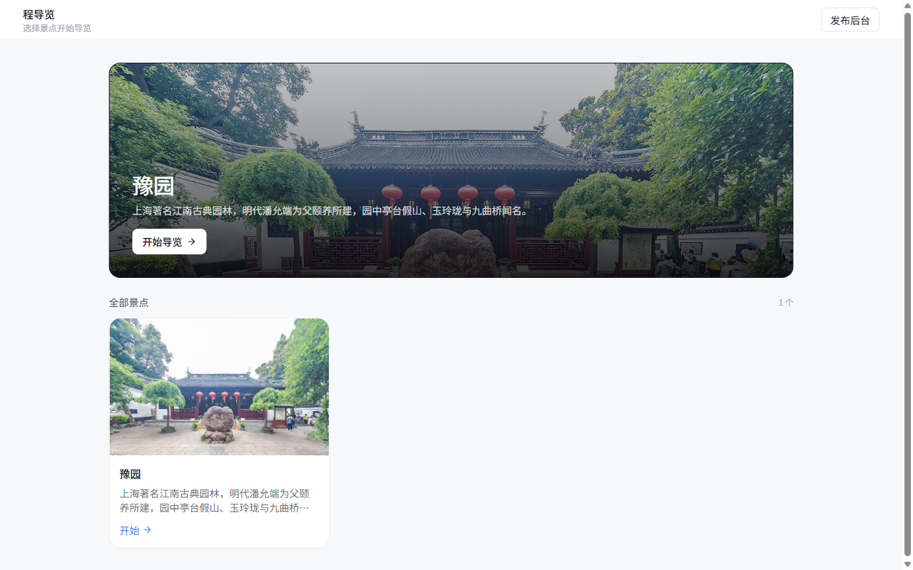
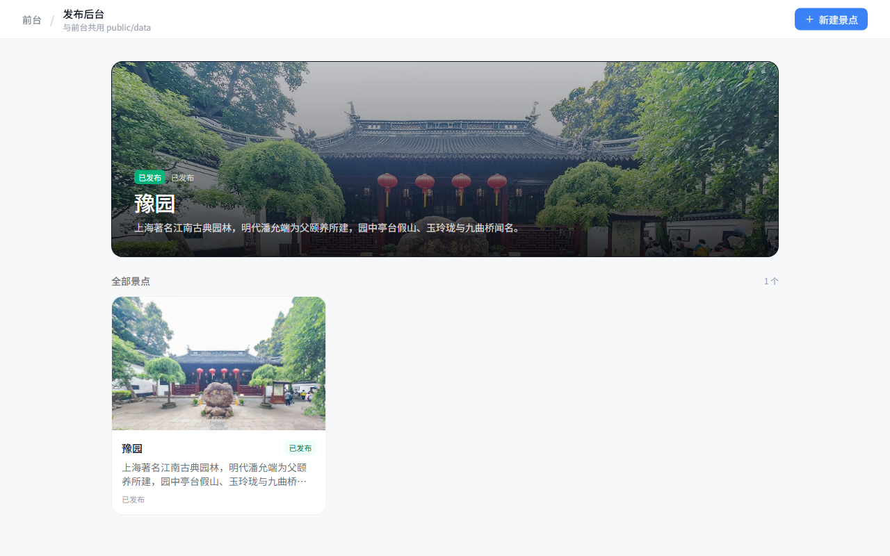
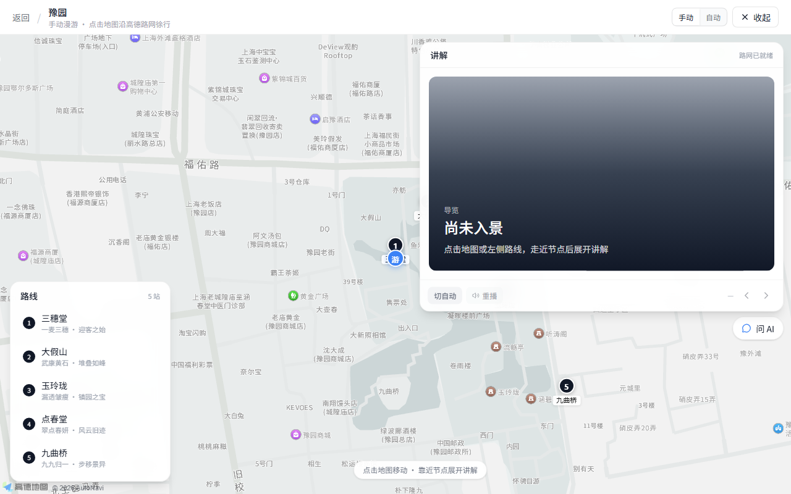
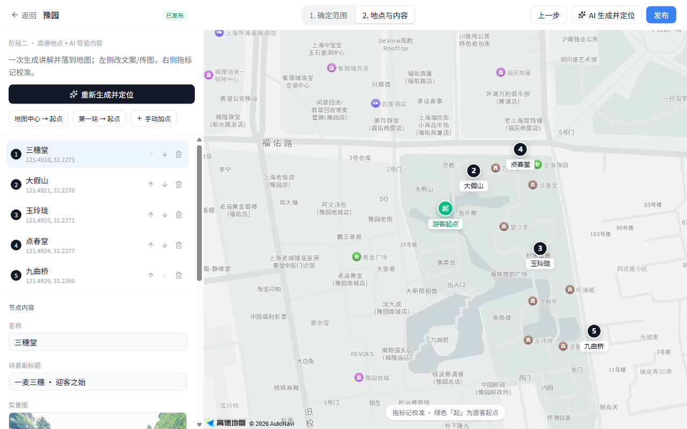

# 时空漫游者 · Trip Experience Engine

首轮「时空漫游者」已接入：从首页开启《一封穿越四百年的家书》，选择自然/匠心视角、人工确认观察并生成旅行手账。故事使用模拟地点事件，无需地图或模型凭据；家书与独白是文学创作。详见 [首轮实现与验收](docs/timewalker_hackathon/docs/04-首轮实现与验收.md) 和 [开发任务](docs/timewalker_hackathon/docs/03-开发任务拆解.md)。

M2 已接入故事 Builder：在发布后台选择已发布景点、主题、受众、时长与语气，生成候选故事，采用到独立草稿后编辑、审核、预览和发布。模板可在纯静态前端使用；在线模型通过服务端网关调用。详见 [M2 实现与验收](docs/timewalker_hackathon/docs/05-M2实现与验收.md)。


游客体验已进一步迭代：照片细节点选与个人感想、分支反馈、顶部进度/声音控制，以及可下载和分享的旅行手账。无需地图或模型凭据即可试玩；详见 [交互体验与可玩性](docs/timewalker_hackathon/docs/06-交互体验与可玩性.md)。

景点实地导览：前台高德地图漫游 + 发布后台（定范围 → AI 结合高德地点生成内容 → 发布）。



## 功能一览

| 场景 | 说明 |
|---|---|
| 前台选景点 | 浏览已发布景点，进入导览 |
| 实地导览 | 高德地图、步行路线、节点讲解、可选 AI 问答 |
| 发布后台 | 确定旅游范围 → AI+高德生成节点 → 改文案/传图/拖标记 → 一键写入 `public/data` |
| 沉浸探索 | 自然/匠心分支、照片手动标注、个人发现、可保存的旅行手账 |
| 故事 Builder | 本地模板或在线起稿 → 独立草稿 → 来源/分支编辑 → 人工审核 → 同一播放器预览 |







## 快速开始

```bash
cd tour-hub-web
node --version        # 使用 Node.js 24
npm ci
npm run dev:full      # 前端 5173 + 服务端模型网关 8787
```

开发前端端口为 5173。无需凭据即可使用故事播放和模板 Builder；只需静态前端时可用 `npm run dev`。

- `/` 前台  
- `/tour/:id` 导览  
- `/experience/yuyuan-timewalker` 沉浸故事；加 `?director=1` 启用演示控制台
- `/publish` 发布后台  

在 `tour-hub-web` 可运行 `npm test`、`npm run build`、`npm run lint`。故事编排支持来源、旁白、图片、选项与下一章编辑；结构错误和未审核候选稿会阻止发布。发布仍为开发服务器本地写文件，生产鉴权与事务性发布尚未实现。

## 环境变量

前端见 `tour-hub-web/.env.example`，如需地图可复制为 `.env.local`：

- `VITE_AMAP_KEY` / `VITE_AMAP_SECURITY_CODE` — 高德 JS API  

服务端见 `tour-hub-web/.env.server.example`。模型变量可以通过环境安全设置注入；本机开发可在忽略的 `.env.server.local` 中配置 `DEEPSEEK_API_KEY`、`DEEPSEEK_BASE_URL`（默认 `https://api.deepseek.com/v1`）、`DEEPSEEK_MODEL`（默认 `deepseek-chat`）。重启 `npm run dev:full` 生效；单独启动接口可用 `npm run dev:api`。自定义浏览器域名通过 `WEB_ORIGIN` 设置允许的来源。

模型私钥只由服务端读取，不能使用 `VITE_` 前缀。旧的 `VITE_DEEPSEEK_*` 已不再使用。未配置时在线起稿明确失败，模板起稿仍可用；旧导览生成会标记本地占位模板，问答失败显示已发布讲解摘录。纯静态部署若要在线能力，需要另行部署网关和配置同源 `/api` 反向代理。

若本仓库锁文件中的企业 npm 镜像在本地不可访问，可按 [云环境安装说明](docs/timewalker_hackathon/docs/05-M2实现与验收.md#安装与启动) 在仓库外复制清单和锁文件并只替换下载地址，保留版本及 integrity 校验；不要重写项目锁文件。

## 数据与契约

已发布内容存放在：

```
tour-hub-web/public/data/catalog.json
tour-hub-web/public/data/attractions/{id}.json
```

外部 AI 生产内容请遵循：`.cursor/skills/trip-guide-content/SKILL.md`  
设计说明：`docs/design.md`

## 仓库结构

```
trip-guide/
├── tour-hub-web/          # 统一应用（包名 trip-guide）
├── docs/                  # 设计文档与截图
├── .cursor/skills/        # 内容生产 Skill
└── README.md
```

## License

Private / 内部使用。
