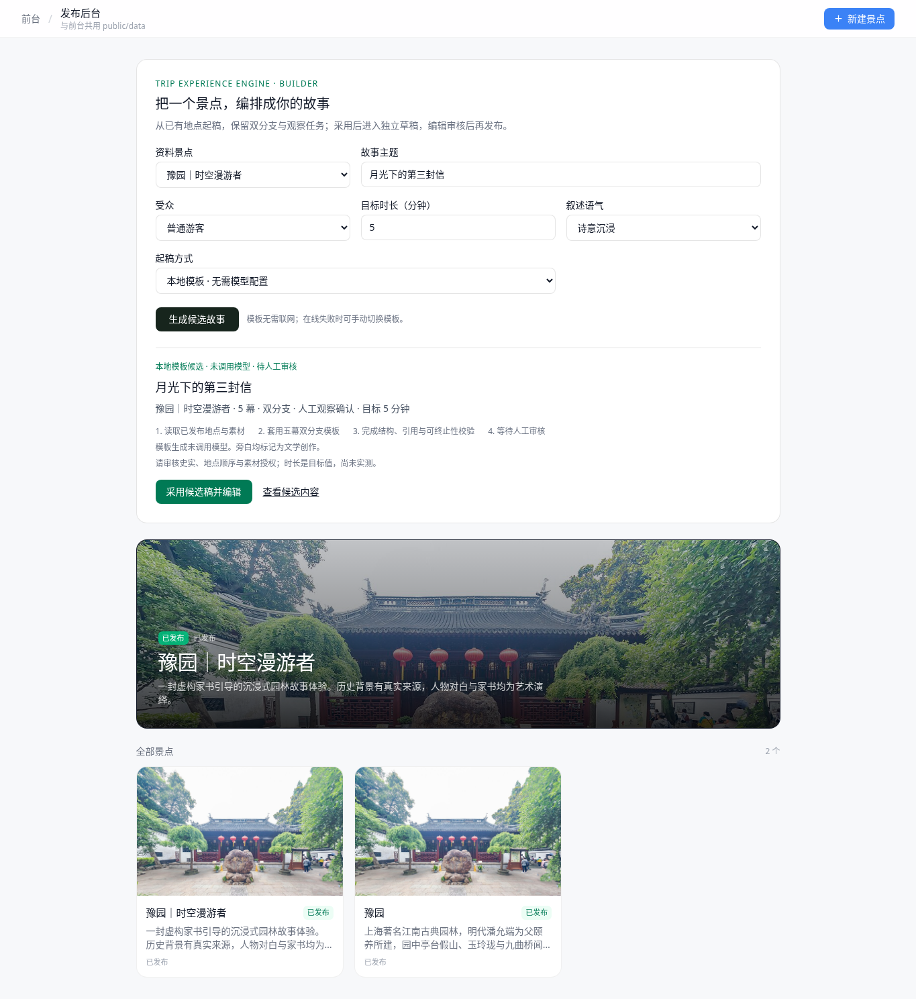
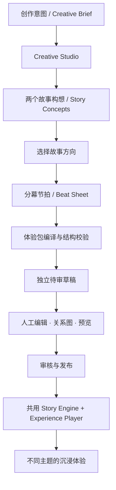
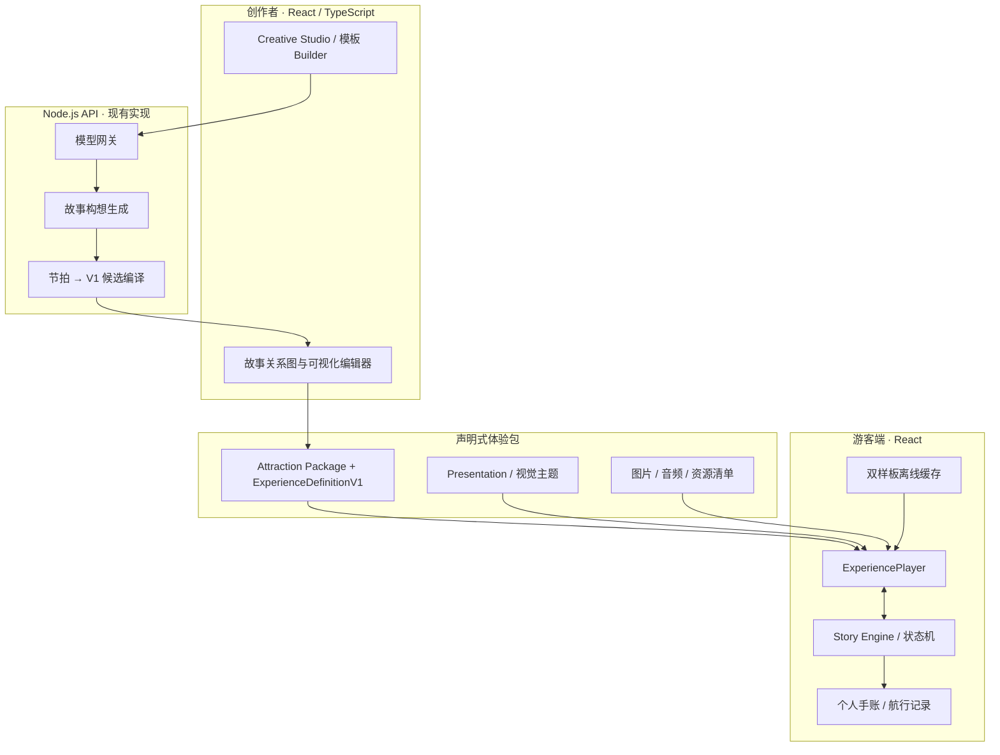

<div align="center">

# 时空漫游者 · TIMEWALKER

### 让世界成为你的故事

**Turn places into stories. Make every journey an experience.**

以真实目的地为舞台，让旅行者走进一段有情节、有选择、有记忆的沉浸式故事。

**沉浸式故事体验 · 轻量交互叙事 · AI 辅助创作 · 可执行体验包**

[立即体验](#-立即体验) · [创作工作台](#-从灵感到可执行体验) · [快速启动](#-快速开始) · [技术架构](#-技术架构)

</div>

---

## ✨ 不只是导览，而是亲历一段故事

传统景点导览回答的是「这里有什么、背后有什么知识」。**时空漫游者（Timewalker）** 希望进一步回答：「当你身处这里，会经历怎样一个故事？」

我们把景点、展区与文化场景变成叙事舞台：故事伴随场景推进，游客通过少量选择改变讲述视角，观察画面并留下自己的发现，最终收获一份由本次体验生成的个人旅行记录。

它既是面向游客的沉浸式故事产品，也是 **Trip Experience Engine（智能旅行体验引擎）** 的首个应用。我们希望创作者可以复用同一引擎，制作历史、人文、科学、幻想等不同题材的体验，而不是为每一个景点单独编写一套应用。

## 🎬 两段故事，同一套引擎

<table>
  <tr>
    <th width="50%">🏮 豫园 · 历史人文</th>
    <th width="50%">🌌 上海天文馆 · 深空科幻</th>
  </tr>
  <tr>
    <td></td>
    <td></td>
  </tr>
  <tr>
    <td><strong>《一封穿越四百年的家书》</strong><br />沿园林亭台与山石，进入一段关于时间、牵挂与传承的虚构家书故事。选择自然或匠心视角，观察细节，留下自己的旅行手账。</td>
    <td><strong>《来自宇宙尽头的讯息》</strong><br />以「家园—宇宙—征程」三个展区为线索，接收一段来自未来的虚构讯号。选择追寻起点或目的地，记录观测，生成专属航行记录。</td>
  </tr>
  <tr>
    <td><a href="tour-hub-web/public/data/attractions/yuyuan-timewalker.json">查看体验包</a> · <a href="#-立即体验">进入故事</a></td>
    <td><a href="tour-hub-web/public/data/attractions/shanghai-planetarium.json">查看体验包</a> · <a href="#-立即体验">进入故事</a></td>
  </tr>
</table>

两份样板**真实复用相同的体验包契约、故事状态机和播放器**，但使用不同的视觉主题、开场形式、文案与结局记录。豫园采用暖色书信叙事；天文馆采用深蓝讯号界面。它们是两段艺术化故事，而不是历史事件重演或科学影像纪录片。

<table>
  <tr>
    <th>旅行结束后 · 园林手账</th>
    <th>旅行结束后 · 深空航行记录</th>
  </tr>
  <tr>
    <td></td>
    <td></td>
  </tr>
</table>

## ▶️ 立即体验

首次运行只想体验故事，**不需要任何 AI 模型或地图密钥**。

```bash
git clone https://github.com/melxy1997/hackathon-trip-guide.git
cd hackathon-trip-guide
git switch feature/timewalker-dual-samples
cd tour-hub-web

# 建议 Node.js 24
npm ci
npm run dev:full
```

打开 **http://localhost:5174**。`npm run dev:full` 会同时启动前端（5174）与本机模型网关（8787）；即使尚未配置模型，两个固定故事样板和本地模板 Builder 仍可使用。

| 入口 | 地址 | 可以体验什么 |
|---|---|---|
| 故事发现页 | [`/`](http://localhost:5174/) | 浏览两种主题的沉浸体验 |
| 豫园故事 | [`/experience/yuyuan-timewalker`](http://localhost:5174/experience/yuyuan-timewalker) | 家书、双分支、观察、旅行手账 |
| 深空讯号 | [`/experience/shanghai-planetarium`](http://localhost:5174/experience/shanghai-planetarium) | 科幻故事、展区推进、航行记录 |
| 创作与发布 | [`/publish`](http://localhost:5174/publish) | Creative Studio、模板 Builder 与人工发布流程 |
| 经典地图导览 | [`/tour/yuyuan`](http://localhost:5174/tour/yuyuan) | 保留最初的高德地图导览能力 |

在故事 URL 后添加 `?director=1` 可以开启演示控制台；**当前故事地点推进使用模拟事件**，不依赖实际 GPS。天文馆使用手动进入展区的交互，不声称具备室内精准定位。

## 🧩 一段沉浸体验由什么组成？

- **叙事章节**：开场、人物与悬念、分支、观察、结局，配合图片和旁白逐步展开。
- **轻量互动**：一个选择就能改变后续章节；观察任务支持在图片上标记细节、写下感想或手动确认。
- **个人记录**：系统根据实际访问章节、选择和观察生成旅行手账或航行记录，可保存为 SVG 卡片、复制或分享文字。
- **多主题呈现**：内容与皮肤分离，`heritage / letter` 和 `cosmos / transmission` 使用不同的配色、字体、语义文案与记录形式。
- **离线样板**：正式构建可以提前准备两份固定故事的内容与媒体，断网后继续体验；在线模型、地图和任意新草稿不属于离线缓存范围。


我们刻意把重点放在**故事本身与情绪体验**，而不是把复杂任务、精确导航或游戏验证变成使用门槛。

## 🎨 从灵感到可执行体验

游客侧是「时空漫游者」，创作者侧是 **Trip Experience Engine / Creative Studio**。

现有发布后台支持三种互补的创作方式：

| 创作方式 | 当前能力 | 是否需要在线模型 |
|---|---|---|
| **Creative Studio** | 输入景点、主题、受众和时长 → 生成两个不同故事构想 → 人工选择 → 生成分幕节拍及可编辑候选 → 采用到独立草稿 | 是 |
| **本地模板 Builder** | 根据已有地点快速起稿，支持不同主题的基础分支与观察，作为无凭据时的稳定入口 | 否 |
| **人工故事编辑器** | 编辑章节、旁白、媒体、选择及图形化连接；切换视觉主题；预览、审核、发布 | 否 |



Creative Studio **已实现前后端接口及候选导入链路**，其中 `POST /api/agent/concepts` 生成双故事构想，`POST /api/agent/compile` 生成节拍与可执行故事候选。两步均复用服务端模型网关、已有景点资料和当前 V1 体验包结构；失败时提供明确反馈，采纳前不改动原包。

Creative Studio 还支持可选的 Tavily 搜索/正文研究、创作进度本机恢复、成果 JSON 导出与导入；研究结果绑定当前简报并参与后续创作。`npm run agent:rehearse` 可经过实际网关生成并保存可导入的彩排成果，详见 [23 · Agent 研究与演示成果交接](docs/timewalker_hackathon/docs/23-Agent研究与演示成果交接.md)。

**当前边界**：上述接口已经使用自动化替身模型和搜索服务验证了结构、失败处理与集成流程；真实 DeepSeek/Tavily 成功仍需在配置凭据的环境中联调。Deep Agents 自主工具编排、AI 生图、云端语音合成尚未接入应用。

### 创作产物怎样变成真正能播放的故事？



这种分层让 AI 负责创意和文字，确定性代码负责内容契约、分支执行与发布。创作者始终可以手动调整，而游客端不需要知道故事是由谁创作的。

## 🏗 技术架构



**主要技术栈**：React 19、TypeScript 6、Vite 8、Tailwind CSS 4、React Router 7、`@xyflow/react`（故事关系图）、Node.js 24（本机模型网关）、高德地图 JS API（经典导览）。

| 层次 | 关键文件 | 职责 |
|---|---|---|
| 内容契约 | `src/experience/experienceSchema.ts` | `ExperienceDefinitionV1`、场景、动作、条件与校验 |
| 叙事引擎 | `src/experience/storyEngine.ts` | 纯状态转移、分支、观察、章节推进 |
| 主题系统 | `src/experience/presentation.ts` | 主题令牌、开场、交互、结局文案 |
| 游客播放器 | `src/experience/components/ExperiencePlayer.tsx` | 画面、讲述、互动与进度 |
| 内容编辑 | `src/experience/components/StoryEditor.tsx` | 图形化关系、人工修改与审核 |
| 创作工作台 | `src/experience/components/CreativeStudio.tsx` | 双构想选择、节拍展示、候选采纳 |
| Agent 契约与导入 | `src/experience/agent/` | 创作中间结构、校验、独立草稿 |
| 服务端编译 | `server/agent/` | 生成概念、编译候选、模型结果校验 |
| 模型网关 | `server/gateway.ts` | `/api/agent/*`、`/api/builder/draft` 等接口 |
| 离线模块 | `src/offline/` | 两份固定故事的离线准备与完整性检查 |

以上路径均相对于 `tour-hub-web/`。

## ⚙️ 开发环境与配置

推荐 **Node.js 24**。`npm ci` 使用项目锁文件安装依赖；如果锁文件使用的企业 npm 镜像无法访问，请先参阅 [本地开发交接](docs/timewalker_hackathon/docs/09-本地开发交接.md)，不要无意重写整个依赖锁定结果。

仅运行游客端，可使用：

```bash
cd tour-hub-web
npm run dev
```

需要**在线故事创作**时，复制 `.env.server.example` 为 `.env.server.local` 并配置：

```dotenv
DEEPSEEK_API_KEY=your_server_side_key
DEEPSEEK_BASE_URL=https://api.deepseek.com/v1
DEEPSEEK_MODEL=deepseek-chat
```

然后执行 `npm run dev:full`。API 通过同源 `/api` 代理到本机 `127.0.0.1:8787`；密钥只由服务端读取，**不要放进任何 `VITE_` 环境变量**。企业兼容网关也可通过 `DEEPSEEK_BASE_URL` 与 `DEEPSEEK_MODEL` 配置，前提是其响应协议与实际模型能力兼容。

如需使用**经典高德地图导览**，将 `.env.example` 复制为 `.env.local`，填写浏览器高德 Key 与安全配置：

```dotenv
VITE_AMAP_KEY=your_amap_js_key
VITE_AMAP_SECURITY_CODE=your_amap_security_code
```

故事样板、手动展区推进、编辑器和本地模板不要求高德 Key。Studio 联网研究可选配置服务端 `TAVILY_API_KEY`；不配置则使用已有资料。Seedream / 云端 TTS 尚未接入应用，不必为了运行样板申请这些密钥。

### 打包与离线体验

```bash
npm run build
npm run preview
```

在构建后的首页或故事侧栏点击**「准备离线故事」**（天文馆使用讯号主题文案），待资源准备完毕后即可测试断网刷新、章节分支、观察与记录。离线机制基于正式构建和 Service Worker，不在 Vite 热更新开发模式缓存页面；仅支持预设的两份样板。

### 代码检查与测试

```bash
npm test           # Node 单元测试（契约、Agent 候选、编排、审核等）
npm run lint       # oxlint
npm run build      # TypeScript + Vite

npm run test:studio       # Creative Studio
npm run test:builder      # Builder 与编辑器
npm run test:dual         # 双样板与主题隔离
npm run test:creator      # 编辑、发布、媒体打包
npm run test:smoke        # 故事基本流程
npm run test:playability  # 观察、记录与交互
npm run test:offline      # 正式构建后的离线回归
```

浏览器回归脚本依赖本机 **Playwright 和 Chromium**；特殊环境可设置 `TIMEWALKER_PLAYWRIGHT_MODULE`、`TIMEWALKER_CHROMIUM` 指向已有安装。`test:offline` 需先完成 `npm run build`。详细步骤参阅 [双样板交接记录](docs/timewalker_hackathon/docs/21-双样板落地与交接.md)。

## 📦 体验包：可复用的内容，而非写死在页面里的剧情

每份景点数据包以 `public/data/attractions/{id}.json` 保存，其中的 `experience` 是声明式故事定义，`presentation` 负责视觉与语义主题。故事由场景、内容块、互动、条件和少量白名单动作组成，播放器通过通用状态机执行。

```text
tour-hub-web/public/data/
├── catalog.json
└── attractions/
    ├── yuyuan.json                 # 经典地图导览
    ├── yuyuan-timewalker.json      # 园林家书故事
    └── shanghai-planetarium.json   # 深空讯号故事

tour-hub-web/public/experience-assets/
├── yuyuan-timewalker/
└── shanghai-planetarium/
```

编辑器支持章节内容、地图/展区绑定、选择分支、故事出口和展示主题配置。新建故事先进入独立草稿，修改内容会重置审核状态；经人工确认后可发布。开发模式下可写入本地展示数据；其他环境支持下载导出的内容包。**这不是已经实现正式多用户鉴权与远程内容管理的生产级 CMS。**

## 🚀 当前实现与下一阶段

| 能力 | 当前状态 |
|---|---|
| 豫园、上海天文馆双样板 | ✅ 已有可运行预制体验 |
| 共用 V1 故事引擎、选择与观察 | ✅ 已实现 |
| 双主题、室内手动展区与故事记录 | ✅ 已实现 |
| 编辑器、故事图、审核与本地发布 | ✅ 已实现 |
| 双样板正式构建离线缓存 | ✅ 已实现 |
| Creative Studio 双概念 → 节拍 → 候选导入 | ✅ 前后端已实现，自动化使用替身模型验证 |
| 真实 DeepSeek 创作质量 | 🧪 待使用团队真实凭据联调 |
| Deep Agents 自主研究与任务编排 | 📐 设计方向，尚未集成到应用 |
| Tavily 搜索与结果正文提取 | ✅ 已接入 Studio 与创作上下文；真实凭据联调待完成 |
| Studio 恢复、成果导入导出、网关彩排命令 | ✅ 已实现，刷新/换浏览器可继续使用已完成候选 |
| Seedream 生图、云端 TTS | 📐 已有调研与独立接入资料，尚未接进应用 |
| 真实 GPS / 室内定位、正式 CMS 服务 | — 不属于当前演示版能力 |

现阶段优先事项是**验证真实模型能为两个题材生成不同的故事构想并成功编译**，按需结合已接入的研究资料，之后再逐步接入自动素材生产和更完整的创作智能体。项目没有把重型任务调度、严格空间导航或复杂游戏验证作为第一版的必要条件。

## 📚 进一步阅读

想快速理解目标和产品叙事，可先阅读 [答辩产品说明](docs/timewalker_hackathon/docs/02-答辩产品说明.md)；准备接手开发，优先阅读以下文档：

| 文档 | 适合了解 |
|---|---|
| [22 · 当前状态与开发分工](docs/timewalker_hackathon/docs/22-现状调研与后续开发分工.md) | 最新完成度、当前任务、验证记录 |
| [23 · Agent 研究与演示成果交接](docs/timewalker_hackathon/docs/23-Agent研究与演示成果交接.md) | 联网研究、成果恢复/导入导出、真实网关彩排 |
| [21 · 双样板开发交接](docs/timewalker_hackathon/docs/21-双样板落地与交接.md) | 双主题落地、离线、媒体、兼容性 |
| [18 · Builder Agent 原始设计](docs/timewalker_hackathon/docs/18-Builder-Agent-设计.md) | Agent 平台方案与架构背景，部分范围已调整 |
| [Builder Agent V2 实施设计](docs/timewalker_4_builder/docs/18-Builder-Agent-设计-V2.0-可实施版.md) | Deep Agents、Tools、编译与素材生产的下一阶段参考 |
| [真实服务接入手册](docs/timewalker_2_intergration/docs/19-Builder-Agent-真实依赖与实施手册.md) | 搜索、地图、生图、语音外部服务的选择与探针 |
| [本地开发交接](docs/timewalker_hackathon/docs/09-本地开发交接.md) | 迁移、运行环境和原有代码约定 |

## 关于这个项目

时空漫游者是一个仍在快速迭代的旅行体验原型，源自最初的 AI 景点导览探索，逐步发展为**以沉浸式叙事为核心、以可执行体验包为载体、以 AI 辅助创作为扩展方向**的 Trip Experience Engine。

两份样板含文学或科幻艺术创作；天文馆故事中的讯号与配图不代表真实科研资料，豫园家书与人物独白不代表已证实的历史事件。当前样板采用模拟地点事件，尚非经实地定位验证的导航产品。

**项目尚未声明通用开源许可证；使用或再分发代码与素材前，请先确认相应授权。**

---

<div align="center">

**TIMEWALKER · 让世界成为你的故事**

*One engine. Many worlds. Your own story.*

</div>
