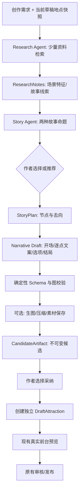

# 时空漫游者｜`fix/draft` Builder Agent 创作子系统增量开发方案

**编制基线**：2026-10-18；仓库 `melxy1997/hackathon-trip-guide`，分支 `fix/draft`，审阅提交 `6abc0d69b17f520c0f11bab7e5ee0a95f4aacc01`。文档为增量设计，尚未修改原仓库；所有建议均以该分支为准，不沿用旧 `feature/timewalker-dual-samples` 的类型、路由、Studio 或 API。

## 1. 一句话与项目范围

**将现有「地点搜索—打卡/故事内容创作—地图编辑—游客端真实预览—发布」升级为有主动研究与创作能力的 Builder Agent 生产链。** 现有游客端、两个模式、`PublishedAttraction` V1 契约、草稿 API、地图选点、发布与回收站保留。Agent 输出独立候选，不自行发表、不直接覆写已经发布的景点。第一版先在「已有地点」条件下，实实在在地完成研究→故事概念→结构设计→逐站编剧→候选草稿→真实预览；再支持一键自动搜地点与生成主题插画。

**答辩可以证明的成果**：非开发人员输入一个命题，Agent 实际检索资料、设计分支、创作场景，并把新的可编辑草稿交给当前的预览/发布后台。至少两种不同题材，建议从已经存在的 `红山动物园《黑神话悟空》` 和 `豫园` 两份包派生新候选；`乐山大佛` 可作为另一种地域和内容测试。商业收入、GPS 核销、平台化模型训练、复杂游戏玩法均不在本阶段范围内。

## 2. 代码核查：真实现状与技术债

### 2.1 当前源代码（均为仓库根目录路径）

| 文件 | 现状 | Agent 应怎样复用 |
|---|---|---|
| `src/App.tsx` | `HashRouter`；`/`、`/tour/:id`、`/publish`、`/publish/:id`、`/publish/:id/content`、`/publish/:id/preview` | 不换路由体系；增加 Builder 入口可用 `/#/publish/:id/agent`，或者嵌入已存在的 `/publish/:id/content` |
| `src/lib/tourPackage.ts` | `PublishedAttraction` V1、`mode:'checkin'|'story'`、`spots`、`slides`、`story` | **冻结已有契约**；Agent 输出适配到这些字段，不得使用旧分支 `ExperienceDefinitionV1` |
| `src/lib/storyTour.ts`、`src/lib/storyGraph.ts` | `entry/choices/endings`、默认顺序、可达性、结构检查 | 直接复用 `validateStoryGraph`；新结构必须给出明确的有效出口 |
| `src/lib/aiDraft.ts` | 打卡：简介→逐点；故事：结构→开场→逐点；浏览器分次请求，JSON 截断修复与模板回落 | 可以提取 Prompt 和结果格式；不能原样当作 Deep Agents 的工具循环运行 |
| `src/pages/content/ContentStoryPage.tsx`、`ContentCheckinPage.tsx` | 现有用户自己选择 AI 重写内容；逐步提交 `persist` | 加入新入口「AI 创作一个完整体验」与「针对当前节点重新构思」；旧功能保留 |
| `src/pages/PublishEditorPage.tsx` | 高德范围检索、候选地点、手动添加/校准节点，阶段一/二 | Agent 可读取已经选好的 `spots`；首次自动选点为后续增强，不强迫重做地图 |
| `src/pages/PublishPreviewPage.tsx` | `ensureEditableDraft`→`toSelfContainedPackage`→真实前台页面；统一发布门控 | Agent 采纳后直接跳转该路由；不新造预览器 |
| `src/lib/draftStore.ts` | `/__trip_guide/drafts` 服务端草稿、`saveDraft`、`prepareMedia`、`toPublishedPackage` | Agent 候选要由浏览器或受控服务转换成**新草稿**并走现有 API；图片在发布前能被 `prepareMedia` 取到 |
| `libs/spots-store.cjs` | Node 持久文件、草稿、目录、图片上传、回收站；支持 `DATA_DIR` | Agent Job 产物另设 `DATA_DIR/agent-jobs`，不能写入公开发布目录作为中间工作区 |
| `libs/app.js`、`vite.config.ts`、`functions/app.js` | Node 原生 HTTP；Vite 开发中间件；Serverless 只代理 `/api/ai/chat` 和运行时配置 | Agent 专用路由必须挂在 **Node 常驻服务** 和 **Vite 开发环境**；Serverless 暂不支持长时 Job |
| `libs/runtime-config.cjs` | `/api/ai/chat` 只允许 `system/user` 文本、响应单次 completion | **不能直接支持 Deep Agents 的 `tool_calls` / `tool` 消息**；Agent 需服务端专用模型适配器 |
| `.cursor/skills/trip-guide-content/SKILL.md` | 发布包格式指南，但部分仓库路径与现状不一致 | 改成 Agent Skill，并修复旧 `tour-hub-web/` 路径、占位坐标/发布行为等历史假设 |

### 2.2 当前真实演示数据

`public/spots/catalog.json` 中已发布：`attr-mvbsg4kw`：红山动物园，故事《黑神话悟空》，有分叉与多终幕、节点插画；`yuyuan`：豫园，打卡模式；`attr-mv9l7mxb`：乐山大佛，打卡模式。旧分支声称的“上海天文馆故事播放器、Creative Studio、Deep Agents、Tavily、Seedream Adapter”不在此分支代码树中。红山故事的插画由之前的外部操作生成压缩写盘，这**不能算仓库已有自动生图服务**。

### 2.3 三个最值得先解决的接口问题

**原有模型网关不支持工具调用协议。** `libs/runtime-config.cjs` 的 `validateChatRequest` 仅接受 `system/user` 字符串，过滤工具规格和 `tool` 角色。`src/lib/aiClient.ts` 也只读取 `message.content`。因此，不能把 `createDeepAgent` 放在浏览器里，也不能把它的运行请求直接转发给 `/api/ai/chat`。新 Agent 要在 Node 侧直接连接支持工具调用的模型；先写一个最小 `tool_calls` 探针实测公司提供的 DeepSeek 兼容网关。

**素材链路支持图片，但不支持自动多媒体生产。** `prepareMedia` 会把 `spot.image` / 封面 / 游客头像读成 Blob，字节去重，写成 `/spots/<id>/*.jpg|png|webp...`；图片生成服务返回的临时 URL 必须在 Job 侧及时下载，生成内容被采用时需有稳定的同源图片 URL 以便 `prepareMedia` 读取。当前 `Slide` 没有独立音频地址，`libs/spots-store.cjs` 媒体写入只允许图片，因此自动配音是单独的 P1 契约升级，不是“调用 TTS 工具”即可完成。

**现有保存机制会逐步改动原草稿，Agent 必须避免半成品覆盖。** 当前页面的 `persist` 对每一步 `saveDraft`。新 Agent 建议先生成不可变 `CandidateArtifact`，供用户查看和选择，再创建一个新草稿。Agent 对原有包/草稿只能读取快照，不允许自作主张覆盖作者已编辑的段落。

## 3. 技术选型与核心架构决策

| 层次 | 选型 | 说明 |
|---|---|---|
| 智能体运行时 | **优先 Deep Agents JS**，基于 LangGraph | 负责研究、计划、工具调用和上下文隔离；若内部模型实测不能稳定工具调用，退回 LangChain 结构化研究/创作分阶段调用，但仍保留相同候选契约 |
| 主模型 | 复用当前 `DEEPSEEK_BASE_URL / API_KEY / MODEL` | **先验证工具调用能力**、工具参数与多轮对话，而不直接假设 OpenAI 兼容便支持工具调用 |
| 搜索 | Tavily Search + Extract | `@tavily/core`，Node 服务端密钥；只抓 2–4 个相关来源，不做逐句事实争议审判 |
| 地点 | 原有高德 JS 地点数据优先；服务器搜新地点时用高德 Web 2.0 | 现有地图 Key 用于浏览器；自动搜新 POI 另申请 `AMAP_SERVER_KEY` |
| 图像 | 火山方舟 Seedream，备选团队已开通的国内文生图 API | 使用已开通的真实模型 ID；后续图片下载与压缩，统一 16:9 800×450 WebP/JPEG 为主，额外保留来源信息 |
| 语音 | 浏览器现有朗读 P0；云端 TTS P1 | 先别扩张 `Slide` 和媒体上传 API |
| 内容输出 | **`DraftAttraction` + `StoryGraph` + `Slide`** | Agent 中间稿可以用 Zod，但发布时绝不输出旧分支 Schema |
| Job 业务状态 | `DATA_DIR/agent-jobs/<jobId>` 的 JSON + 文件；轮询优先 | 文件型 Job 记录状态、候选和配图；P1 可加 SSE 和 SQLite Checkpointer，不复制整套 Agent 状态机 |
| 发布 | 使用现有 `/__trip_guide/drafts`、`toPublishedPackage` 与预览页 | 从 Agent 候选创建新草稿，由作者审核后发布 |

**重要**：Deep Agents 现有 JS SDK 的 `createDeepAgent({ model, tools, subagents, backend })`、虚拟文件工具、子 Agent 与可选 `todoListMiddleware()` 都有官方支持；v0.7 以后的任务清单能力需要显式加入。不要开放 Shell 执行，也不要让 Agent 直接写项目根目录或环境变量。技术资料：

- https://docs.langchain.com/oss/javascript/deepagents/overview
- https://docs.langchain.com/oss/javascript/deepagents/subagents
- https://docs.langchain.com/oss/javascript/deepagents/backends
- https://docs.tavily.com/sdk/javascript/reference
- https://developer.amap.com/api/webservice/guide/api-advanced/newpoisearch
- https://docs.volcengine.com/docs/ark/image-generation-api?lang=zh

## 4. Agent 应该怎样创作，而不是只重新调用现有的 AI 重写器

**入口 A：在已有景点草稿中开启 Agent。** 这是 P0 的最短链路，已有地点、经纬度、模式都可靠。作者在 `/publish/:id/content` 点击“AI 自主创作”，输入主题、受众、风格、时长；系统读取地点与现有分支快照，开始真实资料研究。红山《黑神话悟空》可测试“保留世界观重写节点”和“完全重设计”两个选项，豫园可测试从打卡升格为故事。

**入口 B：从零创建体验包。** 创作者只输入“乐山大佛·江河与千年造像·亲子·20分钟”，Agent 可用高德检索给出候选站点，先进入现有地点确认页核准，再执行编剧和配图。由于需要 `AMAP_SERVER_KEY` 和地图结果校准，将此作为 P1，避免自动搜点成为首个端到端阻塞。

### 4.1 三级 Agent

1. **Creative Director（总导演）**：分析创作意图和模式、委派研究与编剧、选择故事创意、提交故事方案；不持有发布工具。
2. **Researcher（研究子 Agent）**：`get_attraction_snapshot`、`web_search`、`extract_web_page`；输出少量地点特征、关键文化/自然素材、来源 URL 与可写的剧情切口，避免海量百科复制。
3. **Story Architect / Writer（策划与编剧子 Agent）**：输出两个互不雷同的概念，并把所选概念拆成图结构、每个节点的文案和选择。对于 `checkin` 模式，产出有序介绍与逐点讲解；对于 `story` 模式，必须输出具有悬念与情绪回收的 `StoryGraph`。

**Media Producer 暂时是确定性服务**：根据文案生成画面提示词，调用生图 Provider、落盘、压缩并生成 AssetManifest。不要为每张图片启动新的“生图子智能体”。

### 4.2 核心阶段与中间产物



**创作质量不是八个 Critic。** 第一阶段只加四条弱评价：开头是否吸引、章节有没有推进、地点是否参与剧情、结局有没有回收。生成的故事不能只是把每个地点变成一个独立解说段。模型可以提出两个不同创意，由作者选一种；这样在黑客松答辩里更容易真实展示 AI 主动构思的价值。

## 5. 中间契约与编译规则

Agent 的非发布中间稿要结构化，不直接交给现有游客端：

- `CreativeBrief`：`sourceDraftId, mode, prompt, audience, storyStyle, desiredSpotCount, targetMinutes, keepExistingPlaces, rewritePolicy`。
- `ResearchNotes`：`placeFacts[]`（可引用的地点线索）、`motifs[]`（物象）、`hooks[]`（情节切口）、`sourceUrls[]`。
- `StoryConcept[]`：`conceptId, title, logline, visitorRole, conflict, hook, climax, ending, visualStyle`。
- `StoryPlan`：`entrySpotId, spotOrder?, nodes[{spotId,toSpotIds[],role,dramaticBeat}]`，图关系只用已有 `spotId`；无对应地点不能凭空发明 ID。
- `SpotDraft[]`：`spotId, poetic, slides[{title,bullets,narration}], choices[{toSpotId,label,note}], endingTitle, imagePrompt`。
- `CandidateArtifact`：`jobId, sourceDraftId, sourceUpdatedAt, mode, title, description, story, spotsPatch, assetManifest, status`，用于页面预览和采纳。

**编译器规则**：

1. 新候选始终从服务器读取到的 `DraftAttraction` **冻结快照**开始，不在 Agent 的每一步 `PUT /drafts`。
2. `mode='story'`：将 `entrySpotId` 映射到 `story.entry`，将每个 `toSpotIds[]` 映射成 `story.choices[spotId]`，将结局标题映射到 `story.endings`；模型不能输出 JS 表达式和任意动作。
3. `mode='checkin'`：`story` 不写入发布包；保留打卡节点顺序与逐站解说。
4. `slides` 对齐已有 `Slide` 结构，不能将新分支设计成不存在的 `Scene`/`Interaction` 类型。
5. 先调用 `validateStoryGraph`，并检查所有节点内容非空、选择目标正确、节点都可从入口到达；必要时让 Agent 局部修复一次，不能静默随机改图。故事图的多终幕是合法的。
6. 最终输出是一份内容合法的 **可编辑草稿候选**，不是用户可直接发布的 JSON。作者可在原地图编辑器修位置、在内容页改文案和选项。

**额外建议：** 对已有草稿生成候选时默认采用“复制成新草稿”而非覆盖原草稿。仅“局部改写一个节点”允许用户显式选择覆盖，但应要求 `sourceUpdatedAt` 或版本号未变；并由服务端校验，避免 Agent 运行时创作者又手动修改，最终发生丢失更新。

## 6. 最小工具集与具体 Provider

| Tool | 代码责任 | 是否 P0 | 具体服务 / 来源 |
|---|---|---|---|
| `get_attraction_snapshot` | 只读地点、坐标、图和已有草稿文案，裁剪冗长图片 data URL | 必须 | Node `spots-store` 草稿 API / `PublishedAttraction` |
| `search_web` | 按主题搜索约 2–5 条结果 | 必须 | Tavily Search SDK |
| `read_web_page` | 只读取此次搜索命中的 URL，裁剪正文 | 必须 | Tavily Extract SDK |
| `submit_story_concepts` | Zod 检验两个差异化构想并落盘 | 必须 | 自研结构化工具，无外部费用 |
| `submit_story_plan` | Zod 校验节点 ID 与去向图并落盘 | 必须 | 现有 `StoryGraph` 校验复用 |
| `submit_spot_drafts` | 批量交付结构化节点讲解或故事文本 | 必须 | 现有 `Slide` / `Spot` 结构 |
| `search_places` | 查找新景区、新站点和坐标候选 | P1 | 高德 Web 服务 API 2.0，另需 Key |
| `generate_image` | 接受 MediaPlan，调用图像模型，持久保存图片 | P1 | 火山方舟 Seedream，固定预算和图片数量 |
| `synthesize_voice` | 预生成 MP3/音色与缓存 | P2 | 云端中文 TTS；需要升级媒体契约 |

**不要暴露为 Agent Tool 的操作：** `saveDraft`、`publishDraft`、删除恢复、上传任意路径、执行 Shell。它们由应用的确定性代码处理，Agent 只能通过候选采纳间接进入已有发布链。

外部依赖优先级：P0 需要真实工具调用 LLM + Tavily；如果景点快照已经有 POI，**暂不要求高德服务端 Key**；P1 增加 Seedream 账号及模型 ID；P2 再考虑云端语音。浏览器高德 JS Key 与服务端 POI Web Key 是两种不同类型，不应混用。

## 7. 接口与 Node 工程结构

### 7.1 建议新增目录

```text
server/agent/
  builderAgent.ts           # createDeepAgent + 子 Agent
  model.ts                  # 公司模型兼容接口适配 + Tool Calls 探针
  schemas.ts                # Zod 中间产物
  prompt/                   # Director, Research, Story + 题材技能
  tools/
    attractionSnapshot.ts   # 只读快照
    webSearch.ts            # Tavily Search
    readWebPage.ts          # Tavily Extract
    submitCandidate.ts      # 提交结构化产物
  pipeline/
    compileStory.ts         # 中间 StoryPlan → 本分支 StoryGraph
    buildCandidate.ts       # DraftAttraction 候选构建
    mediaProvider.ts        # P1 生图、下载与压缩
  jobs/
    jobStore.ts             # DATA_DIR/agent-jobs
    runner.ts               # 创建任务、阶段进度、取消与超时
  api.ts                    # 可被 Node 生产服务 / Vite 适配器复用
src/agent/
  client.ts                 # Agent Job API 类型与调用
  BuilderPanel.tsx          # 输入需求、选择概念、产物采纳
  CreatorProgress.tsx       # 阶段与工具结果展示
```

**运行时和现有 CommonJS/ESM 接口**：`libs/app.js` 是 Node ESM，而 `libs/spots-store.cjs`、`libs/runtime-config.cjs` 是 CommonJS。新 Agent 推荐用 **TypeScript 编译为 Node ESM**（例如 `tsup`），输出到 `.generated/agent/`，让 `libs/app.js` 导入编译后的 API；Vite 开发时同样挂载这一模块（脚本先构建/监听 Agent Server 模块），不要把服务端代码意外打包进 React。亦可独立开发端口供 Vite 代理，但生产仍应按上述路由整合。技术实现选择哪条需在第一次 `npm run build` 验证；不要因为引入 Deep Agents 就迁移 NestJS 或重写整套 Node 服务。

### 7.2 API（建议命名与响应）

| 路由 | 用途 | 备注 |
|---|---|---|
| `POST /api/builder/jobs` | `{sourceDraftId,prompt,mode,policy,...}` 创建任务 | `202 {jobId,status:'queued'}`，必须是服务端可读取的草稿 ID |
| `GET /api/builder/jobs/:id` | 返回 `status,stage,progress,artifacts,error` | P0 前端 1–2 秒轮询即可 |
| `GET /api/builder/jobs/:id/artifacts` | 返回候选摘要、两个故事概念、媒体清单 | 不返回原始冗长模型对话或密钥 |
| `POST /api/builder/jobs/:id/select-concept` | 创作者选择故事命题并继续生成 | 候选已经定稿则新建版本 |
| `GET /api/builder/jobs/:id/candidate` | 获取通过确定性校验的最终候选 | 浏览器展示差异，准备采纳 |
| `POST /api/builder/jobs/:id/adopt` | **可选 P1** 受控创建独立草稿 | 推荐 P0 让前端使用既有 drafts POST 创建草稿，但需服务端核验版本与产物签名 |
| `GET /api/builder/jobs/:id/assets/:assetId` | P1 同源图片读取，限制 job ID 和 asset ID | 必须在草稿采用后仍能访问直到发布成功 |
| `POST /api/builder/jobs/:id/cancel` | 主动取消任务 | 请求离开页面不等于取消任务 |

### 7.3 运行/部署分界

- **Node 长驻部署（`npm start`）**：支持持久 Job、执行多轮调用、读写候选和 AI 图片，存 `DATA_DIR/agent-jobs/<jobId>/`。与 `drafts/published/trash` 同一持久卷但不同目录；确保垃圾清理不误删已采用草稿仍引用的素材。
- **Vite 本地开发（`npm run dev`）**：须通过自定义中间件或本地 Agent 进程代理让 `/api/builder/*` 可用；不能只在 `libs/app.js` 添加路由就宣称本地运行成功。
- **现有 Serverless（`functions/app.js`）**：目前只读静态资源、模型代理，没有持久草稿/Job 后端。**P0 不能承诺 Serverless 能运行多分钟的 Builder Agent**；运营端显示明确不可用提示或未来迁移队列/对象存储。不应把服务器less临时文件当成素材库。

### 7.4 真实凭据与必要的服务端配置

在根目录 `.env` 或运行环境设置（所有密钥仅服务端使用）：

- 已有：`DEEPSEEK_API_KEY`、`DEEPSEEK_BASE_URL`、`DEEPSEEK_MODEL`、`DATA_DIR`、浏览器高德 `AMAP_KEY/AMAP_SECURITY_CODE`；
- 新增 P0：`TAVILY_API_KEY`，Agent 模型可沿用前述 `DEEPSEEK_*`；
- 新增 P1：`AMAP_SERVER_KEY`（自动发现新地点）、`ARK_API_KEY`、`ARK_IMAGE_MODEL`；
- 新增预算：`BUILDER_MAX_MODEL_CALLS`、`BUILDER_MAX_WEB_SEARCHES`、`BUILDER_MAX_IMAGES`、`BUILDER_JOB_TIMEOUT_MS`。

建议先设置 12 次模型调用、6 次搜索、3 张图、总执行 3–5 分钟作为试验预算，按真实效果调整；只是项目自设阈值，不是服务商配额。

## 8. 可靠性与安全：最少必需约束

当前 `libs/app.js` 会直接警告管理接口缺乏应用层认证，因此**先在内部网络或受反向代理保护的环境**演示 Builder，付费模型接口必须设置鉴权/来源限制和任务限流。默认不让匿名公网访问任意生图工具；密钥永不下发到浏览器。

- 只允许研究子 Agent 读取已经登记的公开 HTTPS 搜索结果，不提供任意抓取内网地址的工具；网页中的指令视为非可信内容。
- 防止价格失控：每 Job 最大搜索/模型/生图次数、超时和重试上限；失败时保留已有成果，不能静默把 mock 当成成功。
- 不允许 Agent 直接修改 `public/spots/`、`DATA_DIR/published` 和已发布目录索引。
- Job 的输入要带 `sourceDraftUpdatedAt` 或内容摘要；采纳前检查原草稿是否变化。内容不冲突时新建独立草稿，否则请求人工合并。
- 图片调用返回的临时 URL 立即下载、验证内容类型和大小，保存到受控目录；只生成合法图片扩展名，供现有媒体上传/发布机制消费。
- 质量最基本检查是结构有效、节点去向存在、所有重要节点有可显示文字、没有占位图/模板混充成已生成成果；历史真实性与复杂游戏性不作为额外的重型项目。
- 运行日志至少包含 `jobId,stage,toolName,toolStatus,duration,errorKind,artifactVersion`；不得打印个人草稿原文和 API Key。

## 9. P0/P1 开发工作包（按实际依赖排序）

| 任务 | 必做 | 直接依赖 | 接受标准 |
|---|---|---|---|
| BA-FX-01：真实模型 `tool_calls` 探针 | P0 | 公司模型服务 | 服务端模型可以主动调用一个真实 Tool，获得工具结果并继续回答；失败则先换可用模型，不能开始 Deep Agents 框架集成 |
| BA-FX-02：Agent Server 模块与本地 Node/Vite 路由 | P0 | 01 | 本地 `npm run dev` 与 `npm start` 都能创建/查询 Job；密钥不进入前端 bundle |
| BA-FX-03：Tavily 搜索/提取 + 景点快照 Tool | P0 | 02 + Key | 红山/豫园至少各成功 1 次检索；研究报告包含真实来源 URL |
| BA-FX-04：Zod 中间产物、故事图编译与校验 | P0 | 无 | 针对已有 `spots` 真正产出 `StoryGraph` 与 `Slide`，通过 `validateStoryGraph` 和预览；能覆盖多结局 |
| BA-FX-05：Deep Agents Director/Researcher/Writer | P0 | 01/03/04 | 模型自主研究，提交两个不同概念、选择一个并形成候选；保留工具执行记录 |
| BA-FX-06：业务 Job 与候选版本 | P0 | 02/05 | 断开页面后任务仍可查；失败不污染原草稿；可以重新选择概念 |
| BA-FX-07：创作面板与新草稿采纳 | P0 | 04/06 | 原 `/publish/:id/content` 中可进入 Agent；选择候选后创建**独立** Draft，能进入原预览和发布 |
| BA-FX-08：三份样板端到端实测 | P0 | 01–07 | 红山故事局部重写、豫园从打卡改故事、乐山打卡主题生成至少两例在现有 Web 页面完成预览 |
| BA-FX-09：生图服务接入与保存 | P1 | 06/07 + 图像服务 Key | 生成后保存 JPEG/WebP，草稿使用同源稳定 URL；重新发布后图片不丢 |
| BA-FX-10：自动选点与新建景区 | P1 | 03 + 高德 Web Key | 从一个新景点名得到 3–6 个候选 POI，由人确认后生成内容，不制造未经确认的坐标 |
| BA-FX-11：局部场景重写与定向重绘 | P1 | 08/09 | 可以单独重写一个节点，不改变其他节点及结构；可选择原版或新版 |
| BA-FX-12：恢复与进度推送 | P1 | 06 | SQLite Checkpointer / SSE；不可声称仅 JSON Snapshot 就支持自动恢复任意中断的工具调用 |
| BA-FX-13：云端配音与播放协议 | P2 | 09 | 新增 Slide 音频字段、图片/音频素材上传、媒体 Content-Type 与游客播放器播放；必须一起改 |

### 9.1 人员与时间建议

3 名工程师 + 1 位内容/设计的理想切法：A（服务端 & Agent）BA-FX-01/02/03/05/06；B（内容数据/编译）BA-FX-04/07；C（图像与联调）BA-FX-08/09/10；设计负责人负责两个题材输入、候选评比及屏幕素材。第一开发日先把 Tool Calling 探针跑通并冻结 `CreativeBrief/StoryPlan/SpotDraft`；第二日完成故事图编译和“已有节点→新候选”；第三日实际 Deep Agents 检索/创作接入；第四日 UI 与草稿采纳；第五日生图与端到端演示收口。若48小时内完成，就保留 P0，P1 图片可使用已保存授权素材，明确不宣称自动生成。

### 9.2 双题材验收建议

**案例 A：红山动物园《黑神话悟空》**。读取现成故事，输入“重写成更具悬念的逃离故事，保留十个地点与分支”，Agent 调用网页检索、提出两个故事创意，选择其中一个后生成每站文本和去向，创建独立草稿，使用 `StoryTourPage` 预览。原 `attr-mvbsg4kw` 已发布数据必须零改动。

**案例 B：豫园打卡 → 故事**。读取 `yuyuan` 的地点、照片与已有文案，输入“以一封家书为线索，设计四百年情感回望”，得到新的 story 模式候选。故事分支至少一个，多处地点真实重用，创建新草稿并从预览页发布（由操作者确认）。

**案例 C：乐山大佛轻量打卡**。输入“给亲子游客制作90秒入门导览”，不生成虚构情节分支，复用原有六站地点，模型输出简洁可读的逐站讲述。检查 Agent 是否遵守打卡模式而非硬把所有需求变成故事。

### 9.3 最低自动化测试

当前 `package.json` **只有** `dev/build/start/lint/preview`，没有现成 `npm test` 或端到端验证框架。增加 `node --test` 的基础覆盖：`compileStory.test`（引用/可达/多结局）、`candidateImport.test`（不覆盖原草稿）、`providerAdapter.test`（超时/错误）、`mediaPersist.test`（P1），以及一个 Playwright `smoke-builder`（如果团队已经有浏览器自动化环境）。最终要求 `npm run build` 和 `npm run lint` 通过。不要照搬旧分支不存在的 `npm run test:studio`、`test:dual` 等命令。

## 10. 最短路径和最终架构判断

先证明**Agent 创作的是真实内容，并能交给现有编辑器**。不要先开发复杂的长任务工作台、工具市场、六类子 Agent、审批平台或通用 Workflow DSL。技术价值来自三个可现场验证的事实：① 模型会检索并构思，不只是套生成模板；② 模型真正编排已有地点的故事分支；③ 创作结果进入原有可编辑、可预览、可发布的产品链，没有第二套不兼容的数据模型。

**最终架构定位**：`Deep Agents = AI 创作与资料研究 Harness`；`Candidate Compiler = 受控数据格式边界`；`现有 Editor/Preview/Publish = 产品生产与人工确认边界`。该拆分是最适合当前 `fix/draft` 的增量接入方式。
