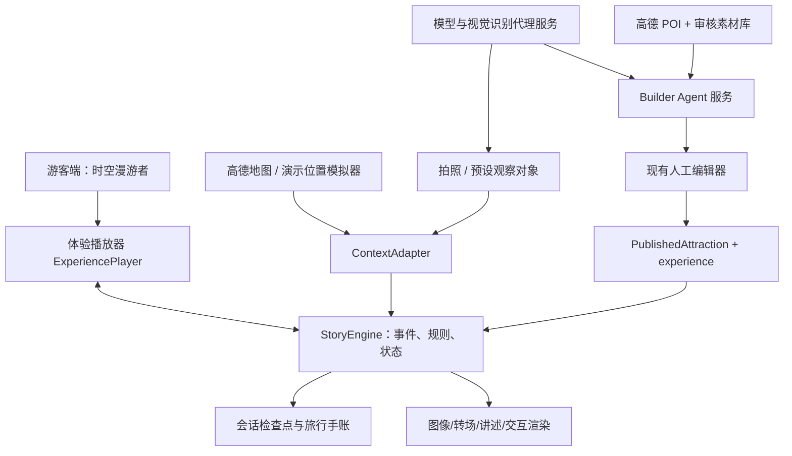
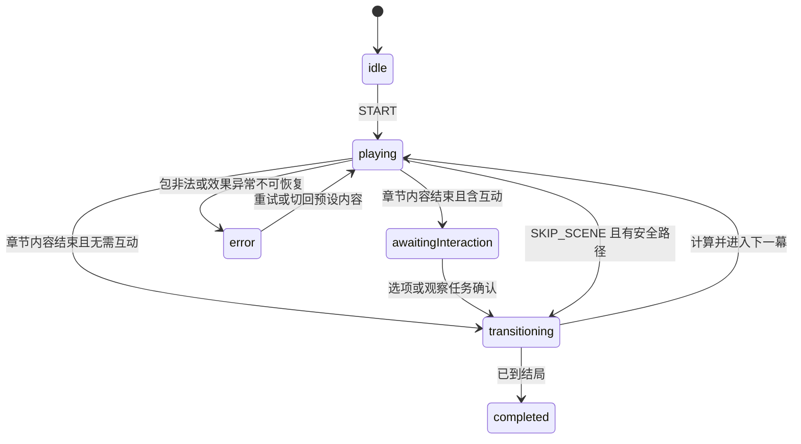
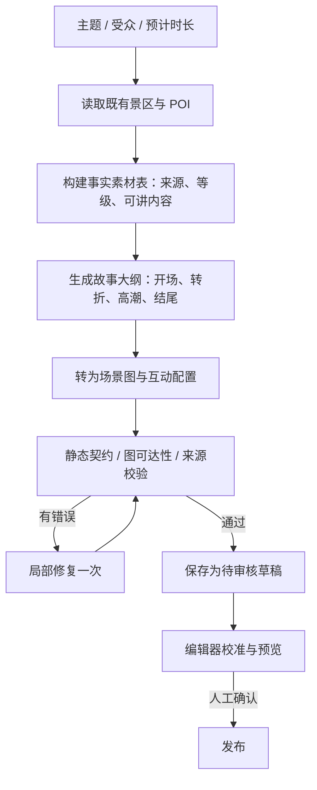

# 时空漫游者｜详细技术设计（TDD）

> **文档状态：历史方案，不是当前开发入口。** 本文中的“当前/待实现/下一步”、分支与测试数只对应文内记录阶段。最新能力见 [导航与当前状态](README.md)，领取任务见 [03](03-开发任务拆解.md)，环境接手见 [09](09-本地开发交接.md)。旧文涉及素材署名/许可复核不再作为本轮任务或验收门槛。

## 当前实现对照（2026-10-15）

应用在 `tour-hub-web`；前端 React/Vite/TypeScript，服务端 Node。V1 定义/纯故事引擎、双主题、图编辑、独立草稿、审核、媒体打包、固定双包离线已完成。Agent 类型与严格校验位于 `src/experience/agent`，服务位于 `server/agent`，Studio 在 `/publish`。

当前接口：`POST /api/agent/research`、`/concepts`、`/compile`、`/media`，`GET /api/agent/assets/<hash>.<ext>`；旧 `/api/builder/draft` 保留。模型候选先校验再进入独立草稿；新增媒体持久保存并在导出/发布时物化。概念/编译仍参考固定蓝图，尚无自主工具编排、持久 Job 或云端 TTS。Provider 适配的自动化与真实账号效果须分开。

以下正文为 2026-10-10 原设计；其中尚未实施/仓库现状不能直接用作今日结论。

**版本**：V1.0（开发启动基线）　**日期**：2026-10-10　**状态**：原始设计存档（不是现状）　**目标仓库**：`melxy1997/hackathon-trip-guide`，`main` 分支当前结构

> 本文严格区分【仓库已存在】、【本轮必须实现】、【展示可模拟】和【远期设想】。本文的「建议」不代表代码已实现；原方案涉及史实/路线/授权的条目不是当前比赛排期；适用范围见导航。黑客松目标是做出可执行且能复用的垂直切片，而不是建成完整旅游平台。

## 0. 执行摘要与设计结论

「时空漫游者」是游客端品牌和产品体验；「智能旅行体验引擎」（Trip Experience Engine）负责解释执行结构化内容包；「体验构建智能体」（Builder Agent）作为现有发布后台的智能起稿能力。三者是上下游而非三个独立系统。首发体验包为《豫园：一封穿越四百年的家书》（虚构故事框架，真实史实有出处），体验以**5个场景、3—4个地点、1个真实分支、1次受控观察、1个可回看结局**为验收目标，不要求开发完整增强现实或真实语音实时通话。

**架构冻结决定 D-01**：复用 React + TypeScript + Vite + 高德地图应用，避免重建工程。**D-02**：保持现有 `PublishedAttraction.schemaVersion=1`，通过可选 `experience` 字段引入体验定义 V1；旧景点导览数据可继续播放。**D-03**：体验内容是声明式数据，不包含可执行脚本；确定性运行时验证和解释事件、状态、转移。**D-04**：故事生成可由模型辅助，但内容事实、地点、任务和发布必须通过校验/人工审核。**D-05**：运行时与模型解耦，即使模型接口离线，也能播放内置完整故事、使用预制分支并结束演示。**D-06**：直播演示的“游客移动”可为模拟器，必须标示“模拟游览”，不得宣传为现场实时识别/定位。

### 0.1 一页目标树

业务目标：从「看景点介绍」升级为「经历可互动、有记忆的主题故事」；工程目标：通过统一的体验包、运行时编排器和可视化创作入口，实现内容与执行分离。

- G1 游客体验：5分钟内完整跑通开场→入景→转折→互动→结局；关键操作不超过3次；地图不是主角，故事是主角。
- G2 引擎能力：同一运行时正确执行两个不同分支并保留状态；能人工跳章节；刷新后可从最近检查点恢复（若预算紧张可做到内存级并将本地持久化列入 P1）。
- G3 生产能力：既能手动编辑发布，又能由 Builder Agent 生成候选内容，再在同一编辑器里修改与审核；输出相同的体验包契约。
- G4 可信可演示：明确历史事实与虚构内容的边界；模型不可用、地图失败、语音失败时有受控降级路径；可以离线/半离线演示本地预制故事。
- G5 工程可验证：结构化契约校验、图可达性校验、事件幂等测试、冒烟测试、错误可观测、密钥不进入浏览器构建产物。

**非目标**：完整物体三维重建、任意地点无准备生成高质量游戏、多角色自主智能体相互协商、实时全双工语音、跨国定位坐标统一、跨用户永久画像、大规模 SaaS 计费、景区商业化正式上线。

## 1. 现有仓库事实盘点（2026-10-10 阅读）

| 代码位置 | 已具备 | 保留/改造建议 |
|---|---|---|
| `tour-hub-web/src/App.tsx` | `/`、`/tour/:id`、`/publish`、`/publish/:id` 路由 | 新增 `/experience/:id`；保留旧路由，首页添加主题体验入口 |
| `src/pages/TourPage.tsx` | 手动/自动模式、虚拟游客路径动画、接近节点展开讲解、浏览器语音合成、AI 问答 | 旧模式保留；抽出位置事件适配器、播放器；**当前移动是虚拟动画而非真实定位** |
| `src/components/AmapLiveMap.tsx` | 地图渲染、步行查询、标记、游览者标记 | 通过 `MapAdapter` 承担导航渲染；不要将剧本状态耦合地图组件 |
| `src/lib/aiDraft.ts` | 高德上下文+DeepSeek生成静态节点/稿件，失败回落 mock | 复用检索成果；新增 Builder Agent 的结构化体验生成，不替换旧生成路径 |
| `src/pages/PublishEditorPage.tsx` | 地点、图片、讲稿编辑、拖标记、发布 | 增加“故事”标签页、章节树、交互设置、预览；保留手工发布 |
| `src/lib/tourPackage.ts` | `PublishedAttraction`、`Spot`、图片/路线/讲解契约和基础校验 | 增加可选 `experience`；新增 `experienceSchema.ts` 严格校验 |
| `src/lib/draftStore.ts` | 本地草稿、编辑、发包 | 保留旧草稿；引入 experience 字段持久化与迁移默认值 |
| `vite-plugin-export-to-display.ts` | **仅开发服务器**写 `public/data` | 本地比赛可继续用；线上发布须替换受鉴权的服务端入口 |
| `public/data/attractions/yuyuan.json` | 三穗堂、大假山、玉玲珑、点春堂、九曲桥共5节点，已有图片/坐标/路线 | 首个体验包复用这些 ID；地图坐标和路线仅为原型数据，现场可达性须再次核验 |

源码级核对：`TourPage.tsx` 采用 `requestAnimationFrame` 在地图路径上虚拟移动，触发半径基线约38米；`askQuestion` 目前主要向模型提供景点名和本轮问题，缺乏故事上下文；`aiDraft.ts` 与 `TourPage.tsx` 都通过前端 `VITE_DEEPSEEK_API_KEY` 调模型，属于必须改造的密钥暴露风险。 `PublishedAttraction` 结构以 spots + slides 为中心，尚不能表达故事分支。地图实地定位不可把动画演示等同真实 GPS。

### 1.1 依赖条件与源事实

目前工程依赖 React 19、React Router 7、Tailwind CSS 4、Vite 8、TypeScript 6、高德 JS API 加载器；无正式服务端/API 服务和数据库。仓库中单个豫园内容包适合内置样板。官方材料可作为史实种子：上海市政府豫园介绍 https://www.shanghai.gov.cn/citywalk/20260625/3a8ac74e088f4d468d9c3434b0b43d94.html ；豫园历史页 https://www.yugarden.com.cn/page/articleView/history-scenery.html 。《家书》本身定位为文学虚构，不声称有历史实物。

## 2. 产品运行场景与用户旅程

核心场景为游客在手机上进入豫园主题体验，也支持比赛现场桌面地图的模拟演示。游客流程：打开体验首页→选择主题故事→点击“开启故事”→序幕/角色出现→地图提示下一站→用户进入真实或模拟节点→播放讲述与视觉演绎→单次选择触发故事分支→玉玲珑观察照片或选择预设观察点→结局与旅行手账。

游客前台首屏在手机上优先提供全屏故事画面、精简标题、播放控制和“下一站”底部条；地图为可展开的路线面板，避免桌面式双大栏在手机上拥挤。比赛桌面演示增加“导演控制条”：选定位置、移动到下一节点、跳到指定场景、切换模拟/实地模式、禁用外部 API。**导演控制条为开发/评审入口，不显示给普通游客。**

非功能体验指标（演示验收目标，而非现成实测）：本地预置素材可在用户启动后2秒内出现首屏；故事推进状态更新在点击后100毫秒内反映到 UI（不包括网络生成）；预置语音/图像失败时文字仍可读；导览完成率在人工测试样本中100%；所有 P0 故事图分支都有结局。

## 3. 总体系统架构



分层职责：`ExperienceSchema` 只定义数据和静态校验；`StoryEngine` 纯 TypeScript，输入当前状态+事件，输出新状态和效果指令，不直接操作 DOM；`ExperiencePlayer` 根据状态呈现情节、互动和媒体；`MapAdapter/LocationAdapter` 把实际或模拟空间事件规范化；`BuilderAgent` 负责生成候选包但不直接拥有发布权限；`PublishEditor` 负责人工审核与校准；`ModelGateway` 持有密钥并提供限流与降级能力。

## 4. 关键设计：内容包兼容与版本策略

### 4.1 不立即升级仓库根契约版本

当前 `assertPublishedAttraction` 要求 `schemaVersion=1`。为尽量不破坏旧页面，第一轮采用 **根结构维持1、体验子结构独立版本1**：

```ts
interface PublishedAttraction {
  schemaVersion: 1;
  id: string;
  name: string;
  description: string;
  start: {lng: number; lat: number};
  zoom: number;
  spots: PublishedSpot[];              // 兼容现有 tour
  coverImage: string;
  publishedAt: number;
  assets?: Record<string, string>;
  routes?: Record<string, LngLat[]>;
  experience?: ExperienceDefinitionV1;  // 新增、可选
}
```

`experience` 缺省时维持旧 `TourPage`；存在则可由新 `/experience/:id` 消费。编辑器必须进行 `ensureEditableDraft` 和 `publishedToDraft` 的字段透传，避免重新发布时丢失新字段。子契约 `experience.schemaVersion=1` 将来可独立升级，暂不设计过度复杂的数据迁移框架。

### 4.2 声明式体验契约

```ts
type ExperienceEvent =
  | {type:'START'}
  | {type:'LOCATION_ENTER'; spotId:string; source:'simulated'|'gps'}
  | {type:'NARRATION_ENDED'; sceneId:string; blockId:string; token:string}
  | {type:'CHOICE_SELECTED'; interactionId:string; optionId:string}
  | {type:'OBSERVATION_CONFIRMED'; interactionId:string; method:'vision'|'manual'}
  | {type:'SKIP_SCENE'}
  | {type:'RESUME'};

type Condition = {var:string; op:'eq'|'neq'|'in'; value:unknown};
type Action =
  | {type:'setVar'; key:string; value:string|number|boolean}
  | {type:'revealMemory'; memoryId:string}
  | {type:'goTo'; sceneId:string};

type Scene = {
  id:string; spotId?:string; title:string;
  mode:'cinematic'|'walk'|'observation'|'ending';
  blocks:Array<{id:string; type:'narration'|'image'|'caption'|'audio';
    text?:string; assetRef?:string; fictional?:boolean; sourceIds?:string[]}>;
  interaction?: {id:string; type:'single_choice'|'photo_or_tap';
    options?:Array<{id:string; label:string; actions:Action[]}>;
    actionsOnComplete?:Action[]; fallback?:'manual_confirm'};
  transitions?:Array<{when?:Condition; to:string}>;
};

type ExperienceDefinitionV1 = {
  schemaVersion:1; id:string; title:string; premise:string;
  initialSceneId:string; estimatedMinutes:number;
  initialVariables:Record<string,string|number|boolean>;
  scenes:Scene[];
  sources:Array<{id:string; url:string; title:string; authority:'official'|'secondary'}>;
};
```

类型是建议契约草案，实际编码使用判别联合和运行时校验库（建议 Zod）。在 `examples/yuyuan-timewalker.package.json` 中提供了可运行样板数据，`tools/validate-experience.mjs` 提供初始独立校验器。**关键约束**：内容包不得包含 JS 代码、任意表达式、系统提示词或自定义 URL 回调；条件只读允许的状态变量，动作只包含白名单语义。

### 4.3 章节状态和媒体行为边界

每个场景进入时：记录 `SCENE_ENTERED`→设置 `currentSceneId`→按顺序播放 `blocks`（图片与字幕可伴随旁白；音频只在用户交互许可后播放）→媒体结束推进；如果有 `interaction` 则进入 `awaitingInteraction`；互动完成后按规则计算唯一 `nextSceneId`。如果没有下一章节，状态进入 `completed` 并生成旅行回顾。

`NARRATION_ENDED` 带 `token`（播放会话标记），用于忽略被跳转/打断后的迟到完成事件；一章内重复收到终止事件不能重复推进。相同交互 `interactionId` 在一次场景进入期只可提交一次，以防按钮连点出现双转移。

`SKIP_SCENE` 在 P0 仅针对有预设 `transitions` 的章节；不能跳过必选题后读取不存在的变量。合理默认：选项未做时保留 `initialVariables`，下章落到默认分支。分支满足“首个命中的条件转移生效，若无命中且无默认则报包非法”。

### 4.4 包校验规则

必须校验：根 schema 兼容；场景/块/选项 ID 唯一；`initialSceneId` 存在；场景 spotId 在 `spots` 内或为空（虚拟场景）；每个媒体资源可解析；条件变量在初始变量中已声明；跳转目标存在；每种必选分支均有有效目标；从起点可到达至少一个结局；不存在无法退出的强制循环；旁白历史陈述必须关联事实来源或被标记为文学虚构；照片任务提供手工降级；校验所有 URL 协议与图片大小限制。

## 5. 核心运行时：StoryEngine

### 5.1 内部状态

```ts
type Phase = 'idle'|'playing'|'awaitingInteraction'|'transitioning'|'completed'|'error';
interface ExperienceState {
  sessionId:string; packageId:string; packageVersion:number;
  currentSceneId:string|null; phase:Phase;
  variables:Record<string,string|number|boolean>;
  visitedSceneIds:string[];
  completedInteractionIds:string[];
  memoryIds:string[];
  playbackToken:string|null;
  lastEventSeq:number;
  mode:'simulation'|'onSite';
  updatedAt:number;
}
```

建议纯函数接口 `transition(pkg, state, event): {state, effects, diagnostics}`。纯引擎只描述 `PLAY_AUDIO`、`DISPLAY_SCENE`、`MOVE_MAP_CAMERA`、`SAVE_CHECKPOINT`、`SHOW_ENDING` 等效果，副作用由网页适配层完成。这样可用 Node 单元测试直接验证所有路径，不依赖高德地图 SDK 或网络。

### 5.2 事件状态机



运行时必须处理：反复点击下一步、音频 `onend` 与兜底计时器同时回调、地图跳章节后旧动画的回调、视觉识别超时、用户关闭问答弹窗、刷新页面、切换模拟/实地模式。`AbortController` 中止过期模型请求；`sceneInstanceId` 或 token 确保只处理当前章节事件。

### 5.3 空间感知与模拟模式

定义统一适配器 `LocationProvider`：`subscribe(handler)` 产生 `{lng,lat, accuracyMeters, source, timestamp}`；P0 使用 `SimulatedLocationProvider`，由导演控制台手动发射 `LOCATION_ENTER` 或沿旧动画更新位置。P1 可接入浏览器地理位置 `watchPosition`，需要 HTTPS、权限以及坐标转换/精度阈值。真实定位应避免只靠“进入38米”瞬间触发：建议进入/离开阈值（如45米/65米）+ 连续两次有效采样 + 30秒冷却，且低精度位置（如误差大于60米）只提示手动确认。阈值仅为初始建议，需实地调校。

高德使用的经纬度与浏览器/设备报告的坐标参考体系可能不同，在中国大陆需要确认 WGS84 与 GCJ-02 的转换和合规使用，**绝不能直接混用**。此条 P0 只保留抽象接口，不做未验证的地理精度承诺。

## 6. 体验播放器与交互设计

### 6.1 页面与组件层级

建议新增页面：`src/pages/ExperiencePage.tsx` 路由 `/experience/:id`。组件拆解：`ExperienceShell`（全屏沉浸容器）→`StoryStage`（故事背景/人物/字幕）→`NarrationPlayer`（语音与播放状态）→`ChoiceOverlay`（情节选择）→`ObservationOverlay`（观察拍照）→`NextStopDrawer`（地图指引）→`EndingJournal`（结局与手账）→`DirectorConsole`（仅调试开关时出现）。

移动端优先：顶部阶段标签与返回，中央 9:16 或接近全屏的故事舞台，底部字幕和单一主行动按钮；地图作为折叠式面板。桌面演示可以使用“手机画幅 + 右侧互动地图”，避免做成全桌面管理后台。信息密度和媒体调性由设计系统样式统一，减少按钮与浮层互相冲突。

### 6.2 媒体实现的现实路径

第一阶段使用**预制图片/短视频/音频 + 前端转场**。剧情音频可预录或本地语音合成，不依赖在线文本转语音；字幕永远可读。浏览器语音 `SpeechSynthesisUtterance` 保留作为兜底，需处理首轮用户手势授权、不同浏览器音色、`cancel`、`onend` 的异常与计时器重复问题。短视频过渡可统一 `poster` 兜底，不要求每幕都生成视频。人物对白必须标为“艺术演绎”，不能伪装成历史录音。

建议六种可复用场景模板（P0 只做前三种）：`opening` 片头、`story` 叙事、`comparison` 古今对照、`choice` 用户选择、`observation` 观察任务、`ending` 结局。**场景模板是渲染组件，不是六套独立逻辑**；体验包通过数据和 block 参数组合。

### 6.3 观察互动的深浅边界

P1 主线只做一处“玉玲珑观察”交互。选定清晰样图或上传用户实拍，前端生成合理压缩后的图片；服务端调用支持视觉输入的模型或使用有限目标分类，提示用户观察孔洞、轮廓等非敏感特征。模型仅输出 `{recognized:boolean, objectType, hint, confidence, evidence}` 等结构，**不承担真实地点到达验证，不声称证明拍摄位置**。失败、离线或识别不确定时弹出“我正在观察这块石头”的手动继续操作，并标注为人工确认。样板演示可以预载图片，但必须向评委说明它是样例图片，不是当前现场摄像头。

## 7. Builder Agent 设计

### 7.1 定位与权限

Builder 是**辅助创作智能体**，调用者是发布后台创作者；只有“创建草稿”和“提出修改建议”权限，不获得无审查发布权限。其最小输入：景点、城市、主题、目标用户、时长、故事调性及选用的真实 POI；输出必须是 `ExperienceDefinitionV1` 草稿以及诊断清单。输入来源：现有 `resolveAttractionScope`/`amapContext`、人工提供的史料链接、素材库中可用图片和原有景点包。不能从未经确认的模型文本自发创造真实建筑坐标。

### 7.2 具体工作流



建议把大模型工作拆为两次生成：第一步“故事规划”返回提纲与事实引用，第二步“体验编排”填充场景、台词、分支和素材占位；结构与代码校验独立于模型。比赛时间非常紧张时，可先一步生成完整 JSON，再进行校验与人工编辑，但架构文档应保留两阶段分工。生成失败只展示明确的失败原因/保留上一次草稿，不能悄然塞入本地 mock 却当成在线生成成功。

### 7.3 事实可信度设计

`Fact` 至少含 `factId, claim, sourceTitle, sourceUrl, evidenceType, reviewStatus`；官方来源（豫园官网、政府文旅机构）优先，其他来源标为待复核。叙事数据将“已证实的地点史实”“有出处但有争议的传闻”“明确虚构的人物对白”区分开。自造的家书是叙事道具，不得以“发现真实明代家书”宣传。原有仓库素材授权文件须继续保留，生成图片/第三方图片需记录可用范围。

### 7.4 人工编辑器新增功能

建议旧 `PublishEditorPage` 以标签页加入“地图和地点／故事编排／素材和来源／预览与发布”。故事编排面板展示场景顺序、人物/地点绑定、讲述稿、分支选项；互动设置通过选项表单而不是编辑原始 JSON；右侧预览允许手动触发当前场景与变量状态。人工修改后的草稿仍由统一校验器检验，再通过既有导出路径发布。**不能让旧草稿编辑逻辑将 `experience` 字段抹掉。**

## 8. 服务端接口与部署边界

### 8.1 推荐的最小部署

保留 `tour-hub-web` 的 Vite 前端，新增 Node.js + TypeScript 的 `tour-hub-api` 小服务，建议 Fastify 与 Zod；Vite 开发态用 `/api` 代理转发。需要少量模型代理和可选持久发布能力，暂时不引入 NestJS 全家桶、消息队列或数据库。后续真正服务化时可以迁入 NestJS，但比赛不以框架选型为创新点。

| 接口 | 输入概要 | 输出概要 | 优先级 |
|---|---|---|---|
| `POST /api/builder/draft` | `attractionId, theme, audience, duration, outline?` | `draft, diagnostics, requestId, sourceSummary` | P1（可先接预置样例） |
| `POST /api/scene/ask` | `sessionId, sceneId, question, limitedContext` | `answer, citations?, modelStatus` | P2 |
| `POST /api/vision/observe` | 压缩图片、`spotId, expectedTargets[]` | `recognized, hint, confidence, mode` | P1 |
| `POST /api/publish` | 通过校验的内容包、管理员身份 | `packageId, version, publishedAt` | P1；本地 P0 可先沿用现有插件 |
| `GET /data/attractions/{id}.json` | 已发布 ID | 含 `experience` 的公开内容包 | P0（沿用静态路径） |

`/api/builder/draft` 返回草稿但不发布；模型调用强制设置超时、最大输入字数、结构校验、请求追踪 ID 和错误码。建议响应错误种类分为 `INPUT_INVALID / PROVIDER_UNAVAILABLE / GENERATION_INVALID / SOURCE_INSUFFICIENT / PUBLISH_DENIED`；前端显示可操作反馈并保留用户输入。注意模型生成期间可能长时等待，按钮要有加载与取消，不能并发生成导致旧响应覆盖新草稿。

### 8.2 安全与隐私必须项

**模型密钥必须从 `VITE_DEEPSEEK_API_KEY` 迁移到服务端私有环境变量**；Vite 的 `VITE_` 变量会写入浏览器侧构建产物，不能作为秘密存储。高德 JS 安全密钥也建议按官方文档改用代理，普通 Web 端公开地图 Key 应设置相应来源域名限制；开发阶段的明文方式不能宣称生产安全。发布 API 必须鉴权，拒绝目录穿越文件名（例如 `../`）、异常大的 `data:` 图片与恶意 URL，服务端自行生成安全 ID 和写盘路径；避免任意跨域、任意路径写入。用户的照片默认只用于本次识别，不在服务端永久保存，日志不记录照片原文和精准经纬度；相机和定位权限明确说明用途且允许随时关闭。

## 9. 数据存储与素材生产

本轮建议 `public/data/attractions/*.json` 继续承担发布产物，新增的图片/音频预制素材放在 `public/experience-assets/{experienceId}/...`；浏览器 `localStorage` 存草稿与演示会话检查点（采用版本化键 `timewalker:session:v1:{id}`），不要把巨大 Base64 视频/图片序列写入 JSON 或 localStorage，避免超过额度。素材关系通过 `assetRef` 与 URL 路径解析；新增 `asset-manifest.json` 记录类型、大小、来源、著作权/许可、分辨率、使用章节。正式平台未来再拆对象存储与后端数据库。

为了避免浏览器音频与视频自动播放限制，用户点击“开始体验”后进入媒体会话；没有音频权限时保留字幕、显示“点按开启声音”。对短视频/大图使用懒加载和静态 poster，提前预取下一幕小尺寸素材。演示机可开启离线模拟但应声明“地图在线瓦片可能仍需网络”。

## 10. 关键交互时序

用户完成一次剧情选择的时序：界面发送 `CHOICE_SELECTED`→`StoryEngine` 检查当前 `phase` 和互动 ID→写入 `aestheticLens`→选择对应的玉玲珑分支场景→生成 `DISPLAY_SCENE` 和 `SAVE_CHECKPOINT` 效果→播放器切图并播音→等结束事件决定下一步。整个步骤除播音本身无需模型请求，所以延迟稳定。

视觉观察时序：用户上传图像→客户端限制图片大小与格式→模型网关进行受控识别→返回是否为候选对象和观察提示→用户确认→发出 `OBSERVATION_CONFIRMED`→引擎解锁隐藏旁白。如果模型失败，UI 明示切换人工确认，仍可继续故事。导游问答属于旁路支线，不应阻塞主线推进。

## 11. 豫园旗舰体验：剧情与资产清单

主题暂定《一封穿越四百年的家书》，历史框架以潘允端营建豫园、为父亲安享晚年等有出处事实为背景；家书、人物直接台词和线索事件是原创虚构演绎。推荐 5 个核心场景：

| 场景 | 绑定地点（原仓库 ID） | 核心情绪/剧情 | 必需素材 | 互动 |
|---|---|---|---|---|
| `prologue` | `san-sui-tang` | 看见一封虚构家书，提出“什么值得留下” | 片头海报、旁白、环境音 | 进入故事 |
| `rockery` | `da-jia-shan` | 通过人造山水讨论园林理想 | 假山实景、古风插画 | **审美选择：自然/匠心** |
| `jade-nature` | `yu-ling-long` | 自然视角理解赏石 | 玉玲珑细节图、自然视角讲述 | 观察确认/图片识别 |
| `jade-craft` | `yu-ling-long` | 工艺视角理解赏石 | 同一细节图、造景视角讲述 | 观察确认/图片识别 |
| `epilogue` | `dian-chun-tang` | 家书主题回响，生成旅行手账 | 终幕插画、个人选择回顾 | 分享/重看 |

该表为**叙事顺序**而非已校验的真实步行路径。点位坐标取自仓库旧包，必须在地图编辑器和有条件的现场踏勘中核对；“九曲桥”可作为可选彩蛋，避免因它与园区出入口关系产生路线误导。首发文字讲述应尽量口语化，单幕主旁白约30—70秒，总长现场精简演示3—5分钟；真实游客版可扩展到30—45分钟。

## 12. 降级、稳定性与可观测性

| 风险 | 用户感知 | 规定降级 |
|---|---|---|
| 高德加载失败 | 地图空白 | 静态路线/站点列表仍可打开故事；现场演示回退至预制地图截图（标示离线） |
| 模型接口失败 | 构建或问答不可用 | Builder 展示失败原因并保持旧草稿；游客继续预制剧情 |
| 音频播放失败 | 无旁白或卡住 | 字幕继续，播放结束由手动按钮推进，不自动疯狂连跳 |
| 视觉识别无结果 | 无法完成观察 | 人工确认继续，展示“手动完成” |
| 地点不在附近 | 自动触发失败 | 导演模式可模拟节点；实地模式提供“我已到达”并明确人工确认 |
| AI 内容事实不可靠 | 文化误导 | 来源校验、人工审核、虚构标签、禁直接发布 |
| 演示断网 | 页面/地图不稳定 | 提前缓存可演示静态包和素材；视频录屏兜底，禁止用录屏冒充在线交互 |

观测事件：`EXPERIENCE_STARTED, SCENE_ENTERED, BLOCK_COMPLETED, CHOICE_SELECTED, OBSERVATION_ATTEMPTED, OBSERVATION_CONFIRMED, EXPERIENCE_COMPLETED, BUILDER_GENERATION_STARTED, BUILDER_GENERATION_FAILED, PACKAGE_PUBLISHED`；建议每条携带 `sessionId, packageId, sceneId, eventSeq, runtimeMode, latencyMs, errorKind`，不上传照片、精确轨迹或用户自由文本作为默认日志。为黑客松演示可使用本地 DebugPanel 显示当前状态与事件时间线。

## 13. 质量保证与验收测试

### 13.1 最小自动化

`schema.test.ts`：旧包兼容、新包有效、无效场景跳转被拒、未知 action 被拒；`storyEngine.test.ts`：两条分支均能到结局、重复音频结束不会两次跳幕、跳过后变量有默认值、异步回调不会跨场景污染；`builder.test.ts`：合法结构生成、缺来源报待审核、非法 JSON 不会入库；`editor.test.ts`：加载旧包→编辑→保存不会丢失 experience；`smoke.e2e`：从首页进入故事，完成选择与观察确认，显示结局。

示例项目自带 `tools/validate-experience.mjs`，可以作为更严谨的 Zod 校验器落地前的基础验收工具；该工具校验结构与图可达性，不等于审核史实或现场可达性。

### 13.2 演示前逐项检查

- 模拟模式可以从第一幕连续走到结局，至少选择两条路径各跑一遍。
- 非网络依赖的主要故事素材本地可用；失去模型 API 不影响核心 5 分钟故事。
- 地图与语音在目标机器浏览器上验证；移动端缩放不出现遮挡。
- P0 的故事分支真实使用统一状态机和一个体验包，不是按点击按钮临时切换硬编码网页。
- Builder 提供真实在线模型生成时明确显示来源和错误；如果使用样例种子则标示“从模板创建”，不要包装为实时生成。
- 人工修改并发布后，刷新浏览器能加载最新的场景内容（本地开发部署）；线上发布若未实现，答辩说明当前仅本地发布能力。
- 历史资料、照片、音频来源与授权已由内容负责人审核；虚构人物对白标示“艺术演绎”。

## 14. 工作分拆建议与代码改造落点

按依赖关系先完成 `experienceSchema.ts`、`storyEngine.ts` 及包校验，再开发 `ExperiencePage`、播放器组件。与此同时设计/内容同学制作 5 个场景脚本和图片/音频；另一名工程师在旧编辑器接 `experience` 透传、章节编排及预览，最后再接 Builder Agent。这样不会出现“界面漂亮，但没有可执行数据源”或“智能体生成漂亮 JSON，前台播不出来”的集成空档。

具体任务卡、工期、依赖和验收条款详见 `03-开发任务拆解.md`；参赛定位、5分钟讲稿、幻灯片结构和预设评委追问详见 `02-答辩产品说明.md`。

## 15. 工程层面必须先评审的六项决策

1. **体验包嵌入策略**：确认暂用根 `schemaVersion=1` + 可选 `experience.schemaVersion=1`，而不是全仓立即迁移根 V2。
2. **导演模式**：确认把旧虚拟游客移动复用为演示事件源，并提供明确模拟标记。
3. **后端边界**：确认只添加薄 Node 模型网关，发布本地先沿用开发插件，避免同时引入复杂服务端框架。
4. **媒体供应**：确认是否有设计师/音视频资源；首发至少 5 张主场景图+3段旁白+1首可授权背景音乐，不将实时生成视频作为阻塞项。
5. **现场路线**：确认真机现场测试是否可能；如不可能，交付物只承诺模拟演示，不承诺真实定位自动触发准确性。
6. **Builder 的真实性**：确定比赛中是在线生成草稿还是从可验证的结构化模板生成；二者展示口径不同，不能混淆。

## 16. 外部依据（供研发复核）

- GitHub 当前仓库： https://github.com/melxy1997/hackathon-trip-guide （读取于 2026-10-10）。
- 上海豫园历史： https://www.yugarden.com.cn/page/articleView/history-scenery.html 。
- 上海市政府景点介绍： https://www.shanghai.gov.cn/citywalk/20260625/3a8ac74e088f4d468d9c3434b0b43d94.html 。
- Vite 环境变量与浏览器暴露边界： https://vite.dev/guide/env-and-mode 。
- 高德 JS 安全密钥代理指导： https://developer.amap.com/api/javascript-api-v2/guide/abc/jscode 。
- 浏览器位置订阅、HTTPS 和权限： https://developer.mozilla.org/en-US/docs/Web/API/Geolocation/watchPosition 。
- 浏览器语音合成： https://developer.mozilla.org/en-US/docs/Web/API/SpeechSynthesisUtterance 。
