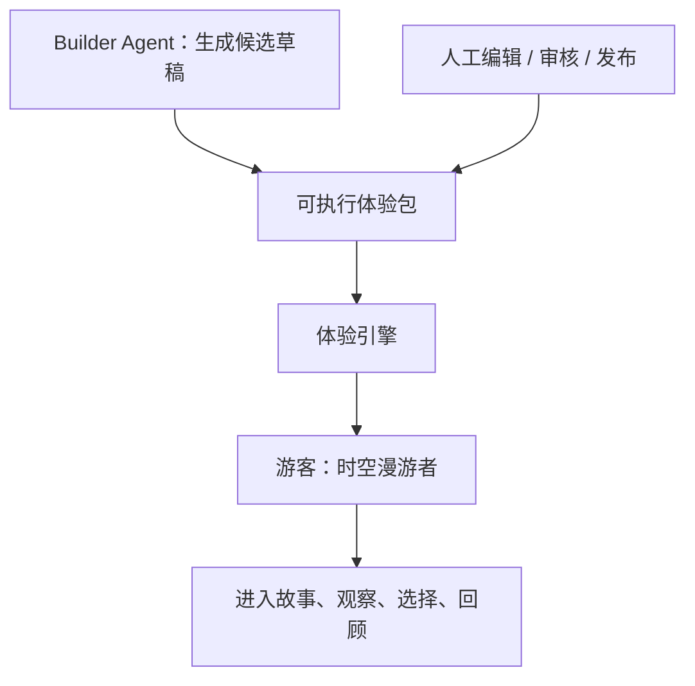

# 时空漫游者｜产品说明与黑客松答辩方案

**版本**：V1.0　**项目主品牌**：时空漫游者　**副标题**：让世界成为你的故事　**技术名称**：智能旅行体验引擎（Trip Experience Engine）　**创作模块**：体验构建智能体（Builder Agent）

当前实际演示口径、八页讲述内容与逐字脚本见 [08-五分钟答辩讲稿](08-五分钟答辩讲稿.md)（2026-10-11）；本篇保留产品设计方案，未实现的视觉/GPS/生产能力不能直接当作完工事实引用。

> 重要口径：这是一份可用作答辩设计的叙述方案，不代表所述模块已全部实现。交付前请按照“演示真实性清单”将未来时态调整为已实现状态。历史背景可引用官方资料，叙事家书及人物对白为文学创作。

## 一、用一句话说清楚作品

**传统导览告诉你「眼前是什么」，时空漫游者让你「经历这里发生过、或基于这里历史创作的故事」；每一段体验由可执行的故事包驱动，可以由人工编辑，也可以由 Builder Agent 辅助生成。**

对游客：一部会随着你的位置、观察和选择逐渐展开的旅行故事。对景区/内容创作者：一套让主题游览从一次性定制作品，转变成可生产、可校验、可编辑、可发布的体验内容的创作体系。对技术评委：声明式体验契约 + 事件驱动的确定性编排 + 受约束的 AI 内容生产 + 多模态交互接口。

## 二、为什么值得做：痛点不在“有没有讲解”，而在“有没有体验”

传统导览通常是“景点列表→找到节点→听完讲解→走下一个节点”。这种设计解决知识传递问题，却容易让旅行者变成被动听众，也缺乏对游客当下兴趣与具体场景的回应。通用大模型虽然可以解释景点和进行问答，却不天然具备可信地图坐标、现场事件、故事连续状态、素材编排、游览任务验证和发布审核工作流。我们的突破不是把语音播放器接上大模型，而是将**地点、证据、故事结构、媒体、互动和用户状态**纳入一个可执行体验。

**目标受众**：第一阶段面向上海豫园这样的文化历史景区的自由行游客，特别是希望得到轻量互动、文化沉浸感而不愿参与复杂实景游戏的年轻旅行者；潜在第二类用户是景区内容运营人员与旅行体验创作者。

**产品承诺**：让“看一个景点”变为“理解一段故事”；一趟路线拥有开场、发展、转折、观察与结局；用户只要轻点几次，故事就能根据他的偏好产生真实变化。不是宣称历史穿越真实发生，而是提供“明确标注为艺术演绎的时空叙事体验”。

## 三、产品结构：用户只需要认识一个名字

对外产品名 **时空漫游者**。所有游客触达、海报、口头介绍、演示录屏均使用这一名称。内部技术说明才使用 **智能旅行体验引擎**。Builder Agent 是内容后台的一项能力，不单独包装成第三款产品。

标准卖点排序：第一是**沉浸式故事**（情绪价值与现场惊艳）；第二是**少量有效的观察互动**（世界真实参与）；第三是**有状态的动态编排**（用户选择影响后续）；第四是**可执行体验包 + Builder**（技术和规模化叙事）。展示时不要一上来讨论 JSON、智能体或架构图。

## 四、旗舰样板：《豫园：一封穿越四百年的家书》

### 4.1 故事设定

以潘允端营建豫园、寄托对父亲的关怀等有来源的史实为基础，引入一封**虚构家书**作为串联叙事的艺术道具。游客从当代进入园林，逐步学习造园理想、园林山石的审美和人与庭园的情感关系，最后解开“留给家人的真正礼物是什么”的主题悬念。**不是寻找历史上确有实物的“失落家书”**，也不是用生成图冒充史料照片。对话、封面、音效可以原创，但事实陈述必须有来源。

### 4.2 五幕结构（演示版）

| 幕 | 场景标题 | 游客能看到什么 | 用户动作 | 系统真正变化 |
|---|---|---|---|---|
| 序幕 | 纸上春秋 | 今日豫园画面转入写意的明代园林创作视角 | 点击“开启时空漫游” | 初始化体验会话与故事变量 |
| 第二幕 | 山水有意 | 大假山实景、墨色线稿与人物旁白 | 在“山林野趣／匠心造景”中选择 | `aestheticLens` 赋值，决定玉玲珑版本 |
| 第三幕 | 石中见山 | 玉玲珑细节、两种不同讲述视角 | 观察照片或手动确认 | `observedJade=true`，解锁“细看之美” |
| 第四幕 | 一园一念 | 点春堂或已核实可达的结局地点，收束人物情感 | 点击“读完家书” | 完成故事状态 |
| 尾声 | 我的时空手账 | 结合所走路线、兴趣视角、已完成观察生成独属卡片 | 保存或分享 | 输出基于真实事件的回顾 |

旗舰样板在技术包中拆成 `prologue/rockery/jade-nature/jade-craft/epilogue` 5 个**场景记录**，实际上玩家每次只体验其中4个分支节点（序幕、假山、玉玲珑自然或匠心版、终幕），与“五幕式叙事结构”不必一一对应。可根据设计需要将“尾声”独立为第五段纯 UI 动画，不额外增加空间站点。

### 4.3 三个看得见的惊艳瞬间

**时空画面切换**：真实园林照片逐渐淡入艺术演绎的历史画面，伴随人物旁白与字幕。技术可用高质量静态图/短视频+前端时间轴转场完成；不必宣称实时三维重建。

**一个选择，两个故事版本**：评委选择“自然山林”或“工匠技艺”，玉玲珑的同一地点显示不同的叙事背景与旁白；演示过程中打开“导演控制条”可看到状态确实变更。重点证明用户不是机械地点击下一页。

**看见即发现**：用户拍摄或选择玉玲珑示例图，系统指出观察重点、解锁隐藏独白。功能可以支持受限对象识别或人工确认，重要的是交互反馈与故事状态联动；不能虚称开放场景识别已完成。

## 五、产品页面设计（直接交给设计/前端）

**P1 发现页**：大幅主题封面、标题、一句话故事悬念、预估时长、参与程度和“开始体验”。推荐只展示一条主线及少量后续主题占位，避免像普通景点列表。

**P2 电影化故事页**：垂直手机舞台，图片/视频背景，情绪化旁白字幕，底部“继续探索”行动条；地图收于抽屉。首屏不出现多功能浮动按钮群。文字浓度由“微标题+1—2段简短旁白”控制，面向实地行走而非坐在电脑前读长文。

**P3 互动选择页**：两个大按钮，每个按钮有具有情绪色彩的解释，选择后给即时反馈；内容分支的结果在下一站显现，而非只是按钮变色。

**P4 观察页**：视觉目标样例图、上传/拍摄入口、模型识别反馈、可用的“手动确认观察”路径。识别结果不应以高置信度数值吓唬游客，可用“我看到的可能是……”式谨慎表达。

**P5 手账页**：线路缩略图、3张故事图、你选择了什么、发现了什么、带走一句怎样的结语；可由静态 HTML 卡片先实现，分享/图片导出可选。

**P6 创作者控制台**：地图/真实地点、故事节点树、右侧章节属性/素材/来源、预览按钮；新增 Builder 对话输入或简表单，生成后回到同一个编辑器，不打开另一套互不相通的产品。

## 六、五分钟答辩现场导演脚本（可直接彩排）

| 时间 | 屏幕动作 | 主讲要点 | 演示凭据 |
|---|---|---|---|
| 0:00–0:35 | 对比普通景点介绍与故事封面 | “旅行不应只知道景点名词，还应该经历值得记住的故事。” | 产品封面 |
| 0:35–1:10 | 打开豫园故事，片头转场、旁白开始 | “我们把豫园的一段文化背景编排成一次可走入的故事。” | 片头真实运行 |
| 1:10–2:00 | 到大假山，选择审美方向 | “你选择的兴趣不会消失，它将决定后续怎么讲。” | 选项及状态改变 |
| 2:00–2:45 | 到玉玲珑，展示不同旁白、完成观察 | “同一个真实地点，故事因人的视角改变。” | 分支文字/媒体差异，观察完成 |
| 2:45–3:20 | 展示结局与旅行手账 | “游客留下的不仅是足迹，还有自己的发现。” | 完成事件与手账 |
| 3:20–4:10 | 切到体验包可视化编辑，展示 scene/transition | “内容不再是写死的页面，而是一份可执行的体验协议。” | 两条分支状态与图示 |
| 4:10–4:45 | 输入主题，生成草稿或展示样板起稿+修改 | “同一个内容引擎，支持人工精修和智能体协同创作。” | Builder 或明确标为模板草稿的操作 |
| 4:45–5:00 | 回到产品海报，给出落地价值 | “让世界成为你的故事。” | 业务闭环示意 |

**主讲提醒**：现场不要临时启动超过 30 秒的视觉/语言模型调用；Builder 如果必须联网生成，应先在彩排验证平均与最长耗时，设置预制成功样例作为兜底，但现场要清楚说明“展示的是此前生成的草稿”。地图坐标可走模拟位置，不假装真的在豫园；说“现场演示模式驱动地点事件”。所有实际交互在页面运行，不使用剪好的录像假扮按钮操作。

## 七、8页幻灯片结构（无须满屏技术术语）

1. **封面：时空漫游者**。一句话“让世界成为你的故事”；实景/历史演绎强烈对照视觉。
2. **用户困境：导览知道得很多，游客感受到的却很少**。短小的“固定讲稿 vs 参与式故事”对比；不要贬低已有成熟竞品。
3. **产品魔法：现实地点 × 故事 × 你的选择**。豫园入口→大假山→玉玲珑三张连贯视觉。
4. **现场演示页：真正会改变的叙事**。请评委看台上实际点击分支，而不是放堆截图。
5. **技术突破：可执行体验包**。场景、地点、状态、条件、动作；给一小段人类可读示例，强调“声明式、安全、可校验”。
6. **内容供给：Builder Agent + 编辑器**。主题输入→候选故事→结构验证→人工校准→发布；突出生产力、可信度、可控性。
7. **Trip.com 价值：从预订到旅途中的情绪价值**。预订→在地体验→分享/记忆→个性化后续探索；避免宣称已上线变现。
8. **结束页：今天是豫园，未来可以是每一处有故事的地方**。区分“本次完成”“验证中”“未来设想”三列。

## 八、技术亮点如何说才可信

### 亮点一：可执行体验协议，而不是静态讲解 JSON

普通导览包存节点、文本和音频；我们将场景顺序、触发条件、状态变量、交互事件和分支转移组织成声明式内容。统一引擎读取内容包，不为不同故事重新写整套前端页面。建议现场展示“选择自然山林→进入玉玲珑自然叙事”和“选择匠心→进入不同叙事”的两个真实状态演示。

### 亮点二：确定性执行 + 生成式创作的分工

故事推进、分支跳转和完成条件由程序验证和执行；大模型用于扩展故事、改写角色口吻与辅助内容起稿。它既保留生成能力，也避免故事出现“玩家明明没找到线索，模型却擅自宣布通关”的问题。这种设计比堆积多个名词化智能体更有工程含量。

### 亮点三：人机协同内容生产

现有后台已经有高德地点搜索、节点编辑、图片调整、地图标记和本地发布。Builder 在此基础上生成完整的候选故事图，人工仍能审核事实、调整地点、修订旁白并发布；同一个内容包既可手工创建也可机器起草，从而具备可扩展的内容生产路径。

### 亮点四：多模态与空间事件接口

同一体验引擎可以消费地图进入事件、用户点击与照片识别反馈。比赛最小实现选择可控的模拟位置和少量视觉目标，证明“架构允许事件驱动”。不能把一处受控识别说成完成了整个城市的实时空间理解。

## 九、商业价值与评估指标

**游客价值**：提高对文化地点的理解、主动探索意愿和分享意愿；建议现场做小规模对照评价：传统静态讲解版与互动故事版，各邀请5—10名体验者，收集“故事记忆点”“愿不愿意继续探索”“是否理解了一个新知识点”的主观反馈。该测试只能支持体验假设，不能直接推断真实业务增长。

**内容供给价值**：同一地点素材复用于不同主题；候选故事起稿时间、人工审核/修改时间、一次发布成功率、图分支校验通过率均可真实测量。人工审核不是效率缺陷，而是内容可信度的必要环节。

**Trip.com 场景价值**：目的地内容增强、景区及当地体验合作、旅行后分享、在用户同意下构建较有依据的兴趣偏好；未来可与门票、当地玩乐、行程管理串联，但绝不将这些未来设想说成已经接通的业务接口。

建议答辩指标：P0 样板故事双分支走通率100%；3–5分钟现场演示成功率100%（内部彩排统计）；包校验错误拦截率以测试样本统计；Builder 起稿耗时统计中位数与失败率；素材/史实人工审核覆盖率100%。所有数字以实际测试填充，不提前包装为成果。

## 十、评委可能追问与回答模版

**问：这不就是地图配上 AI 解说吗？** 答：我们并不把差异放在大模型会解说，而是构建可执行的故事体验。地图、故事、互动和用户选择共同决定下一段内容；您刚才的选择改变了后续章节，不是同一音频重复播放。

**问：直接向 ChatGPT 提问为什么不行？** 答：通用聊天可以回答很多文化知识，却不会自动管理一个有位置触发、状态变量、媒体资产、章节路径及人工审核标准的现场体验；我们的重点是把生成模型放到受约束、可验证的运行系统中。

**问：你们实际上用了多少个 Agent？** 答：黑客松阶段我们优先使用一个 Builder Agent 和确定性 StoryEngine；这足够承载真实价值。故事生成可以分成资料整理、提纲生成、结构化装配和验证步骤，但不需要为了形式把每步都改成独立智能体。

**问：你们视觉识别真能在任何景区用吗？** 答：本轮只验证了（按实际替换：样例图片/少量可选真实照片）识别与状态触发的链路，不宣称任何地点都可以无准备理解。未来要结合区域知识、目标清单、证据可信度与现场评测扩大覆盖。

**问：用户真的在现场吗？** 答：演示使用明确标注的“模拟游览模式”复现实地事件；真实定位订阅已预留适配接口，（若未实现：尚未完成现场精度验证）。我们不把模拟点击包装成 GPS 到达。

**问：内容大量产生后质量谁保证？** 答：Builder 只起稿，不直接发布；真实 POI 和文化事实来自可信来源，输出经过契约校验、故事路径验证和人工编辑审核；虚构旁白在产品中有艺术演绎说明。

**问：这对 Trip.com 的价值是什么？** 答：它延伸旅行服务到“旅途中为何值得停留、观察和理解”的体验层；平台可通过可复用内容生产链路丰富目的地体验，未来也能结合门票和当地玩乐场景，但本次先验证体验与生产机制。

**问：为什么要开发引擎，不写死一个好看的豫园页面？** 答：写死页面可以做单个样板，却没法让人工和 Builder 在同一数据契约下改写、预览并发布不同故事。引擎带来的价值是“内容可执行、可测试、可替换”，是我们对规模化能力的最小证明。

## 十一、真实性清单：上台之前必须核实

| 对外可说 | 必须具备的真实证明 | 未完成时的替代说法 |
|---|---|---|
| “我们实现了多分支故事” | 双分支由同一包+状态机运行 | “我们设计了分支契约，当前演示单线样板” |
| “构建智能体自动起稿” | 实际 API 生成、可编辑草稿、错误反馈 | “我们预制了一个由设计流程产出的候选包，Builder 接口已规划” |
| “看见即讲解” | 图片输入、实际模型/分类响应、状态联动 | “我们演示针对预设观察目标的图片互动，支持人工确认降级” |
| “实地自动触发” | 真实手机定位与现场测试录像/日志 | “本次采用模拟地图行走触发故事” |
| “可以在线发布” | 有鉴权的服务端写入/读取链路 | “可在本地编辑并发布到同一应用的数据目录” |
| “历史叙事真实可信” | 来源清单和人工核实记录 | “历史背景有官方来源；人物对白属于文学创作” |

## 十二、开场与结尾可复制讲稿

**开场（约45秒）**：

“当我们旅行到一座拥有数百年历史的园林，常见的导览应用会告诉我们它建于哪一年、哪些建筑值得看。但我们总觉得，知道一座园林的名字，和真正走进它的故事，是两回事。今天我们想把真实世界变成一座会响应人的故事舞台：你站在哪里、你看见什么、你选择理解什么，都可能改变旅程怎么展开。这就是时空漫游者——让世界成为你的故事。”

**技术转场（约35秒）**：

“刚才的故事不只是写死在页面中的视频。我们把地点、叙事章节、触发条件、用户选择和下一步动作存成可执行的体验包，由确定性的体验引擎解释运行。后台既能人工编辑，也可以通过 Builder Agent 起草，再由创作者校准与发布。今天是豫园的一段故事，技术上我们希望验证的是同一套系统能承载更多主题体验。”

**结束（约20秒）**：

“我们希望旅行不只是去过多少地方，而是发现了什么、理解了什么、留下了怎样的故事。时空漫游者从豫园开始，但它最终想改变的是人们探索世界的方式。”

## 十三、答辩演示预案

**A档（全链路）**：地图模拟推进 + 双故事分支 + 图片观察 + 手账 + 在线 Builder 生成草稿 + 人工编辑发布。**B档（稳定版）**：地图模拟推进 + 双故事分支 + 手账 + 预制体验包编辑发布；照片观察使用预设样本或人工确认。**C档（保底版）**：静态预置场景素材 + 稳定故事引擎 + 可点击分支 + 结局；不依赖地图加载或在线模型。无论哪一档，都要真实说明哪些是模拟、哪些是实际调用。

**彩排规则**：彩排不少于5次，模拟失网1次、模型超时1次、浏览器语音不可用1次；每一档都必须演示得到完整结局。准备演示专用故事状态重置按钮、暂停按钮、跳到指定章节按钮；演示前清空旧 session，避免因旧进度造成剧情跳跃。
