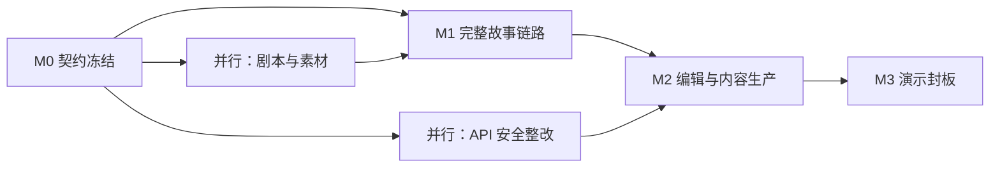

# 时空漫游者｜开发拆解、里程碑、任务卡与验收清单

**版本**：V1.0（Issue-ready）　**编制基线**：2026-10-10，基于 `hackathon-trip-guide/tour-hub-web` 当前代码。**估算**：单位为理想工程人日，不含景区现场踏勘与大批量高质量视频制作；不应被当成承诺工期。

## 一、先确定交付顺序，而不是先分页面

总体依赖：**故事体验定义 → 体验包契约 → 纯状态引擎 → 可播放的前台 → 豫园故事素材 → 可视化编辑器与 Builder → 演示/答辩**。美术脚本与契约/引擎可以并行，后台 Builder 与游客前台可并行，但两条线必须在第一个集成点共用同一份示例体验包。

**P0＝必须真跑通**：加载体验包、两种分支、章节播放、状态检查、至少一个完整结局、本地可发布、模拟模式、素材与史实审校、关键降级。**P1＝争取完成**：Builder 在线起稿、受控视觉观察、场景编辑器、旅行手账、服务端正式发布。**P2＝答辩未来规划**：真实 GPS 充分验证、任意拍照识别、双向实时语音、跨旅程记忆、多智能体、自助商业化。

P0 最小版本即使全部模型失效，也必须可演示。这是项目“能交差”和“拿高分”的共同前提。

## 二、建议团队分工（可根据人数缩放）

| 角色 | 主责 | 并行交付 | 不建议承担 |
|---|---|---|---|
| 工程 A：运行时负责人 | Schema、StoryEngine、单测、场景状态联调 | 示例包与校验器 | 大量美术调图 |
| 工程 B：前台体验负责人 | StoryStage、音频、转场、交互、导演模式 | 响应式移动 UI | 独自写 Builder 服务 |
| 工程 C：创作工具/服务负责人 | PublishEditor 改造、Builder、模型代理与发布链路 | 错误处理/生成日志 | 在契约未冻结时重构全后台 |
| 产品/设计/内容 D | 旗舰剧情、人物语气、画面资产、分镜、来源审核、答辩 | 真实地点评估、彩排节奏 | 无审核放行模型生成的史实 |

如只有2名工程师：优先 A+B，一人兼做最小手工编辑器和 Builder“从模板起稿”，放弃在线生成与实时视觉。若有4人以上，可专人负责素材与测试/兼容性。团队不必为每个功能成立 Agent 小组。

## 三、里程碑和退出条件

### M0：可执行契约冻结（建议半天到一天，按团队可并行处理）

产物：`experienceSchema.ts` 类型草案、真实豫园样例包、样例图结构校验脚本、两个分支的验收用例、故事分镜与素材清单；所有人签字接受包结构。**退出条件**：样例包包含完整主路径，两个选择都可到结局，旧包仍可加载；不再在后续阶段随意重命名基础字段。

### M1：游客端完整垂直切片

产物：`StoryEngine`、`ExperiencePage`、故事渲染模板、声音开关、模拟位置、结局页。**退出条件**：无网络模型调用也能从首页进入故事并播放到结局；两种选择有不同叙事；重复点击与快速跳章不崩溃。此时已经有一个可参赛的核心作品。

### M2：体验工厂与探索效果

产物：旧编辑器读取/修改/保存 `experience`，Builder 起稿（按剩余时间选择在线/模板）、至少一个照片观察/人工确认、可选旅行手账。**退出条件**：演示能够修改某章旁白并重新发布，前台刷新读取更新；新增互动会触发 StoryEngine 事件。

### M3：演示封板

产物：目标机器/网络的稳定彩排版、备用演示数据、视频兜底、真实能力对照清单、答辩页与主持人讲稿。**退出条件**：连续5次完整演示成功；任一外部接口失败后仍可到结局；讲稿中所有“已经实现”有演示证据。

## 四、可直接新建 GitHub Issues 的开发任务

### EPIC 0：契约与工程基础

**TW-001｜定义并校验体验包契约**（P0，1人日，工程A）
- 改动：`src/lib/tourPackage.ts` 增加可选 `experience`；新增 `src/experience/experienceSchema.ts`（类型及运行时解析）；新增 `src/experience/__tests__/schema.test.ts`。
- 验收：旧 `yuyuan.json` 通过旧加载路径；新包所有 scene/spot/transition 引用合法；非法目标、重复 ID、未知动作被拒绝；错误明确指向对应 scene。
- 依赖：无。注意现有 `assertPublishedAttraction` 只进行基础检验，不能代替新校验器。

**TW-002｜豫园旗舰故事种子与资产清单**（P0，1人日内容+设计）
- 改动：`public/data/attractions/yuyuan-timewalker.json` 或与原 `yuyuan` 保持兼容的独立 ID；`public/experience-assets/yuyuan-timewalker/`；素材清单和 fact 表。
- 验收：4个实际路径节点、5个含互斥分支的 scene、至少3张完整视觉素材、完整旁白、两个分支、结尾、授权/来源记录；家书被明确标记为虚构。
- 依赖：TW-001 契约；可先按照 `examples/yuyuan-timewalker.package.json` 起稿。注意资产制作人日需单独估计。

**TW-003｜模型密钥与基础服务边界**（P0，0.75人日，工程C）
- 改动：新建轻服务 `tour-hub-api/` 或最小安全代理，迁出前端 `VITE_DEEPSEEK_API_KEY`；更新 `.env.example`；为 Vite 添加 `/api` 代理。
- 验收：生产前端包和网络请求里没有模型私钥；没有密钥时主线仍能运行；服务记录请求 ID 但不记录用户照片/密钥。
- 依赖：无，可并行。**注意**：当前高德安全密钥正式部署也需服务端代理，黑客松本地环境先给出风险说明。

### EPIC 1：状态机与游客播放器

**TW-101｜纯状态 StoryEngine**（P0，1.5人日，工程A）
- 改动：`src/experience/storyEngine.ts`、`events.ts`、`effectTypes.ts`、`__tests__/storyEngine.test.ts`。
- 验收：START→开场→选择→分支→观察确认→结局；两条分支均可完成；同一 `CHOICE_SELECTED` 重复提交只有一次生效；播放结束回调携带旧 token 时不推进新幕；非法 scene 转移可见错误；不依赖 React/地图模型网络。
- 依赖：TW-001。

**TW-102｜故事播放器基础骨架**（P0，1人日，工程B）
- 改动：`src/pages/ExperiencePage.tsx`、`src/experience/components/ExperienceShell.tsx`、`StoryStage.tsx`，`App.tsx` 注册 `/experience/:id`；首页增加入口。
- 验收：读取发布包、渲染序幕→场景→结尾；加载/缺包/缺资源有界面状态；手机视口主要操作不被遮挡；旧 `/tour/:id` 可用。
- 依赖：TW-001，可以与 TW-101 并行搭界面。

**TW-103｜旁白播放、字幕和时间线控制**（P0，0.75人日，工程B）
- 改动：`NarrationPlayer.tsx` + `useNarration.ts`；支持预制媒体优先、浏览器语音兜底、字幕/静音/重播/下一幕。
- 验收：首次用户点击开启声音；音频错误仍可阅读并手动推进；切场景取消旧音频；不会因 `onend` 与超时双回调重复跳章。
- 依赖：TW-102，TW-101。

**TW-104｜情节选择 UI 与状态联动**（P0，0.75人日，工程A+B）
- 改动：`ChoiceOverlay.tsx`，引擎订阅连接层。
- 验收：两个选项更新 `aestheticLens`，后续加载不同玉玲珑场景和旁白；两个场景共用同一地点；开发控制条能展示当前变量，快速双击不重复转移。
- 依赖：TW-101/102。

**TW-105｜演示地图事件与导演控制台**（P0，0.75人日，工程B）
- 改动：`src/experience/adapters/SimulatedLocationProvider.ts`、`DirectorConsole.tsx`，复用旧地图和路线动画或只接离散站点事件。
- 验收：点击“到大假山”能进入下一段故事；有明确“模拟模式”标签；导演可重置、跳幕、重新播放；无定位权限也能演示。
- 依赖：TW-101/102；不需要 P1 真机定位。

**TW-106｜结局与简易旅行手账**（P0 简版，0.5人日，工程B+内容）
- 改动：`EndingJournal.tsx`。
- 验收：显示已访问章、选择的审美方向、已发现的观察点和结尾故事；数据来自引擎真实状态，不能全部写死。图片导出/跨设备分享列 P1。
- 依赖：TW-101/102/104。

### EPIC 2：内容编辑与生成

**TW-201｜编辑器透传 experience 字段**（P0，0.5人日，工程C）
- 改动：`src/types/attraction.ts`、`src/lib/draftStore.ts`、`src/lib/tourPackage.ts`。
- 验收：从新包加载为草稿，修改旧字段并发布，不丢失 `experience`；旧包不报错；本地存储版本号考虑迁移。
- 依赖：TW-001。

**TW-202｜最低限度故事编辑器**（P1，1.5人日，工程C）
- 改动：`PublishEditorPage.tsx` 增加“故事”标签页，`SceneListEditor/SceneInspector`。
- 验收：人工可以修改场景标题/旁白、选择下一场景、查看两条分支、预览；保存后能由同一前台播放器读到；发布前强制校验。
- 依赖：TW-201，TW-101/102 的稳定播放器。

**TW-203｜Builder Agent 最小生成链路**（P1，1.5人日，工程C）
- 改动：`tour-hub-api/src/builder/`；前端 `BuilderPanel.tsx`；复用已有 `aiDraft.ts` 所提供 POI 摘要。
- 验收：输入豫园/受众/风格/时长，生成兼容的 `ExperienceDefinitionV1` 草稿；生成错误保留表单输入和既有稿；不能绕过人工审核直接发布；每条史实要么给源链接、要么“待审”、要么“虚构”。
- 依赖：TW-001、TW-003、TW-202。预估不含多轮深研检索。

**TW-204｜结构和叙事图预检**（P1，0.5人日，工程A+C）
- 改动：`experienceValidator` 统一用于生成、编辑和发布；可选显示图关系。
- 验收：可视化提示无出口、未知地点、缺图片、无来源等错误；有错误禁止发布；至少1种自动修复建议可展示。
- 依赖：TW-001/202。

### EPIC 3：视觉感知与体验增益

**TW-301｜玉玲珑拍照观察（受控）**（P1，1人日，工程B+C）
- 改动：`ObservationOverlay.tsx`、`POST /api/vision/observe`、图像压缩、人工确认。
- 验收：样例目标照片可以得到结构化观察提示并触发 StoryEngine 事件；失败有人工确认；不保存原图到长期日志；对外不表述成真实位置验证。
- 依赖：TW-003、TW-101、TW-102。

**TW-302｜视觉转场与音效一致性**（P1，1人日，设计+B）
- 改动：`SceneTransition.tsx`、若干动画样式、素材预加载。
- 验收：首幕、两种故事分支、终幕有统一电影感；低端设备上不卡住流程；关闭动画仍可推进。
- 依赖：TW-102；高质量视频生成是额外工时。

**TW-303｜真实位置适配器（演示可不完成）**（P2，1—2人日，工程B）
- 改动：`OnSiteLocationProvider.ts` + 权限说明 + 坐标转换、精度过滤、滞回触发。
- 验收：只能经实测证明 GPS 行为；无现场实测则不宣称能力已完成。
- 依赖：TW-105。

### EPIC 4：交付质量、答辩与发布

**TW-401｜目标链路端到端冒烟**（P0，1人日，工程A+B）
- 步骤：打开首页→启动故事→选择自然分支→玉玲珑观察确认→结束；重置后走匠心分支→结束；检查导出编辑后的包可读取。
- 验收：本地/部署环境双分支成功，旧 `/tour/yuyuan` 不回归；模型中断不影响主线；错误状态提供回退。
- 依赖：M1 和 TW-201。

**TW-402｜演示模式与容灾预案**（P0，0.5人日，全员）
- 产物：预置素材、样板 JSON、状态重置、5分钟操作清单、备用浏览器、离线播放版或录屏备份。
- 验收：至少5次内部全链路彩排；故障模拟（地图/API/语音）各1次；每次都有真实可操作的故事结局。
- 依赖：M1。

**TW-403｜答辩演示资产与产品说明**（P0，1人日内容/设计）
- 产物：8页左右讲述页、5分钟逐字讲稿、技术答辩图、实测数据表、真实能力对照表。
- 验收：价值叙述与真实完工一致；历史资料可追溯；讲解只用“已实现”的事实；5分钟内有内容生产/技术段落。
- 依赖：M1 稳定。

**TW-404｜有鉴权的正式服务端发布**（P1，0.75—1.5人日，工程C）
- 改动：服务端发布入口替代 Vite 开发专用写文件插件。
- 验收：非管理员不能发布；文件名白名单、尺寸上限、路径规范、原子写盘、失败回滚；构建后部署可以读取更新。
- 依赖：TW-003/201/204；黑客松若仅现场本机演示，可不进 P0。

## 五、最短路径及任务依赖表

| 任务 | 优先级 | 估算人日 | 直接依赖 | 本轮交付是否阻塞 |
|---|---|---:|---|---|
| TW-001 Schema | P0 | 1.0 | 无 | 是 |
| TW-002 故事包素材/文案 | P0 | 1.0+美术 | TW-001 | 是 |
| TW-003 密钥代理 | P0 | 0.75 | 无 | 模型在线能力必须 |
| TW-101 StoryEngine | P0 | 1.5 | TW-001 | 是 |
| TW-102 故事播放器 | P0 | 1.0 | TW-001 | 是 |
| TW-103 语音字幕 | P0 | 0.75 | TW-101/102 | 是 |
| TW-104 选择分支 | P0 | 0.75 | TW-101/102 | 是 |
| TW-105 模拟地图 | P0 | 0.75 | TW-101/102 | 是 |
| TW-106 结局手账简版 | P0 | 0.5 | TW-101/104 | 是 |
| TW-201 旧编辑器字段透传 | P0 | 0.5 | TW-001 | 是 |
| TW-401 自动化冒烟 | P0 | 1.0 | M1 | 是 |
| TW-402 演示容灾 | P0 | 0.5 | M1 | 是 |
| TW-403 答辩资产 | P0 | 1.0 内容/设计 | M1 | 是 |
| TW-202 最小故事编辑器 | P1 | 1.5 | TW-201 | 否 |
| TW-203 Builder 起稿 | P1 | 1.5 | TW-003/202 | 否 |
| TW-204 图预检 | P1 | 0.5 | TW-001/202 | 否 |
| TW-301 观察识别 | P1 | 1.0 | TW-003/101 | 否 |
| TW-302 视觉转场 | P1 | 1.0 | TW-102 | 否 |
| TW-404 服务端发布 | P1 | 0.75—1.5 | TW-003/201 | 否 |

P0 工程约8—10人日（另加内容/素材与联调缓冲），3名工程师可在若干个并行工作日内完成，但不能保证在某个具体日历日期前结束；P1 全部叠加另需约6—8人日。若团队实际只有 48 小时，必须将 P1 Builder 改成“模板生成+人工编辑”演示，优先保住真实分支和完整情绪表达。

## 六、给工程同学的逐日协作建议（假设3工程+1内容设计，约5个工作日）

**第1个工作日**：A 定 Schema 和校验，B 建播放器框架并设计媒体模板，C 搭模型服务最小工程并修改旧草稿透传，D 先交人物设定、分镜、5场景文案和首屏图。结束时跑一次“加载 JSON 能显示第一幕”。

**第2个工作日**：A 完成 StoryEngine，B 接入旁白/字幕/选择 UI，C 做编辑器故事字段查看与保存，D 制作完整图像/音效并标注来源。结束时能从开场点到假山并选分支。

**第3个工作日**：A 补引擎边界测试和导演事件，B 完成分支/结局/简单过渡，C 接编辑器预览和 Builder 结构化起稿最小链路，D 打磨长短两个讲稿。结束时至少一条路径完整走通。

**第4个工作日**：A 负责冒烟和旧包兼容，B 精修移动 UI 与图片过渡，C 处理 Builder 错误/发布校验，有余力则接视觉观察。D 优化演示脚本，核对历史事实和素材许可。结束时两条路径都稳定。

**第5个工作日**：冻结功能与依赖，跑 5 次完整演示，模拟断网/地图报错/语音异常，修复 P0 问题，不再加入新技术栈；输出最终答辩材料和现场演示包。

注：这是资源规划示例，不是必须按这些绝对天数执行。若实际黑客松只有周末两天，按“第1—3天任务合并+放弃 P1”的原则裁剪。

## 七、验收用例（可直接写为测试）

**AC-01 首次进入**：给定有效体验包，点击开始，状态 `idle→playing`，显示 `prologue` 并初始化变量 `aestheticLens='unset'`、`observedJade=false`。

**AC-02 选择自然**：给定 `rockery` 场景等待选择，选 `nature`，状态 `aestheticLens='nature'`，随后进入 `jade-nature`，对应旁白中能看到自然审美讲解。

**AC-03 选择匠心**：相同步骤选 `craft`，进入 `jade-craft`，状态变量不被上次测试残留污染。

**AC-04 观察确认**：在 `jade-*` 场景，走视觉识别成功或手工确认路径，结果均记录 `observedJade=true`；事件重复提交不重复添加记忆或跳幕。

**AC-05 结束**：有效分支走至 `epilogue`，完成后 `phase='completed'`，手账展示本次选择、访问节点、完成观察，不凭空增加地点。

**AC-06 异步过期**：场景 A 的音频结束事件在场景 B 已启动后才到达，旧 token 事件被忽略，场景 B 不被意外推进。

**AC-07 旧版兼容**：访问 `/tour/yuyuan`，仍能加载旧版静态讲解节点，地图、路线和问答模块不因为新增 experience 而崩溃。

**AC-08 编辑发布**：旧编辑器加载包含 `experience` 的景点草稿，更改描述和旁白后保存发布，重新加载数据时所有新增 scene 存在；若校验不通过禁止发布。

**AC-09 安全**：打包前端中不能搜到模型私钥；发布接口不接受 `../../evil`、未鉴权请求与超过上限的图片；对观察上传文件设置格式与尺寸限制。

**AC-10 断网容错**：模型 API 不可用或语音合成失败时，预置故事仍能点通到结局；显示当前是离线/模拟模式，不把失败误报为在线成功。

## 八、开发前 60 分钟的冻结会议议程

1. 用 10 分钟统一 MVP：“故事第一、分支第二、Builder 第三、视觉观察第四”。
2. 用 15 分钟 review 示例包：哪些字段必须稳定、交互选择怎样跳转、旁白/素材怎样绑定。
3. 用 10 分钟确定仓库改造策略：旧 `/tour/:id` 不动，新增 `/experience/:id`；编辑器只增标签页；API 密钥服务端。
4. 用 10 分钟确认人力、素材来源、哪台设备/浏览器上台、谁负责讲述。
5. 用 10 分钟设定每天的集成演示“必须能运行到哪一幕”，明确谁有权砍需求。
6. 最后 5 分钟建立 GitHub milestone 和分支规范：`feature/experience-schema`、`feature/story-engine`、`feature/story-player`、`feature/builder`；每次合并前最小回归旧 `/tour/yuyuan`。

## 九、不可忽略的切割原则

时间不够时按此顺序砍：先砍复杂实时视觉；再砍 Builder 的多轮资料检索；再砍正式服务端发布和长期云存储；再砍故事自动重规划；最后才考虑缩短艺术素材数量。**不能砍的**是统一数据契约、可运行分支、完整结局、用户可理解的媒体体验和可信的演示表述。少做一套 AI 系统，不会自动减少技术深度；没有一个真实执行的故事状态机才会。
