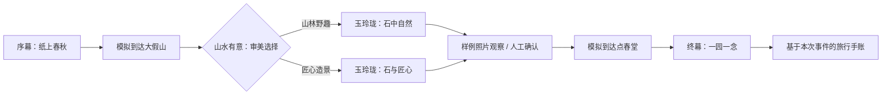

# 首轮实现与验收记录

> **文档状态：阶段记录，不是当前开发入口。** 本文中的“当前/待实现/下一步”、分支与测试数只对应文内记录阶段。最新能力见 [导航与当前状态](README.md)，领取任务见 [03](03-开发任务拆解.md)，环境接手见 [09](09-本地开发交接.md)。旧文涉及素材署名/许可复核不再作为本轮任务或验收门槛。

> 本文记录 M0/M1 阶段状态。M2 已完成模型调用迁移、Builder 起稿和审核工作流；当前状态及验证见 [M2 实现与验收](05-M2实现与验收.md)。
2026-10-10。基于 `main` 的文档提交 `6eea7ef` 开发；本轮交付 M0 的工程契约和 M1 的游客端垂直切片，同时实现 TW-201 与部分 TW-202。不是全部 P0/P1 任务完成声明，也不是生产上线验收。

## 已落地的路径

从首页「沉浸故事」进入 `/experience/yuyuan-timewalker`：



无需地图 Key、模型 API 或位置权限；页面明确标记模拟游览，地图入口仍链接到原版 `/tour/:id`。当前位置事件由“模拟到达”按钮发出，不宣称实际 GPS 到达。观察使用原有照片与人工确认，不宣称已调用视觉模型。开始时默认静音，点击「开启旁白」接入浏览器语音；无可用语音时阅读字幕并手动继续。

## 任务状态

| 任务 | 本轮结果 | 剩余边界 |
|---|---|---|
| TW-001 契约 | 已实现类型、加载/编辑/发布共用校验器，旧包兼容 | 团队对契约的正式评审仍可在此基础上进行 |
| TW-002 种子包 | 已迁入独立 `yuyuan-timewalker.json`；四个地点、五个场景、两分支 | 素材精修、预录音与人工史实/授权审校未完成 |
| TW-101 引擎 | 已实现纯函数事件执行、幂等、过期 token 拦截、记忆与状态 | 未接真实位置/视觉事件 |
| TW-102 播放器 | 已实现沉浸页面、首页入口、移动布局、错误与旧包回退 | 高质量片头/历史演绎画面待制作 |
| TW-103 旁白 | 已接浏览器语音、字幕、重播、关闭声音、手动继续 | 目标设备真实出声与预制音频尚待内容/现场验收 |
| TW-104 分支 | 已实现自然/匠心变量赋值与不同旁白场景 | 无在线重规划，按预制规则执行 |
| TW-105 模拟与导演 | 已实现离散模拟站点；`?director=1` 显示重置、跳幕、状态与事件 | 未复用地图动画，未做 GPS |
| TW-106 手账 | 已实现真实访问章、所选选项、人工观察和三张地点图 | 无图片导出、跨设备分享 |
| TW-201 透传 | 已实现草稿持久化、图片引用解析、重打包保留 `experience` | 旧草稿键沿用，新增可选字段无需破坏性迁移 |
| TW-202 编辑器 | 部分实现：章节标题/旁白、地点绑定、选择文案、单条下一幕、预览 | 完整场景增删、复杂转移/来源表单、Builder 待 M2 |
| TW-401 冒烟 | 开发态双分支、刷新恢复、旧路由、错误、编辑预览及临时目录发布已验证 | 未做实际线上部署与现场手机测试 |
| TW-402 容灾 | 连续五次浏览器自动化彩排；图片/语音错误仍可到结局 | 尚无断网首次加载支持、Service Worker、录屏备份和人工上台彩排 |
| TW-003/203/301/404 | 尚未实施 | 模型网关、Builder、在线视觉、鉴权正式发布是后续工作 |

## 契约的编码决定

- 根 `schemaVersion=1` 保持兼容，`experience.schemaVersion=1` 独立演进；目录新增可选 `experience: {title, estimatedMinutes}` 摘要，用于发现页入口。
- 使用原生 TypeScript 运行时校验与 Node 测试，没有新增依赖。条件限 `eq/neq/in`，动作限 `setVar/revealMemory/goTo`；不执行脚本。历史叙述必须关联来源或显式标为虚构，这只是结构检查，不等于内容审核。
- V1 拒绝所有场景图循环，条件转移必须带最后一个无条件兜底；这比初始工具的“只拒绝无出口循环”更保守，保证当前故事有限结束。未来需要循环任务时另行扩展契约。
- 引擎新增 `awaitingLocation` 阶段；转至不同地点先等待正确的模拟事件。未到站的场景不记为已访问。当前事件源只允许 `simulated`，预留真实位置能力不等于已实现。
- `SKIP_SCENE` 只跳过阅读/旁白；必选题会进入 `awaitingInteraction`，不会擅自选择分支。`REPLAY_SCENE` 和 `DIRECTOR_JUMP` 都刷新场景 token，过期媒体回调无法继续新幕。
- 检查点键为 `timewalker:session:v1:{packageId}`。保存已接受事件，刷新时重放；包版本或内容变化、非法事件、损坏存储均放弃旧检查点。声音不随恢复自动开启；存储不可用时故事可在内存中完成。
- 导演模式仅在明确的查询参数下显示。跳幕不假造选择或观察，手账标明使用过导演跳幕。草稿预览使用 `?preview=1`，不覆盖公开故事的进度。
- 开发插件服务端也校验体验包及文件名，阻止无效内容覆盖；它仍只适用于本机开发，没有生产鉴权和事务性发布。下载兜底保持为草稿，只有开发服务写入成功才标为已发布。

## 本轮验证证据

运行目录 `tour-hub-web/`，使用 Node.js 24；项目已有依赖已安装。

```bash
npm test
npm run build
npm run lint
npm run dev -- --host 127.0.0.1 --strictPort
```

`npm test` 使用 Node 原生 TypeScript 测试器，不新增测试依赖；测试也由单独的 `tsconfig.test.json` 纳入 `tsc -b`。当前 39 项测试通过，覆盖结构错误、图终止、两种结局、幂等、过期回调、重播/导演重入、检查点重放、旧编辑字段与故事图片透传、发布前拦截无效包。发布集成测试使用临时 Vite 根目录，保持仓库样板数据不被测试改写。

`npm run build` 通过；`npm run lint` 通过，保留原地图组件/编辑器的 10 条警告，本轮没有新增警告。

可选浏览器检查使用 Playwright。已验证云环境的现有浏览器运行时；在这台机器可运行：

```bash
TIMEWALKER_PLAYWRIGHT_MODULE=/opt/codex/cua_node/lib/node_modules/playwright/index.mjs \
TIMEWALKER_CHROMIUM=/usr/bin/chromium npm run test:smoke
```

其他机器可在独立工具目录安装 Playwright 并通过 `TIMEWALKER_PLAYWRIGHT_MODULE` 指向其 `index.mjs`，设置 `TIMEWALKER_CHROMIUM` 为已有 Chromium 可执行文件；如果 Playwright 已安装到本项目且有其浏览器，可直接 `npm run test:smoke`。`TIMEWALKER_BASE_URL` 可指定开发或部署测试服务。Playwright 是可选浏览器工具，未加入项目依赖与锁文件。

浏览器脚本已执行：自然三次/匠心两次完整链路；手机 390×844 无横向溢出；刷新后恢复下一站和已完成手账；图片 404/模拟语音错误仍到结局；修改草稿旁白后预览显示修改；导演跳至结局不会虚构已选择/已观察；旧 `/tour/yuyuan` 加载和缺 Key 提示；旧包无故事回退、不存在的景点错误页；普通入口无导演面板。主线零模型请求、零浏览器页面异常。图像/语音错误测试是受控故障注入，不是对真实 TTS 音质的验收。

## 下一轮开发顺序

1. TW-003：将旧 `aiDraft.ts` 和 `TourPage.tsx` 的前端模型调用移到服务端网关，再接在线生成；当前 `VITE_DEEPSEEK_API_KEY` 遗留调用未整改，不能带真实模型私钥正式上线。
2. 补齐 TW-202/204：场景和选项目标编辑、来源审查状态、素材管理以及可读的图错误定位；处理图片大小与本地草稿配额。
3. TW-203：优先明确标记的“从模板起稿”，随后接 Builder 在线起稿与取消/超时；始终保留人工审核发布。
4. 内容负责人核实官方史实和四张现有照片的作者/许可，在 `public/experience-assets/yuyuan-timewalker/asset-manifest.json` 填写审核结果；制作艺术演绎画面与预录音。
5. 最后接 TW-301 受控视觉观察或 TW-404 正式发布，再安排目标设备与现场彩排。暂不把真实 GPS、AR、开放场景识别加入首轮验收。
