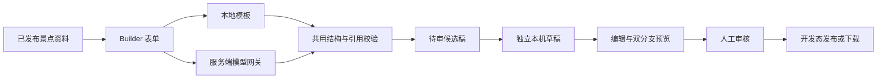

# M2：故事起稿、审核与服务端模型网关

截至 2026-10-10，本轮在 M1 播放器之上打通内容生产流程。无需模型凭据即可完整运行模板链路；在线模型适配器已完成受控测试，但当前环境没有模型密钥，尚未进行真实供应商生成验收。

## 从发布后台开始

1. 进入 `/publish`，在「故事 Builder」选择已发布景点。
2. 填写主题，选择普通/亲子受众、诗意/活泼语气与 3–30 分钟目标时长。
3. 选择「本地模板」或「在线模型」，生成候选故事。页面明确显示生成模式、处理步骤和待审核项。
4. 可查看候选旁白；「采用候选稿并编辑」创建新的 `attr-<UUID>` 草稿，不改写原景点或旧草稿。
5. 在故事编排中调整梗概、标题、旁白、地点、图片、选项、下一章与来源。结构错误显示章节 ID 和修复建议。
6. 点击「预览草稿故事」，用正式播放器演练两条分支。默认仍为模拟游览和人工观察确认。
7. 人工核对史实、来源、虚构标注、地点顺序及素材授权，勾选审核声明并确认。内容修改后审核自动重置。
8. 发布成功后才标记「已发布」；没有开发写文件服务时仍提供下载兜底并保持草稿。


候选稿保留在当前页面内存中，采用后存入本机草稿。生成失败或取消会保留表单与上一份候选稿；页面刷新或关闭前应先采用需要保留的候选稿。保存失败（例如浏览器存储配额不足）时会显示错误，候选稿仍可在页面查看。

## 实现与任务对应

| 任务 | 本轮实现 | 尚未包含 |
|---|---|---|
| TW-003 模型服务边界 | Node 服务端读取私钥；旧生成/问答迁移；请求约束、超时、取消、限流、脱敏；前端产物检查 | 生产账号鉴权、持久化用量计量与真实供应商验收 |
| TW-202 最小故事编辑器 | 故事/章节标题、梗概、时长、旁白、虚构标注、来源增删编辑、地点/图片、选项/转移目标、连接表与预览 | 场景增删、可拖拽图编辑器、条件表达式表单、素材库上传 |
| TW-203 Builder 最小链路 | 已发布资料 → 模板或模型起稿 → 共用校验 → 候选稿 → 人工采用/审核 | 网络检索、多代理协作、自动史实验证、批量生产 |
| TW-204 结构与图预检 | 生成、编辑、审核、预览和发布复用校验器；图循环/不可达、未知地点/目标/来源、错误媒体提示；按错误给修复建议 | 不自动修改内容，不验证 URL 所指史料的真实性或素材版权 |

模板生成五个场景记录，实际每次走四幕：开场 → 选择 → 自然或创造观察 → 终幕；只复用已有地点与图片，所有新旁白均标为文学创作。受众、语气和主题影响文字，时长仅是目标参数，尚未按内容自动扩写到指定分钟数。

在线起稿将给定 POI 摘要、可信来源与模板结构传给模型，返回 `ExperienceDefinitionV1`；模型输出先过结构校验，再检查来源与媒体是否属于原资料包。不能由模型补出新的来源 URL 或媒体。验证失败返回错误，界面不会悄悄用模板冒充在线结果；可由用户明确切换模板。

## 代码与接口



| 文件 | 职责 |
|---|---|
| `src/experience/builder.ts` | 表单校验、确定性模板、候选来源/媒体白名单和修复建议 |
| `src/experience/builderDraft.ts` | 采用候选到独立草稿、审核前结构校验 |
| `src/experience/components/BuilderPanel.tsx` | 生成、取消、保留旧稿、查看候选和采用 |
| `src/experience/components/StoryEditor.tsx` | 编辑、连接与来源管理、人工审核 |
| `src/lib/draftStore.ts` | 持久化；修改内容重置审核；发布前拦截未审候选 |
| `src/lib/modelApi.ts` | 同源模型接口客户端；不读取模型私钥 |
| `server/gateway.ts` | HTTP 接口、模型调用、服务端内容边界 |
| `server/index.ts` / `scripts/dev.mjs` | 网关启动、前后端进程启动与关闭 |

| 接口 | 输入 / 结果 |
|---|---|
| `GET /api/health` | 返回 `ok`、`modelConfigured` 与请求 ID；配置状态不等于供应商连通性 |
| `POST /api/builder/draft` | `attractionId, theme, audience, duration, tone, mode`；返回 `experience, mode, steps, diagnostics, reviewRequired, requestId` |
| `POST /api/draft/spots` | 旧景点表单与高德摘要；返回校验过的导览节点候选 |
| `POST /api/scene/ask` | 已发布景点 ID、可选地点 ID、问题；服务端选取该包讲解作为上下文 |

接口只从已发布文件读取景点；浏览器不能提供任意系统提示、模型地址或密钥。模型连接仅允许服务端配置的无凭据 HTTPS 地址，不跟随重定向。请求 JSON 上限 64KB；模型返回上限 1MB；同时最多两条模型调用，每来源 IP 每分钟最多 15 次请求。问答问题上限 500 字，主题上限 100 字。服务端模型超时 25 秒，客户端请求超时 30 秒；断开客户端连接会取消对应模型请求。错误包含公开错误码和请求 ID，不暴露模型私钥、私有地址或供应商原始报错。

网关绑定 `127.0.0.1:8787`。开发/预览 Vite 将 `/api` 代理过去；默认接受开发来源，定制域名须设置 `WEB_ORIGIN`。这是开发服务边界：Origin 检查、限流与本机审核记录不构成生产身份鉴权。开发发布插件仍没有生产鉴权、事务回滚或持久审计，不应直接暴露为公共发布服务。

草稿新增可选 `storyReview`，记录生成方式、原景点、请求 ID、诊断、审核状态和确认时间。它保存在本机草稿中，不改变根发布包契约或旧草稿键。修改标题、描述、地图起点/缩放、地点、图片或故事内容会重置审核；仅修改发布状态不会重置。旧包和未设置该字段的旧草稿保持兼容。此状态用于编辑工作流，无法代替正式发布服务的鉴权和审计。

旧导览在线节点生成失败时，明确显示「本地占位模板」，提醒名称/坐标/讲解需校准；问答失败只显示当前已发布讲解摘录，不再把硬编码豫园答案用于任意景点。

## 安装与启动

使用 Node.js 24 与仓库锁文件；本轮没有新增依赖，也未更改锁文件。

```bash
cd tour-hub-web
npm ci
npm run dev:full
```

没有地图或模型凭据时，模板 Builder 与故事播放仍能使用。只运行静态前端可用 `npm run dev`；单独启动网关可用 `npm run dev:api`。浏览器预览与生产静态包不包含网关，线上要使用在线起稿时须部署服务并配置同源 `/api` 反向代理。

- 地图可选配置：`.env.example` → 忽略的 `.env.local`，填写浏览器高德配置。
- 模型可选配置：通过云环境安全设置注入 `DEEPSEEK_API_KEY`；本机也可使用忽略的 `.env.server.local`，参考 `.env.server.example`。默认服务为 `https://api.deepseek.com/v1`、模型 `deepseek-chat`；可设置授权的兼容 HTTPS 服务。重启服务后生效。
- 模型私钥不能放入 `VITE_*`。旧 `VITE_DEEPSEEK_*` 已不再使用。
- 云环境没有模型凭据，当前在线模式应返回 `MODEL_NOT_CONFIGURED`；没有把受控响应当成真实模型成功。

云环境配置草稿已保存：更新 `start_skill` 为前后端启动与验证流程，增加 `DEEPSEEK_BASE_URL`、`DEEPSEEK_MODEL` 的非秘密默认值，以及可选个人 `DEEPSEEK_API_KEY` 绑定；该绑定仅用于 `api.deepseek.com`，此域名已加入允许列表。安装脚本与原地图配置要求保持不变。保存草稿不会注入密钥、重启服务或发布环境；如需在线能力，请在环境设置中填写凭据、审核保存配置并发布环境，然后再实测。

当前锁文件下载地址使用企业镜像。若镜像不可达，云环境已验证以下方法：在 `/workspace/.trip-guide-deps` 复制 `package.json` 与锁文件，只将 `resolved` 中前缀 `https://artifactory.release.ctripcorp.com/artifactory/api/npm/trip-npm-prod/` 换为 `https://registry.npmjs.org/`，保留精确版本和 integrity，执行 `npm ci` 后把本项目 `node_modules` 链接到该目录。仓库锁文件保持不变。云环境已保存此安装脚本，并更新前后端启动指引；已有依赖可直接复用。不要覆盖其他机器已有的 `node_modules`，先判断是否需要此回退。

## 已执行验证

| 检查 | 结果与范围 |
|---|---|
| `npm test` | 50 项通过，0 失败/跳过。覆盖原 39 项与新增 Builder、审核、HTTP 网关集成测试 |
| `npm run build` | 前端、服务端及测试类型检查与 Vite 构建通过 |
| 私钥产物检查 | 用合成 canary 值构建；前端 JS/HTML 中没有该值、旧私钥变量名或模型 Authorization 头 |
| `npm run lint` | 通过，保留已有地图/编辑器 10 条警告，没有新增警告 |
| `npm run test:builder` | 模板→候选→真实未配置接口错误保留旧稿→取消/过期响应→独立草稿→未审拦截→审核→编辑重置→循环提示/修复→发布请求→两分支预览→移动端；0 页面异常 |
| `npm run test:smoke` | 原主线五次完整彩排、刷新恢复、图片/语音错误、编辑预览、旧包/旧导览回归通过；0 页面异常、0 模型请求 |
| 实际服务请求 | 启动前后端；经 Vite 代理调用健康接口，配置状态为 false；模板 API 返回有效体验包 |

网关测试通过注入受控供应商响应验证密钥仅存在于服务端请求头、合法候选、坏 JSON/图/来源拒绝、错误脱敏、超时、客户端断开取消、来源/请求大小/限流/并发限制、旧生成及问答。真实供应商成功生成未验证。

浏览器 Builder 测试拦截发布请求，以免改写仓库种子数据；真实写文件与重新读取由 `publish.test.ts` 在临时 Vite 根目录验证。缺图/语音失败与取消延迟是受控故障注入，不代替目标手机、真实音质、真实网络或现场验收。

可选浏览器工具仍未加入项目依赖。在已准备的云环境中运行：

```bash
TIMEWALKER_PLAYWRIGHT_MODULE=/opt/codex/cua_node/lib/node_modules/playwright/index.mjs \
TIMEWALKER_CHROMIUM=/usr/bin/chromium npm run test:builder

TIMEWALKER_PLAYWRIGHT_MODULE=/opt/codex/cua_node/lib/node_modules/playwright/index.mjs \
TIMEWALKER_CHROMIUM=/usr/bin/chromium npm run test:smoke
```

## 下一步按优先级推进

1. 内容负责人核验种子包史实与四张照片的作者/授权；制作片头和预录旁白，进行真机彩排。
2. 在环境安全设置中配置模型凭据，实测在线起稿质量、生成耗时、模型兼容性与目标时长；模型仍可能产生内容错误，继续人工审核。
3. TW-301：仅针对玉玲珑的受控观察识别，并保留人工确认。
4. TW-404：为正式发布增加身份鉴权、版本/事务发布、审核审计、素材存储与配额控制；本机演示可继续使用当前开发发布链路。
5. 扩展场景增删、条件编辑、素材管理和跨设备分享。复杂 GPS/AR 和开放视觉识别仍不纳入当前演示主线。
