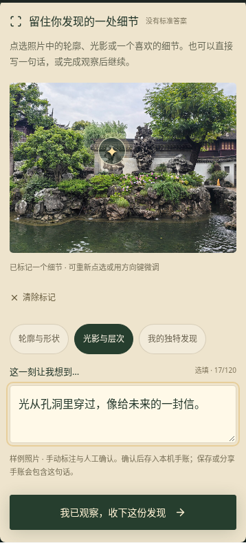
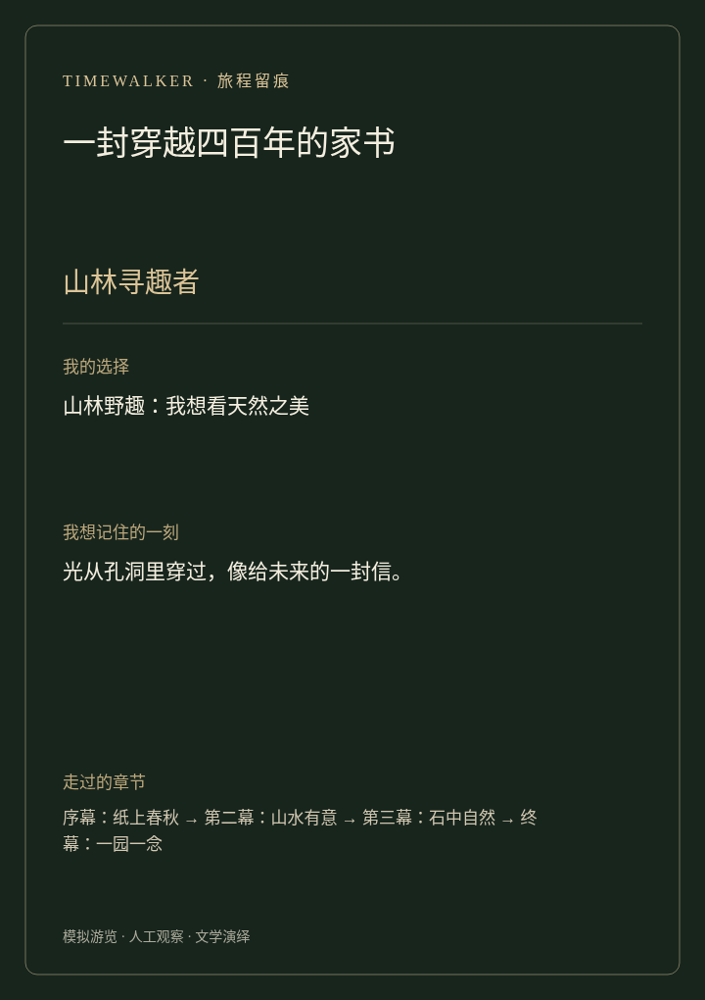

# 游客体验迭代：从点确认到留下自己的发现

本轮（2026-10-11）围绕「选择有回响、观察有参与、结局有可带走的记录」改进游客端。保持已有两条叙事路径，并让模板 Builder 的故事同样使用新的交互组件。

## 可以实际试玩的变化

| 环节 | 当前行为 | 游客得到的反馈 |
|---|---|---|
| 开场 | 简短展示选择、发现、手账三个体验目标 | 知道这一趟可以做什么 |
| 声音与进度 | 声音、重播与探索进度放在固定顶部栏 | 手机上不用翻到页面底部找控件；重播尊重静音选择 |
| 选择 | 自然/匠心选项增加说明，选中后显示选择回响 | 明确下一幕为何发生变化，没有对错或强制默认选择 |
| 前往下一站 | 显示上一地点 → 下一地点卡片 | 看得懂故事走到哪里；仍需明确点击模拟到达 |
| 观察 | 点选样例照片细节、选择记录类型、写最多 120 字感想 | 标记即时显示，可改位置、清除、用方向键微调 |
| 确认 | 确认观察后把细节与文字纳入故事事件 | 显示发现已收下；刷新仍可恢复已确认记录 |
| 结局 | 显示本次旅途称号、选择、照片标记、个人感想和实际章节 | 两个视角得到不同称号；导演跳幕不伪造互动 |
| 留念 | 下载 SVG 手账卡，或分享/复制文字手账 | 能把这一页带走；不支持分享/剪贴板时提供可手动复制的文本 |
| 再玩 | 保存喜欢的手账后可重新开启另一视角 | 重新开始会重置这趟本机进度，界面有提醒 |

观察不是答题，没有必须找到的正确热点。照片只是已发布景点的样例素材，点选位置、标签与感想都由游客亲自提供，不是 AI 识别结果，也不是到达现场的证明。无需相机上传、模型凭据或位置权限即可试玩。





## 一轮试玩步骤

1. 从首页进入《一封穿越四百年的家书》，默认静音。需要听讲述时明确开启声音。
2. 阅读开场，前往并模拟到达大假山，选择自然或匠心视角。
3. 查看选择回响，模拟到达玉玲珑，阅读对应讲述，继续探索。
4. 在观察卡的照片上点选一个细节，选择「轮廓与形状」「光影与层次」或「我的独特发现」，写一句想记住的话。
5. 确认发现后可以刷新页面；继续模拟到达点春堂，收下手账。
6. 在结局查看自己的标记与感想，保存手账卡或分享文字；保存后可再走另一条分支。

不想标注时直接确认观察即可。照片加载失败时可以留下纯文字发现，也可以直接确认；不会人为卡住故事。未确认的标注只保留在当前观察界面，确认后才纳入本机进度；关闭或重播前请先确认需要保留的发现。本机存储不可用时仍可在当前页面完成故事，但不能保证刷新恢复。

## 数据和兼容性

- 选择选项支持可选 `description`（1–240 字），既有包可省略。种子包与模板补齐说明，编辑器可修改说明。
- `photo_or_tap` 支持可选 `prompt`（1–240 字）及 `hints`（最多 3 条、每条 1–80 字）。缺失主提示时沿用通用文案，缺失轻提示时不显示展开入口；自然/匠心可提供不同观察侧重，但都不设置标准答案。
- `OBSERVATION_CONFIRMED` 仍为 `method: manual`，新增可选 `discovery`。示例：

```json
{
  "category": "light",
  "x": 0.45,
  "y": 0.40,
  "note": "光从孔洞里穿过，像给未来的一封信。"
}
```

- `category` 限 `shape/light/detail`。位置是显示照片上的归一化坐标，x/y 必须成对、有限且在 0–1；没有照片时可只记录非空文字，不编造坐标。文字最多 120 个 JS 字符单位。
- 引擎复制已确认记录并校验数据，拒绝非法坐标、未知类别、过长感想及过期 token。重复确认不会多收一份发现。
- 检查点仍使用事件重放，新记录随已接受事件恢复。旧的直接确认事件没有 `discovery` 也保持有效。
- 根包和 `experience.schemaVersion` 均保持 1。种子故事新增选项说明后，旧的内容指纹不匹配进度会按既有规则重新开始，避免跨内容版本错误重放。
- 顶部进度与路线只使用故事涉及的地点，个人称号依照本次实际选择与变量生成；不会给导演跳幕凭空发放未完成互动。
- 草稿预览返回时直接进入故事编排标签，减少编辑/预览间的重复操作。

## 手账保存与分享

`journalSvg` 生成 720×1020 的独立矢量卡片，包含本次标题、称号、选择、个人发现与实际章节。它不引用远程图片或字体，不含脚本与 `foreignObject`；所有文字作 XML 转义并清除不合法 XML 字符。长内容按卡片尺寸简排，完整文本可复制分享。卡片格式为 SVG，可用浏览器打开；本轮没有实现 PNG、云端分享链接或跨设备同步。

分享优先使用浏览器系统分享；不可用时复制文字，剪贴板权限不足时显示只读文本供手动复制。取消分享不会更改手账。记录留在当前浏览器；只有用户主动保存或分享时才导出个人文字。本轮测试中的系统分享和剪贴板行为为受控模拟，未向第三方发送内容。

## 实现入口

| 文件 | 改动 |
|---|---|
| `components/ObservationCard.tsx` | 触摸/鼠标点选、键盘移动与清除、分类、感想、照片错误回退 |
| `components/ExperiencePlayer.tsx` | 固定控制栏、进度、下一站卡、选择/发现回响、焦点与滚动衔接 |
| `events.ts` / `storyEngine.ts` | 可选个人观察记录，验证、复制、幂等和 token 边界 |
| `journey.ts` | 实际进度、旅途称号、文字分享与安全 SVG 卡片 |
| `components/EndingJournal.tsx` | 个人标记与感想、下载、分享/复制、失败回退 |
| `useNarration.ts` | 重播不再擅自打开已关闭的声音 |
| `experience.css` | 观察卡与手账视觉、44px 操作目标、窄屏布局、减少动画支持 |

## 已验证

在 `tour-hub-web` 使用 Node.js 24：

- `npm test`：58 项通过，0 失败/跳过。新增个人记录复制与边界、重复/过期事件、文本确认与旧事件兼容、检查点恢复、真实进度/称号、SVG 转义、导演记录和选项说明校验。
- `npm run build`：前端、服务端和测试类型检查与构建通过。
- `npm run lint`：通过，仅原有地图/编辑器 10 条警告。
- 原 `test:smoke`：五次双分支彩排、刷新恢复、缺图/语音失败、编辑预览、旧包/旧导览回归通过。
- 原 `test:builder`：起稿、取消/保留、审核、修改重置、发布请求与生成故事的双分支预览通过。
- 新 `test:playability`：390px 触摸点选、320px 键盘移动、焦点衔接、顶部控件可见、静音重播、选择/发现回响、照片标记与文字刷新恢复、实际下载和 SVG XML 解析、复制成功/拒绝、分享取消、另一路径称号、减少动画、缺图纯文字发现均通过；0 页面异常、0 模型请求。

浏览器验证在云环境 Chromium 中执行，320/390px 是模拟手机视口；真实 iOS/Android、系统分享面板与现场语音质量尚待团队真机验收。截图及下载结果来自本轮测试，示例文字是测试输入。

```bash
npm run dev:full

TIMEWALKER_PLAYWRIGHT_MODULE=/opt/codex/cua_node/lib/node_modules/playwright/index.mjs \
TIMEWALKER_CHROMIUM=/usr/bin/chromium npm run test:playability
```

## 下一轮聚焦

1. 真机检查阅读节奏、软键盘、系统分享与旁白音色，调整现场演示时长。
2. 核验原型照片与史实来源，精修视觉素材和预录音；当前仍不宣称素材已完成授权审校。
3. 为内容创作者扩展可配置观察提示及场景编辑；若接视觉识别，保留当前人工观察路径。
4. 需要正式上线时再完成生产鉴权、持久审核与素材存储；本轮保留开发态发布边界。
