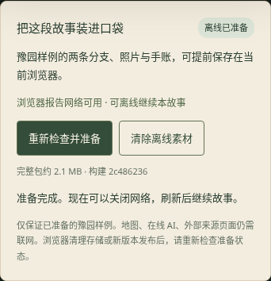

# 离线演示包与现场容灾

本轮（2026-10-11）落实 TW-402 的离线保底链路。它服务于已发布的豫园样例，不依赖模型网关、地图加载或在线识别；结合 [08-五分钟答辩讲稿](08-五分钟答辩讲稿.md) 可安排完整现场演示。

## 游客看到的行为

首页故事卡下方、豫园故事侧栏新增「把这段故事装进口袋」。用户联网点击「准备离线故事」，看到素材准备进度、包大小与构建版本；全部成功后显示「离线已准备」。当前包为 10 个文件，2,203,031 字节（约 2.1 MiB，界面简称 MB）。构建内容变化会改变大小与版本，不作为固定产品指标。



准备后可以断网并刷新 `/experience/yuyuan-timewalker`：自然/匠心分支、四站照片、人工观察、个人感想、结局和 SVG 下载均可使用。已确认记录仍由既有事件检查点恢复，不新增另一套进度存储。首页也能离线打开；目录中其他导览并不因此获得离线保证。

- 没准备：不会把普通 HTTP 缓存或注册成功包装成离线就绪。首次打开时即断网不受支持。
- 准备失败：给出可重试反馈，删除本次未完成缓存；如果之前已有完整包，继续保留它。
- 清除离线素材：只清除本应用的离线素材缓存，不删除故事检查点、草稿、个人发现或其他应用缓存。
- 浏览器清理了部分素材：状态检查会发现不完整并显示「尚未准备」，不凭上次的成功标记继续声称就绪。
- 新构建：Service Worker 切换后按新版本检查，不套用旧包的就绪标记；重新准备、刷新，再开始正式彩排。
- 网络标签来自 `navigator.onLine`，界面明确写「浏览器报告」。它不能证明互联网或模型服务实际连通；离线就绪以缓存完整性为依据。

## 构建与缓存契约

`vite-plugin-offline-demo.ts` 在正式构建完成后读取实际输出，收集入口 HTML、JS/CSS、图标、目录、样例 JSON 与样例引用的本站图片/音频；嵌入资源随 JSON 校验。每个文件记录 URL、字节数和 SHA-256，文件列表生成构建版本，写入 `dist/offline-worker.js`。样例外链媒体会阻止离线构建，整个包上限为 20 MiB。没有新增 npm 依赖，锁文件保持原样。

`offline/worker.js` 是模板，不直接公开部署。Worker 仅在用户点击准备时下载，逐一核对长度与摘要，最后写完成标记，再切换到新缓存。失败时回滚本次缓存。新缓存成功后清理本应用旧缓存；版本和完整性检查仍会在 Worker 重启后执行。注册本身不预下载、不承诺准备成功。

就绪后，这一组文件使用缓存优先，以保证同一构建中的页面、故事与素材一致。首页和样例故事的直接导航使用已缓存 HTML；其他文件和路径继续走网络。缓存白名单不含 `/api/*`、发布请求、上传内容、来源网站、地图资源或用户草稿，POST 请求也不拦截。用户进度仍只在本机的既有存储中。

## 使用与部署

```bash
cd tour-hub-web
npm run build
npm run preview -- --host 127.0.0.1 --strictPort
```

`npm run dev` / `dev:full` 提供正常开发试玩，离线按钮有说明且禁用，不缓存 HMR 或开发模块。离线只在正式构建验证；静态部署发布整个 `dist`，必须使用 HTTPS（本机 loopback 可测试），当前要求部署在域名根路径。不要把旧的 `public` 目录代替 `dist` 部署。

托管服务须让 `/offline-worker.js` 以 JavaScript 返回，保持其 URL 不变并允许更新检查（推荐 `Cache-Control: no-cache`），不要重定向到 SPA HTML；`/experience/*` 需设置 HTML 回退。构建所有文件应作为一份版本发布，避免部署中途准备混合版本。无需模型网关即可演示；要展示在线能力则另行配置同源网关。

准备期间保持页面打开。新版本上线后，应重新联网检查、准备并刷新。浏览器可能清理缓存，隐私模式、系统存储不足、禁用 Service Worker、非安全来源会限制能力；因此现场必须在同一个浏览器配置中检查实际状态，而非只看以前的截图。此功能不包含安装式 PWA、后台更新通知、跨设备同步或离线高德地图。

## 自动验收

```bash
npm run build
TIMEWALKER_PLAYWRIGHT_MODULE=/opt/codex/cua_node/lib/node_modules/playwright/index.mjs \
TIMEWALKER_CHROMIUM=/usr/bin/chromium npm run test:offline
```

新套件自行启动仅供测试的临时静态服务器，使用真实构建产物和真实 Service Worker，不依赖开发服务器。它不写回 `public/data`。本轮结果：

| 检查 | 结果 |
|---|---|
| 只注册、不准备就断网刷新 | 按预期失败，不报就绪 |
| 图片返回 200 但字节被篡改 | SHA-256 拦截，未完成缓存清理 |
| 完整包存在后重新准备失败 | 旧完整包保留，可继续离线 |
| 新 Worker 版本（受控更新夹具） | 旧标记不套用，新准备成功后清理旧包 |
| 断网页面 + 服务器停止响应，完整彩排 5 次 | 自然 3 次、匠心 2 次，全部得到结局 |
| 每轮确认发现后刷新、结局刷新 | 标记/感想与分支称号恢复 |
| 离线直接开第二个标签，含导演参数 | 恢复同一手账 |
| 每轮实际下载 SVG | 5 份下载成功，包含当轮个人文字 |
| `/api/health` 离线请求 | 失败，不从缓存伪造接口成功 |
| 删除一张缓存照片模拟浏览器清理 | 状态回到未准备 |
| 清除离线素材 | 无关缓存保留，个人手账进度保留 |
| 320/390px 布局、页面异常 | 无横向溢出，0 页面异常 |

浏览器的后台 Worker 更新检查可能仍尝试访问网络；测试服务器在离线彩排期间拒绝返回任何数据。五轮均无服务器数据依赖、无模型调用，未将“页面离线模式”误当作所有浏览器后台流量都已停止。

原有 58 项 Node 测试、构建、lint（仅原 10 条警告）以及故事、Builder、可玩性三个浏览器套件通过。五轮彩排是云环境 Chromium 自动化验证，尚不能替代现场真机、设备语音与人工计时。

## 上台前十分钟

1. 固定版本并启动正式构建；主浏览器与备用浏览器分别准备，看到「离线已准备」。不同浏览器不会共享缓存。
2. 主浏览器断网刷新，走一轮到手账。检查照片、文字与下载；再恢复网络。
3. 打开正常游客入口与 `/publish` 两个标签。后台准备好一份模板候选稿；如用静态部署不现场演示写文件发布。
4. 在 `?director=1` 重置体验，或在上一轮手账点击「换个视角，再走一次」，确认回到开场。重置会清除当前旅途记录，请先保存需要的手账。
5. 默认静音演示，减少设备语音的不确定性；若开声音，先真机检查。语音失败直接阅读点击继续。
6. 检查投屏与字号，按 [讲稿](08-五分钟答辩讲稿.md) 彩排计时；准备录屏或截图备份，并明确标为备份材料。本轮没有制作录屏。

## 后续任务

TW-402：软件准备、失败回滚与自动化离线彩排已完成；实机断网、投屏和人工五分钟彩排由团队现场验收。

TW-403：提供八页内容、逐字讲稿、技术图与能力对照，见下一份文档；尚未导出 PPTX/视频。

接下来优先落实 TW-302 的素材/声音打磨与真机节奏，并扩展创作者可配置的观察提示。在线视觉、真实 GPS 与生产鉴权继续独立验收，不影响当前样例离线体验。
