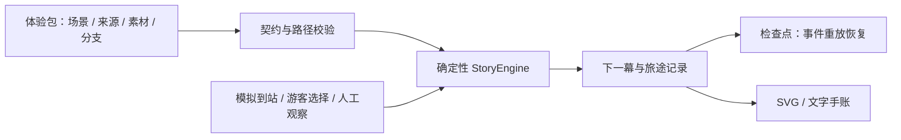

# 时空漫游者：可直接彩排的五分钟答辩

更新日期：2026-10-15。以下按当前实现写作。默认演示采用静音、模拟到站、照片人工观察，并在 Creative Studio 展示「两个构想→人工选择→节拍/V1 编译→采用并编辑」。当前环境没有真实供应商成功调用证据；若演示环境仍无凭据，使用已保存候选或本地模板，不把 mock 自动化或固定样板称为在线 AI 生成。

## 八页讲述内容

### 第 1 页 · 让世界成为你的故事

**时空漫游者**

Trip Experience Engine · 智能旅行体验引擎

一封虚构家书，一座真实园林，一条因你的选择而变化的故事。

画面：首页故事卡或开场。页脚：豫园样例 · 模拟游览 · 家书和独白为文学创作。

### 第 2 页 · 游客想带走的不只有知识

旅行者听到了景点介绍，却未必有机会参与、观察和留下自己的发现。

我们提供三次轻量参与：**选择一种目光 → 看见一个细节 → 收下一页自己的手账**。

这是等待用户试验验证的体验假设；本轮不提供转化率、付费意愿或留存增长数字。

### 第 3 页 · 同一块石头，两种理解

大假山做一次选择，玉玲珑读到不同叙事：

| 选择 | 下一幕 | 手账称号 |
|---|---|---|
| 山林野趣 | 自然视角的讲述 | 山林寻趣者 |
| 匠心造景 | 造园视角的讲述 | 匠心寻迹者 |

称号来自实际选择记录，不做人格测评。请评委选一路，另一条用预先保存的真实试玩截图展示；五分钟内不从头重复全部路线。

### 第 4 页 · 把自己的发现带回去

实际操作：照片点选、选择记录类型、写一句感想、确认、结局下载手账。

观察没有标准答案；样例图不是用户现场拍照，标记不是视觉模型识别。已确认的文字与位置随事件重放恢复；下载 SVG 或主动分享文字，将这一刻带走。

准备好的约 2.1 MB 样例包，可以在断网刷新后继续。浏览器清理存储后须重新准备，不承诺首次访问离线可用。

### 第 5 页 · 故事是一份能执行的内容

同一包描述地点、章节、变量、互动和跳转，同一播放器执行两条路径。

不是让模型决定用户是否完成任务。运行时拒绝过期事件、重复确认、非法跳转；内容校验拒绝引用缺失、循环和无结局的图。结构通过不等于史实已审核。

### 第 6 页 · 从创意到可执行体验

主题 / 受众 / 时长 → 两个故事构想 → 人工选择 → 4–6 个节拍 → V1 候选 → 独立草稿 → 编辑审核 → 预览发布。

- Creative Studio 已串起双概念、节拍/V1 编译与采用；概念必须在悬念、地点作用和结尾上有实质差异。
- 模型只在当前包的地点、媒体、来源和白名单动作内改写；非法输出最多定向修复一次，不能成为候选。
- 采用后是带请求与产物标识的独立待审草稿，不覆盖固定样板；改故事或主题会重置审核。
- 本地模板仍可现场起稿，并明确显示「未调用模型」；无凭据、超时或模型失败不影响两个固定样板。

时长是目标元数据，不宣称任意输入时长都生成对应长度的内容。素材署名与许可复核不作为本轮任务或验收门槛。

### 第 7 页 · 证据与边界

| 本轮有证据的事实 | 范围 |
|---|---|
| 102 项 Node 测试通过 | Agent 契约/导入、协议、引擎、恢复、审核/发布与受控网关测试 |
| 7 套 Chromium 回归通过 | Studio、Builder、Creator、双样板、主体验、可玩性与真实 Worker 离线 |
| 新增 5 次完整离线彩排全部到结局 | Chromium，模拟 320/390px，服务器拒绝响应 |
| 每次离线下载手账成功 | 实际 SVG 文件含个人输入 |
| 准备失败与新版本处理验证 | 摘要拦截、回滚、更新夹具、缓存缺失检查 |

不将测试样本成功率推断为生产可靠性。真实 GPS、在线视觉、真实模型效果、照片授权与史实全文核验、真实手机 OS 分享、正式生产发布，都还需验证或交付。

### 第 8 页 · 从预订之后，走到旅行之中

对游客：多一次愿意停下来观察的理由，多一页属于自己的旅行记忆。

对内容方：让同一组景点与素材承载不同主题，经过校验与人工精修复用。

对 Trip.com：未来可衔接目的地内容、当地玩乐与门票体验。本次完成体验和内容生产机制验证，尚未对接平台订单或商业化接口。

**今天从豫园开始，让每一处有故事的地方，都能回应你的好奇。**

## 五分钟逐字讲稿与操作

时段是彩排预算，包含点击和等待，尚未进行人工计时。不要用模板页数、技术词或测试总数取代产品演示。

### 0:00–0:35 · 首页 / 第 1–2 页

“来到一座园林，导览会告诉我们它叫什么、建于哪一年。我们还想知道：这座园林怎样成为我自己的经历？时空漫游者把地点串成一段可以参与的故事。今天是一封穿越四百年的家书——家书是我们的文学创作，园林是故事发生的舞台。”

动作：进入样例，点击「开启时空漫游」，开场读到最后，点击「前往下一站」。不用开启旁白。

### 0:35–1:35 · 大假山 / 第 3 页

“我们用模拟到站来展示地点事件，点击并不代表真实定位。现在来到大假山。请选一种理解园林的目光：山林野趣，还是匠心造景？这不是答题。你的选择会改变接下来玉玲珑的讲述，而不仅是给一个按钮换颜色。”

动作：模拟到达大假山 →「读完了，继续探索」→ 按评委选择 → 展示选择回响 → 模拟到达玉玲珑。读一行分支正文，不重复整段。

“这里同一个地点，因为刚才的选择，已经变成另一种观看方式。”

### 1:35–2:35 · 玉玲珑观察 / 第 4 页

“我们让互动保持轻量：不要求解谜，也不用抢着找正确答案。请在这张样例照片上挑一个你留意的细节，写一句想记住的话。这是你亲自记录的观察，不是 AI 告诉你看到了什么。”

动作：「读完了，继续探索」→ 点照片 → 选记录类型 → 输入「光从孔洞里穿过，像给未来的一封信。」或评委原话 → 确认发现。

“这份发现已经被收下，刷新页面也能继续。我们提前准备了离线包，现场网络不稳定时，故事、照片和手账仍然可以完成。”

动作：提前已准备才断网；刷新 → 模拟到达点春堂。未验证设备断网时，口头说明并展示真实验收记录，不临时冒险关网。

### 2:35–3:10 · 结局手账

“旅程的结尾不只是一句完成。你选择了什么、走过哪些章节、发现了哪一处细节，都在自己的手账里。可以下载这张卡片，也可以主动分享文字。再走一次，换一种目光，会留下另一份记忆。”

动作：「读完家书，收下手账」→ 展示称号与个人感想 →「保存手账卡」。保留下载结果，不操作系统分享面板，以免投屏或权限中断。

### 3:10–3:40 · 技术 / 第 5 页

“刚才运行的不是一组写死的页面。地点、章节、变量和互动存在一份可执行体验包里，由确定性的引擎推进。重复点击和旧播放回调不会让故事乱跳；刷新后按事件重放恢复。模型可以帮内容起稿，但不替用户宣告任务完成。”

动作：展示技术图；可在预备导演标签展示事件与变量，不跳幕造出与游客不一致的记录。

### 3:40–4:35 · 内容生产 / 第 6 页

“内容方先输入景点、主题、受众和时长。智能体给出两个真正不同的故事构想，我们人工选择一个，再编译成可执行节拍。这里能直接看出每一幕在哪个地点、选择怎样分叉、观察任务是什么、在哪里汇合。采用后它不是覆盖原样板，而是一份带生成记录、等待人工审核的独立草稿。”

动作：切发布后台 → Creative Studio 展示预先生成的两个构想 → 选择一张 → 展示节拍时间线 →「采用并进入故事编辑器」→ 展示「构建智能体起稿」「待人工审核」与预览。若演示环境已验证真实模型，可现场生成概念；耗时的编译优先使用已保存的真实成功产物接续。若没有凭据，明确切换下方本地 Builder，不把固定候选说成现场在线生成。

### 4:35–5:00 · 第 7–8 页

“同一套引擎已经支撑园林家书和天文讯号，也能接住新的模型候选。我们用 102 项 Node 测试和七套 Chromium 回归覆盖生成边界、两个分支、移动端、刷新、下载与真实离线 Worker。真实定位、视觉识别和正式生产发布仍是下一阶段。对 Trip.com，我们希望把目的地内容从旅行前的介绍，延伸到旅行中的参与和旅行后的记忆。时空漫游者，让世界成为你的故事。”

## 故障时的现场话术

| 触发 | 操作与一句话 |
|---|---|
| 网络中断，已有完整离线包 | 继续点击；“这一条样例已提前准备，所以可以继续。” |
| 没有离线准备，页面加载失败 | 换已准备的备用浏览器；仍失败展示标明为录屏/截图的备份，承认现场失败 |
| 旁白不可用 | 保持静音；“文字和交互可以独立完成。” |
| 在线起稿超时/无凭据 | 手动切本地模板；“在线调用未完成，现在演示模板候选。” |
| 手账分享权限弹窗/取消 | 下载 SVG 或手动复制，不把分享取消解释为数据丢失 |
| 操作误跳幕 | 明确说明导演模式，重置游客标签重新演示，不将导演手账当普通完玩证据 |
| 剩余不足一分钟 | 停止后台编辑，保留手账/架构/真实性，结束产品价值；不声称没展示的链路已现场运行 |

## 评委追问的准确答案

**Agent 在哪？** Creative Studio 是新的分阶段 Agent 入口：模型先生成两个不同概念，用户选择后再生成节拍并编译 V1 候选；服务端校验基础包版本、地点、媒体、动作、分支和结局，最多修复一次，采用后进入独立待审草稿。若当前环境无模型凭据，只演示已保存产物或本地 Builder，并明确说明。

**图片识别实现了吗？** 当前是样例照片上的人工发现，点选位置与个人感想驱动观察完成事件，没有调用视觉模型。未来接识别反馈也应保留人工路径。

**离线能覆盖所有景点吗？** 当前只保证构建内的豫园和上海天文馆两个固定样板；首次访问需联网准备，地图、来源站点、在线模型及任意新 Agent 草稿不在固定离线包承诺内。扩展到用户自建体验包需要单独实现资产管理和配额策略。

**史实靠什么保证？** 包内有来源引用和文学创作标记，结构校验能拦截缺失引用，但不能证明事实正确、图片授权或来源可信；团队必须完成内容核验，不能声称本轮已完成审校。

**能直接上线吗？** 游客样例可静态部署，离线链路依赖 HTTPS 和正确 SPA 路由。在线模型需要部署网关；正式创作发布还需要鉴权、持久审核与素材存储，本地审核不是生产安全边界。

**五轮全过说明什么？** 说明这个固定样例在受控 Chromium 环境中，两个分支、失网和刷新链路可重复完成；不证明真实手机、真实景区或大规模流量都已验证。
