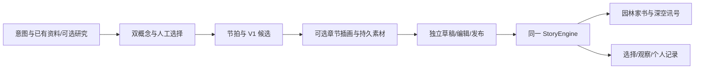

# 双样板与创作生产线｜五分钟答辩操作稿

更新：2026-10-15。当前能力以 [导航](README.md) 为准。本稿替换旧单豫园逐幕演示；时间为彩排预算，仍需人工计时。核心展示故事效果，不把测试总数当作产品价值。

## 演示前准备

- 两个固定成品都打开过；使用 [07](07-离线演示与验收.md) 在演示浏览器准备固定离线包。
- Studio 预先导入一份可用成果；真实服务产物保留请求/模型/artifact。没有真实产物则用本地模板，并准确说明来源。
- 准备两种主题开场、各自分支/个人记录、Studio 时间线和编辑器标签页。导演跳幕要明确说明是演示控制，不把跳幕结局当普通完玩证据。
- 耗时模型/生图使用已完成的真实产物接续，现场只做已验证的短操作；不临时填写 Key 或赌一次长调用。
- 默认静音可读；要播旁白则先在实际设备测试声音启动。下载比现场弹系统分享面板稳定。

## 五分钟讲述与操作

| 时间 | 展示与动作 | 建议话术 |
|---|---|---|
| 0:00–0:35 | 首页双主题卡片 | 「旅行不只记住地点名，也可以带走一段自己参与的故事。时空漫游者，让世界成为你的故事。」 |
| 0:35–1:45 | 豫园开场→自然/匠心选择→观察→手账；可用已准备章节接续 | 「一封虚构家书把园林串起来。同一块石头，你选择不同目光，会读到不同叙事。点一个细节、留一句感想，结尾就是自己的手账。」 |
| 1:45–2:55 | 天文馆深蓝讯号→起点/目的地选择→航行记录 | 「现在换成深空讯号，画面、语言和结局都改变了，背后仍是同一引擎。家园、宇宙、征程是手动进入的展区章节，没有室内定位。」 |
| 2:55–4:15 | `/publish`：两个构想→选中→时间线→章节配图/已有成果→采用并编辑 | 「创作者先给主题，再选择真正不同的故事命题；模型形成分幕候选，系统检查结构和引用。关键章节可补生成插画，成果能携带新素材交给别人继续编辑。」 |
| 4:15–5:00 | 架构图与个人记录收束 | 「同一份契约、同一运行时、多种故事风格，再接一条可编辑的内容生产线。我们希望把目的地内容从旅行前的介绍，延伸到旅行中的参与和旅行后的记忆。」 |

每包 70 秒只演示关键片段，不从头朗读全文。完整路径另留录屏或备用浏览器，不为凑时间跳幕后声称“刚才完整玩完”。现场配图若不是本次实时生成，就说「此前生成并保存的插画」。

## 幻灯片建议（八页，按演示切换）

1. **让世界成为你的故事**：品牌与双主题封面。
2. **旅行者愿意停下的一刻**：选择、观察、带走个人记录；不编造增长数字。
3. **豫园的家书**：一次有回响的选择、文字感想和手账。
4. **天文馆的讯号**：同一引擎，显著不同的叙事媒介和航行记录。
5. **可执行体验包**：地点、章节、变量和白名单动作，经确定性引擎运行。
6. **创作生产线**：研究→双概念→选择→节拍/V1→插画→独立草稿→编辑/发布。
7. **当前证据与后续**：接口/测试与真实服务分开，列实际演示过的能力；后续是声音、自主工具与更多故事。
8. **从预订之后走到旅行之中**：Trip.com 目的地内容的扩展价值；订单与商业化接口未对接。

## 问答与失败回退

| 问题/情况 | 准确回答或操作 |
|---|---|
| Agent 做了什么？ | 已有分阶段概念/编译、研究与生图适配，候选可编辑发布；尚未接 Deep Agents 自主工具编排，编译仍参考固定蓝图 |
| 这是实际在线生成吗？ | 只把实际成功调用说成在线生成；固定剧情为手工样板，现有天文图来自 image_gen；替身测试不是供应商成功证据 |
| 识别了照片/自动导航吗？ | 当前照片是人工标记/确认，位置是模拟到站或手动展区；没有视觉识别、真实 GPS 或室内定位 |
| 图片怎么带走？ | 新图落本机素材目录；成果导出会携带新增媒体，采用后通过原发布链打包 |
| 网络或生成失败 | 固定样板离线继续；Studio 使用成功成果或明确切本地模板；配图失败保留原图 |
| 离线覆盖所有作品吗？ | 只保证提前准备的两个固定样板；携带媒体的 JSON 不等于已经安装离线缓存 |
| 能正式上线吗？ | 游客成品可静态部署；在线服务与创作发布需要相应后端与访问控制，当前本地工作流不是生产 CMS |
| 证据有多少？ | 最新素材切片 117 项测试、build/lint 和五套相关浏览器通过；前一轮七套全过。不要合并成同一轮，也不等于真机或供应商验证 |

文学/科幻艺术演绎自然标记即可；素材署名和许可复核不作为本轮开发或答辩验收门槛。不要临时增加无关审查环节打断演示。
