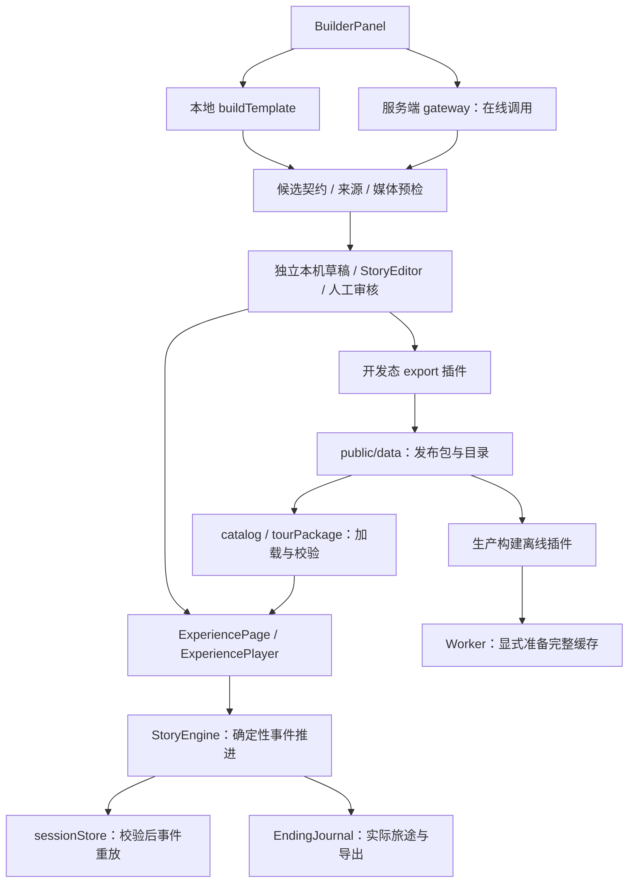

# 时空漫游者｜本地开发交接文档

交接日期：2026-10-12（北京时间）。面向换到本地环境的开发者、设计/内容负责人，以及接手的编码助手。

**2026-10-15 最新增量：[23-Agent研究与演示成果交接](23-Agent研究与演示成果交接.md)。**当前已加入 Tavily 研究、Studio 自动恢复/成果导入导出和 `npm run agent:rehearse`。最新基线为 112 项测试、build、lint 及七套浏览器验收通过；真实模型/搜索成功产物仍需配置凭据后生成。下文旧的“未接研究/无 Studio”及测试数量为历史记录。

**最新任务分发入口：[22-现状调研与后续开发分工](22-现状调研与后续开发分工.md)。**2026-10-14 已独立复验 `5fc4b56`：81 项测试、lint、build 与六套浏览器验收全部通过。后续以快速可用、有演示效果为目标，主线是真实概念→节拍→编译→独立草稿；素材署名与许可复核不列入本轮任务或门槛。下文历史任务与此冲突时，以 22 为准。

**2026-10-14 更新：**当前继续开发入口为 `feature/timewalker-dual-samples`，基于 `af9d278` 的双样板资料包。创作链路三个问题已修复；后续阶段、实际验证与尚未完成项见 [21-双样板落地与交接](21-双样板落地与交接.md)。下文早期提交、测试数量和任务建议是历史基线，新环境接手优先采用最新阶段记录。

V2-01 已实现：可选展示配置贯通草稿、编辑审核、发布、播放器、首页与 SVG/文字记录。开发验收新增 `npm run test:creator`，浏览器工具配置与其他套件一致。

媒体打包已扩展至故事块图片和预制音频，引用替换到 assets；原始静态大图保持不变，发布副本可压缩。新 Agent 采纳与真实供应商链仍未实施，详见 21 的分阶段边界。

V2-02/03 的可运行天文馆样例已交付：`/experience/shanghai-planetarium`，同一引擎两种讯号解读，室内手动展区、艺术配图与航行记录。固定离线包已扩大为豫园＋天文馆（约 6.6 MiB，20 MiB 上限不变）。最新验收为 78 项 Node 测试及六套浏览器检查；新增 `test:dual`。新模型 Agent 流水线尚未实现，不能将手工样例/生成插画当成 Builder 真实生成证据。当前实际状态与下一条任务优先看 21 文档。

本文以代码与实际验收为准。**当前分支为 `feature/timewalker-dual-samples`，V2 起点为 `af9d278`，拉取远端最新 HEAD。**`40ab602` / `016b206` 是首轮交接历史，不是最新实现。

## 1. 先知道这五件事

1. **不要只克隆 `main` 开始开发。**交接时远端 `main` 仍为 `6eea7efe3e30d05dcf0eece083060e43dc119d20`，没有后续实现；最新开发分支包含完整前端、网关、离线包与文档。尚未合并到 `main`。
2. 样例已经能玩完：选择自然/匠心视角、观察照片细节、记录个人感想、得到并下载手账。下一步是在此基础上打磨和扩展，不是重新搭建项目。
3. 无密钥也能开发主线：故事和本地模板 Builder 不依赖地图/模型。在线模型接口已写好，真实供应商成功调用与效果尚未验证。
4. 位置是模拟到站，照片是样例，观察是人工确认；没有在线视觉识别、故事实地 GPS 验证或历史画面重建。家书与人物对白明确属于文学创作。
5. 浏览器数据、云端依赖目录和启动进程不会随 Git 自动迁移。本地需重新安装、启动、检查；有价值的草稿、发现和手账须另外保存。

## 2. 背景、产品方向与目标

### 2.1 项目如何走到这里

这是参加 Trip.com Hackathon 的项目。原仓库是景点导览原型：高德地图、地点讲解、发布后台和内容生成。最初的景点列表与讲解播放器缺乏足够强的参与感，后续设计选择将它发展为以沉浸故事为主、轻量探索为辅的产品。

两种定位已经结合：

- **对游客：时空漫游者 · 让世界成为你的故事。**重点是情绪记忆、主动观察、少量有回响的选择。
- **对技术/内容方：Trip Experience Engine · 智能旅行体验引擎。**重点是可执行体验包、确定性编排、辅助起稿、人工编辑审核与内容复用。

Builder 是创作入口，不是第三个独立产品。不要为了技术答辩把产品变成多 Agent 管理面板；游客应首先体验故事。

### 2.2 当前旗舰样例

《一封穿越四百年的家书》以豫园为场景，使用虚构家书串联园林故事。

```text
prologue：序幕／三穗堂
  → rockery：大假山，选择山林野趣或匠心造景
  → jade-nature 或 jade-craft：玉玲珑，两种不同讲述
  → 人工观察：标照片细节／记一句话／也可直接确认
  → epilogue：点春堂
  → 手账：实际章节、选择、发现、称号、下载／文字分享
```

包里有 5 个场景记录，一次实际经过 4 个场景、4 个地点；不能把未走的分支计入用户实际旅程。自然/匠心不是对错题，也不是人格判断。

### 2.3 下一阶段的目标

| 层级 | 目标 | 判断是否达成 |
|---|---|---|
| 产品目标 | 游客愿意参与，并能带走一份自己的发现 | 分支有不同正文，观察不只是点完成，结局展示真实输入 |
| 开发目标 | 内容可编辑、替换，播放器可复用 | 新候选稿使用同一契约与引擎，无另写故事页面 |
| 演示目标 | 五分钟展示游客闭环与内容生产 | 双分支之一、观察、手账、Builder/技术段落能按时展示 |
| 质量目标 | 外部服务坏掉仍能完成固定样例 | 缺图/语音失败可读完；已准备的离线包断网可刷新继续 |
| 真实性目标 | 所说能力都有代码/验收或明确规划状态 | 不把模板说成真实 AI，不把模拟点击说成实地定位 |

当前优先级是交互体验、可玩性和稳定答辩。真实 GPS、开放视觉、AR、实时语音、多智能体、商业化接口不进入当前主线的必做项。

## 3. Git 交接与版本记录

仓库：[melxy1997/hackathon-trip-guide](https://github.com/melxy1997/hackathon-trip-guide)。交接时已推送并核对远端开发分支；工作区无未提交代码。

| 提交 | 内容 | 对应分支 |
|---|---|---|
| `6eea7ef` | 原设计文档基线 | `main` |
| `006b120` | 契约、引擎、游客故事、首轮验收 | `feature/timewalker-m1` |
| `2568062` | Builder、人工审核、服务端模型网关 | `feature/timewalker-m2` |
| `ee5d7ae` | 个人观察、分支回响、手账保存分享、移动交互 | `feature/timewalker-playability` |
| `40ab602` | 首轮离线演示包、真实 Worker 测试、答辩内容 | `feature/timewalker-offline-demo` |
| `af9d278` | V2 双样板与服务接入资料 | 原 `feature/configurable-observation-hints` 基线 |
| `a417cb9` | 发布断点、图出口、复制 ID 修复 | `feature/timewalker-dual-samples` |
| `97997e9` | 展示配置贯通编辑发布与记录 | `feature/timewalker-dual-samples` |
| `abd173d` | 故事图片/音频打包与发布副本压缩 | `feature/timewalker-dual-samples` |
| 后续提交见最新 HEAD | 天文馆样例、双主题离线与回归 | `feature/timewalker-dual-samples` |

提交是连续演进的；最新分支已包含前面成果，不需要再次依次 cherry-pick。上述是 Git 分支/提交，不代表已经创建 PR、合并或部署网站。

新机器：

```bash
git clone --branch feature/timewalker-dual-samples https://github.com/melxy1997/hackathon-trip-guide.git
cd hackathon-trip-guide
git status --short --branch
git log -5 --oneline
# 从最新交接分支继续，另开自己的开发分支
git switch -c feature/timewalker-next
```

已有本地仓库：先 `git status` 保留已有修改，再 `git fetch origin`，检查是否已经有同名本地分支。不要直接 reset/clean 或覆盖别人的工作。可从 `origin/feature/timewalker-dual-samples` 建新分支继续。

## 4. 本地安装和启动

### 4.1 工具链

- Node.js **24**，之前实测 `24.19.0`；npm 实测 `11.9.0`。
- React 19、Vite 8、TypeScript 6、Tailwind CSS 4、React Router 7、oxlint；准确依赖版本由锁文件固定。
- 服务端为 Node 内置 HTTP，直接运行 `.ts`；单元测试使用 Node 内置 `node:test`，不是 Jest/Vitest。
- Playwright/Chromium 是可选的浏览器验收工具，**没有加入项目依赖**。
- 不需要数据库、Docker 或外部对象存储就能运行当前样例。

首先检查 Node 版本。不要在旧 Node 上为了启动而把 TypeScript/运行时全改一遍。不同操作系统的实际兼容性仍需本地确认；下面 shell 命令面向 macOS/Linux 或 Windows WSL，不能原样当作 PowerShell 命令。

### 4.2 正常安装与开发

```bash
cd tour-hub-web
node --version
npm --version
npm ci
npm run dev:full
```

`dev:full` 启动前端 `127.0.0.1:5174` 和网关 `127.0.0.1:8787`，Vite 将 `/api` 代理到网关。前端使用严格端口，冲突时会失败；先确认已有服务归属再关闭，不要随意杀进程。

- `npm run dev`：仅前端，故事和本地模板可用；需要在线接口的操作会失败。
- `npm run dev:api`：仅网关。
- `npm run build`：前端、服务端和测试类型检查，并生成 `dist`。
- `npm run preview`：预览正式静态构建，默认端口 4173；不是生产鉴权发布服务。

本地浏览器从终端给出的地址打开。路线：`/` 首页、`/experience/yuyuan-timewalker` 样例、`/publish` 创作后台、`/tour/yuyuan` 旧地图导览。`?director=1` 仅开启演示控制台；`?preview=1` 读取当前浏览器中相同 ID 的草稿，不能在另一浏览器凭 URL 访问别人草稿。

### 4.3 企业 npm 镜像不可达时

锁文件中有 `artifactory.release.ctripcorp.com` 下载地址。公网机器上，仅设置 `npm --registry` 不一定替换锁文件已经固定的 `resolved`。**保留项目锁文件、版本和 integrity，不要改校验值或关闭 TLS 校验。**

已验证的回退机制：在仓库外复制清单/锁文件，只替换企业下载地址前缀，然后安装并链接依赖。下面为适配本地路径的同等步骤；仅在本项目没有现成 `node_modules` 时执行，临时目录被系统清理后需重新安装：

```bash
# 当前目录必须是 tour-hub-web；在子 shell 中执行，失败即停止
(
  set -eu
  if [ -e node_modules ] || [ -L node_modules ]; then
    printf '%s\n' '请先保留并检查现有 node_modules，不自动覆盖。' >&2
    exit 1
  fi
  app_dir="$(pwd)"
  deps_dir="$(mktemp -d "${TMPDIR:-/tmp}/timewalker-deps.XXXXXX")"
  node --input-type=module - "$app_dir" "$deps_dir" <<'JS'
import fs from 'node:fs';
import path from 'node:path';
const [source, target] = process.argv.slice(2);
fs.copyFileSync(path.join(source, 'package.json'), path.join(target, 'package.json'));
const lock = JSON.parse(fs.readFileSync(path.join(source, 'package-lock.json'), 'utf8'));
const oldPrefix = 'https://artifactory.release.ctripcorp.com/artifactory/api/npm/trip-npm-prod/';
for (const pkg of Object.values(lock.packages)) {
  if (pkg.resolved?.startsWith(oldPrefix)) {
    pkg.resolved = pkg.resolved.replace(oldPrefix, 'https://registry.npmjs.org/');
  }
}
fs.writeFileSync(path.join(target, 'package-lock.json'), JSON.stringify(lock, null, 2) + '\n');
JS
  npm ci --prefix "$deps_dir" --registry=https://registry.npmjs.org --no-audit --no-fund
  ln -s "$deps_dir/node_modules" "$app_dir/node_modules"
)
```

旧云环境使用 `/workspace/.trip-guide-deps/node_modules` 链接。这是环境实现细节，不是项目必要路径，也不需要复制到新机器。不要把该绝对路径写入本地 Vite 配置。

### 4.4 凭据：哪些必需、哪些可选

| 配置 | 用途 | 当前是否必需 |
|---|---|---|
| `VITE_AMAP_KEY`、`VITE_AMAP_SECURITY_CODE` | 浏览器高德地图 | 仅旧地图/地点编辑相关功能需要 |
| `DEEPSEEK_API_KEY` | 服务端在线模型调用 | 仅在线起稿、在线问答/生成需要 |
| `DEEPSEEK_BASE_URL` | 兼容接口的 HTTPS base URL | 默认 `https://api.deepseek.com/v1` |
| `DEEPSEEK_MODEL` | 模型名称 | 默认 `deepseek-chat` |
| `WEB_ORIGIN` | 允许的浏览器来源，逗号分隔 | 自定义前端域名/端口时检查 |

需要地图时，将 `.env.example` 复制为 `.env.local`；需要模型时，将 `.env.server.example` 复制为 `.env.server.local`，在本机安全填写。两类文件均被忽略，改配置后重启对应服务。`WEB_ORIGIN` 是实际网页 Origin，包括协议和非默认端口，不能填任意路径。

模型私钥不能用 `VITE_` 前缀；`VITE_DEEPSEEK_*` 已弃用。云平台的凭据代理绑定/配置草稿不会自动迁移成本地环境变量，不要复制占位绑定值当作真实 key。交接没有提供或提交任何真实模型私钥。

只需试玩时不要等待密钥。`GET /api/health` 返回 `ok` 与 `modelConfigured`；后者只表示配置存在，不代表模型连通。没有配置时在线模式明确报 `MODEL_NOT_CONFIGURED`；模板仍正常。

## 5. 新机器第一次验收

### 5.1 必须先跑的检查

```bash
npm test
npm run build
npm run lint
```

最新（2026-10-14）云环境证据：78 项 Node 测试通过，0 失败/跳过；构建通过；lint 无警告。文档 04/05 中的 39/50、前期 58/71 是历史里程碑，不是测试丢失。**这些证据不等于新机器已验收，迁移后要实际再跑。**

### 5.2 五分钟人工启动检查

1. 启动 `dev:full`，首页能加载目录与照片。
2. 打开样例，默认静音，完成一个分支，留感想，确认后刷新，最终到手账。
3. 下载 SVG，打开确认个人文字；再玩另一个分支，称号与正文确实变化。
4. 打开 `/publish`，用本地模板生成候选，采用成独立草稿，编辑旁白并预览；确认没有误修改原样例。
5. 无模型凭据时，在线尝试应明确失败且保留输入/上一稿，不能显示伪成功。
6. 检查 `git status`。人工点击开发态发布会真实写入 `public/data`；不要把测试内容误提交为正式种子。

### 5.3 浏览器自动验收：本地工具安装

不要照搬云环境中的 `/opt/codex/...` 或 `/usr/bin/chromium`。在仓库外安装 Playwright 后通过环境变量指定，避免更改应用依赖/锁文件。以下是本地准备方式，需要网络下载；它不同于已验证的云端预装工具路径：

```bash
browser_tools_dir="$(mktemp -d "${TMPDIR:-/tmp}/timewalker-browser.XXXXXX")"
npm install --prefix "$browser_tools_dir" --no-save playwright
"$browser_tools_dir/node_modules/.bin/playwright" install chromium
export TIMEWALKER_PLAYWRIGHT_MODULE="$browser_tools_dir/node_modules/playwright/index.mjs"
unset TIMEWALKER_CHROMIUM
# 开发服务已在另一终端通过 dev:full 启动
npm run test:smoke
npm run test:builder
npm run test:playability
npm run test:creator
npm run test:dual
# 离线套件独立启动临时静态服务器；先有最新正式构建
npm run build
npm run test:offline
```

如果已有可用 Chromium，可设置 `TIMEWALKER_CHROMIUM` 为本机实际可执行路径，不要填不存在的云端路径。Linux 若缺浏览器系统库，按 Playwright 安装指引处理；Windows 原生需要用相应 shell 配置变量，并另设合适输出目录。

开发态浏览器套件默认访问 `http://127.0.0.1:5174`，可用 `TIMEWALKER_BASE_URL` 修改。它们适配开发流，尤其 Builder 的未配置网关断言，不建议直接对已填真实模型密钥的环境执行。离线套件不使用这个 base URL，而是自行启动/关闭服务器。

测试输出用 `TIMEWALKER_TEST_OUTPUT` 指定；默认分别在 `/tmp/timewalker-smoke`、`/tmp/timewalker-builder-smoke`、`/tmp/timewalker-playability`、`/tmp/timewalker-offline`。同一输出目录避免不同套件并发写入覆盖。

| 套件 | 关键验证 |
|---|---|
| `test:smoke` | 五次双分支、刷新、缺图/语音失败、编辑预览、导演真实性、旧包回归 |
| `test:builder` | 模板与无配置失败、取消过期响应、独立草稿、审核重置、图错误提示、发布请求、生成故事双分支 |
| `test:playability` | 触摸/键盘标记、窄屏、静音重播、焦点、个人输入恢复、下载、受控分享/剪贴板失败 |
| `test:offline` | 真 Worker、损坏素材/回滚/更新、源站不响应时豫园五轮＋天文馆双分支、下载、缓存清理 |
| `test:creator` | 旧导览、本机地点起稿、主题重审、图出口、实际天文馆媒体打包与预览 |
| `test:dual` | 首页双主题、天文馆起点/终点分支、画面失败、回信与刷新、蓝色卡片下载 |

Builder 浏览器测试拦截发布请求，不写种子；真实发布写文件测试在临时 Vite 根目录中执行。分享/剪贴板和模型响应部分使用受控模拟，不向第三方发送个人记录，也不证明真实模型质量。

## 6. 当前架构与关键代码入口



以下路径均相对仓库根目录：

| 路径 | 接手时看什么 |
|---|---|
| `tour-hub-web/src/App.tsx`、`pages/` | 路由、首页、故事、创作/旧导览 |
| `src/lib/tourPackage.ts`（应用内） | 根包契约、媒体解析、旧包兼容 |
| `src/experience/experienceSchema.ts` | 运行时权威契约与图校验 |
| `src/experience/events.ts`、`storyEngine.ts` | 事件类型、观察边界、阶段、token、动作执行 |
| `src/experience/useStory.ts`、`sessionStore.ts` | React 包装、接受事件持久化、恢复 |
| `src/experience/useNarration.ts` | 静音默认、语音/音频、失败回退、过期回调 |
| `src/experience/components/ExperiencePlayer.tsx` | 舞台、进度、模拟到站、分支/发现回响、焦点 |
| `components/ObservationCard.tsx`（experience 内） | 归一化标记、键盘移动、120 字感想、人工确认 |
| `journey.ts`、`components/EndingJournal.tsx`（experience 内） | 真实记录、称号、安全 SVG、分享回退 |
| `builder.ts`、`builderDraft.ts`、`components/BuilderPanel.tsx`（experience 内） | 模板、候选验证、采用、取消/过期保护 |
| `components/StoryEditor.tsx`（experience 内） | 章节/分支/来源编辑、校验、审核、预览 |
| `src/lib/draftStore.ts`、`src/types/attraction.ts` | 本机草稿、媒体打包、审核重置、发布 |
| `src/lib/modelApi.ts`、`server/gateway.ts`、`server/index.ts` | 客户端超时、受限请求、服务端凭据、错误处理 |
| `vite-plugin-export-to-display.ts` | 开发态写文件，不是正式生产发布 |
| `vite-plugin-offline-demo.ts`、`offline/worker.js`、`src/offline/` | 生产文件摘要清单、缓存提交/回滚、准备 UI |
| `src/experience/__tests__/`、`server/__tests__/`、`scripts/smoke-*.mjs` | 已有验证入口 |

表中省略前缀的 `src/...`、`server/...`、`vite-...` 均在 `tour-hub-web/` 下，不是仓库根目录同名文件。

### 6.1 必须保持的设计约束

- 根发布包 `schemaVersion: 1`，可选 `experience.schemaVersion: 1`。旧 `yuyuan.json` 没有故事仍可打开旧导览，不要强制把所有旧包改成故事包。
- 动作白名单仅 `setVar/revealMemory/goTo`；不执行字符串脚本。引用、变量、来源、素材、可达性、结局都要验证；当前拒绝所有循环路径。
- 确定性引擎管理真实完成情况；必选互动不会被“跳过”自动选择。不要用模型回复直接写 completed。
- 章节事件绑定当前 `sceneId` 和播放 token，防重复/过期媒体回调、连点与导演跳幕污染。
- 检查点以合法事件重放恢复，不信任任意序列化变量；包发布时间/内容指纹不匹配时不复用旧进度。改种子故事可能让原有本机进度重新开始。
- 观察仍是 `method: manual`。标记 x/y 成对、有限、0–1；无图可只留非空文字，不造坐标；感想最多 120 个 JS 字符单位。未确认的标注不是已保存事件。
- 旁白默认关闭；重播不能擅自打开声音。用户应随时能阅读后继续，不能依赖声音才能通关。
- 候选验证只允许所选资料包中的地点/素材及已知来源；结构校验不证明历史事实或授权。Builder 新稿必须审核，修改内容会重置审核；无审核元数据的旧草稿保留兼容路径。
- 旅途称号/进度只来源于实际接受事件；导演跳幕在手账中标注，不凭空发放观察或选择。
- 手账 SVG 不含外链图片/字体、脚本或 `foreignObject`，个人文本作 XML 转义。别为了美化直接插入未转义感想。

### 6.2 网关接口与限制

已实现 `GET /api/health`，以及 `POST /api/builder/draft`、`/api/draft/spots`、`/api/scene/ask`。没有 `/api/vision/observe`、生产发布 API 或登录 API。

网关包含已知包 ID 约束、输入大小/类型校验、HTTPS 供应商地址约束、Origin 检查、IP 限流、模型并发限制、超时/断开取消、返回错误脱敏。浏览器通过同源 `/api` 调用，不直接请求模型带私钥。**这些限制不是管理员身份认证，也不让 loopback 服务自动成为可公开暴露的生产网关。**

旧导览节点生成失败显示本地占位模板（坐标需校准），问答失败显示现有讲解摘录，不冒充模型回答。真实在线起稿质量、耗时、输出格式兼容需有凭据后单独实测。

## 7. 已完成、尚未完成与验证边界

| 模块 | 已有 | 尚未完成/未验证 |
|---|---|---|
| 故事运行 | 双分支、模拟站点、token、防重复、跳过/重播、导演 | 故事实地 GPS、现场路线精度 |
| 探索交互 | 样例图标记、分类、感想、纯文字/直接确认回退 | 相机上传、受控视觉识别、开放场景理解 |
| 手账 | 实际路线/选择/发现、称号、SVG 下载、文字分享/复制回退 | PNG、云分享链接、跨设备同步、历史旅程库 |
| Builder | 本地模板、在线网关、验证、取消、独立草稿 | 真实供应商成功/效果、自动资料检索、多 Agent |
| 编辑器 | 旁白/选项/说明/地点/图片/来源/跳转、连接表、审核预览 | 场景增删、复杂条件可视化、拖拽故事图 |
| 发布 | Vite 开发态写本地文件，失败可下载包 | 身份鉴权、服务端审核审计、事务回滚、正式存储 |
| 离线 | 固定样例显式准备、SHA-256、完整标记、回滚、刷新 | 任意自建包离线、离线地图、安装式 PWA |
| 媒体/体验 | 实景图、文字、浏览器旁白、基础入场动效、窄屏键盘支持 | 高质量历史艺术画面、统一预录音效、真实手机体验评测 |
| 答辩 | 八页内容、逐字脚本、技术图、能力/证据表、截图 | PPTX 导出、录屏、团队人工五分钟计时 |

最重要的内容欠账：`public/spots/ATTRIBUTION.md` 只有笼统 Wikimedia 说明，四张图的原作者、原图 URL、准确许可仍待补齐；`public/experience-assets/yuyuan-timewalker/asset-manifest.json` 明确是 pending。官方来源引用也不代表已经完成逐句核验。不要把这些项标成已审校。

## 8. 迁移时要带走哪些数据

### 8.1 Git 已包含的资源

代码、设计文档、样例包、四站素材、资产清单、可见截图和测试脚本都随分支迁移。运行时种子为 `tour-hub-web/public/data/attractions/yuyuan-timewalker.json`，目录为 `public/data/catalog.json`；`examples/` 是设计例子，不是前端加载路径。

### 8.2 Git 不包含的内容

- 未发布草稿：浏览器 `localStorage` 的 `trip-guide:drafts:v1`。
- 旅途检查点：`timewalker:session:v1:{packageId}`；样例实际键为 `timewalker:session:v1:yuyuan-timewalker`。故事内部 experience ID 是 `yuyuan-letter-demo`，不要混用两种 ID。
- 已下载的个人 SVG/分享文本、`/tmp` 中测试输出。
- `.env.local`、`.env.server.local`、操作系统浏览器权限与语音设置。
- `node_modules`、`dist`、云环境配置草稿及存活进程。
- 已准备的 Cache Storage：按来源和浏览器隔离，不能只把缓存名复制到另一个 Origin 使用。

有需要时，先主动下载手账；草稿可在原浏览器开发者工具中将准确的草稿存储键值保存为私有 JSON 备份，再在新环境相同应用内谨慎恢复。当前没有承诺完备的草稿导入/导出 UI。备份可能包含图片数据和个人文字，不要提交 Git 或上传给第三方。不要导出整个 localStorage/浏览器配置或混入凭据。

不同协议、主机名和端口是不同 Origin；`localhost:5174`、`127.0.0.1:5174`、`127.0.0.1:4173` 不共享草稿、进度和缓存。新机器第一次故事从开场开始是正常现象；旧检查点即使拷贝过来仍须通过内容指纹和事件校验。

## 9. 离线、部署与发布的特别注意事项

离线仅在 `npm run build` 的产物启用；开发模式按钮禁用，避免缓存 HMR。两个固定样例合计约 6.6 MiB、15 个文件，具体随构建变化；包上限 20 MiB，样例外链媒体会阻止构建。

```bash
npm run build
npm run preview -- --host 127.0.0.1 --strictPort
# 打开首页/样例，点准备，看到已准备，然后刷新并断网验收
```

静态部署上传整个 `dist`，使用 HTTPS、域名根路径、SPA HTML 回退；`/offline-worker.js` 必须返回 JS、允许更新检查，不能回退成 HTML。不要在本轮自行假定支持子路径部署。

就绪后固定清单内文件缓存优先，保证同版本一致。更新构建后重新检查、准备、刷新；只修改已部署 JSON 可能与 Worker 摘要不一致，需重新构建整套产物。浏览器清理了一张缓存图也会导致未准备。清除素材只删本应用缓存，不删个人记录。

静态站点不包含模型服务或开发态发布中间件。在线功能需单独部署网关与同源反代，正式发布需补生产能力。**下载一份 JSON 不等于更新网站；构建成功/推 Git 也不等于已部署。**

## 10. 资源文档阅读顺序

| 顺序 | 资源 | 用途 |
|---|---|---|
| 1 | [根 README](../../../README.md) | 命令与入口概览 |
| 2 | [06-交互体验与可玩性](06-交互体验与可玩性.md) | 最近游客行为、兼容数据、测试证据 |
| 3 | [07-离线演示与验收](07-离线演示与验收.md) | Worker/构建契约、部署限制、现场清单 |
| 4 | [05-M2实现与验收](05-M2实现与验收.md) | Builder、审核、网关、密钥与发布边界 |
| 5 | [08-五分钟答辩讲稿](08-五分钟答辩讲稿.md) | 当前八页内容、逐字脚本、真实能力口径 |
| 6 | [01-技术设计](01-技术设计.md) | 总体设计与拓展方向，包含未实现方案 |
| 7 | [03-开发任务拆解](03-开发任务拆解.md) | 原任务编号、依赖和验收目标，估算非实际工时 |
| 8 | [02-答辩产品说明](02-答辩产品说明.md) | 产品原始思路，不直接当完工陈述 |
| 9 | [04-首轮实现与验收](04-首轮实现与验收.md) | M0/M1 决策与历史演进 |

更多入口：

- [运行时种子](../../../tour-hub-web/public/data/attractions/yuyuan-timewalker.json)、[旧导览包](../../../tour-hub-web/public/data/attractions/yuyuan.json)、[资产审校清单](../../../tour-hub-web/public/experience-assets/yuyuan-timewalker/asset-manifest.json)。
- [设计示例包](../examples/yuyuan-timewalker.package.json) 与 `tools/validate-experience.mjs` / `tools/simulate-experience.mjs` 为原始设计辅助工具；**当前运行时权威是应用 schema/engine**，不要只改旧模拟器来让验收通过。
- [内容生产 Skill](../../../.cursor/skills/trip-guide-content/SKILL.md)：创作/扩充真实地点内容前阅读，用户授权和实际项目范围优先。
- 截图：[Builder](../../screenshots/timewalker-builder.png)、[观察](../../screenshots/timewalker-observation-mobile.png)、[手账](../../screenshots/timewalker-journal-card.png)、[离线准备](../../screenshots/timewalker-offline-ready.png)。
- 原讨论上下文：[黑客松项目创意设计](chatgpt-conversation://6ac9fd26-9334-83ec-a18a-a8c8eb441d53)。不用依赖能访问这条对话才能开发，落地决策已在仓库内。

原设计与实现发生冲突时，用最新实现记录、运行时契约和测试判断。例如原方案有视觉识别/完整时间轴，也提到未选择可能默认分支；当前没有视觉识别，必选互动必须由用户选择。不要按早期设想反向“修坏”已验证行为。

## 11. 最新下一步与历史实施建议

**当前下一项：**独立 Agent 候选验证与草稿采纳，再接真实两概念→节拍→编译、Job/受控素材注册与 Studio。按 [21 的当前状态表和纵向任务](21-双样板落地与交接.md) 推进。下列 0–6 步保留首轮计划和人工验收建议，已完成代码项无需再实现。

以下是交接后的建议顺序与可执行任务，不代表新增 GitHub Issues 已创建，也不代表团队人员已分配。时间为粗估，不含供应商等待/美术制作；现场截止时间未知，接手后应按余量缩减。

### 第 0 步：建立本地可重复基线（先做，约 1–2 小时）

按第 3–5 节拉分支、启动、跑三项必需检查与四个浏览器套件。记录 OS/Node/浏览器、测试结果和首次完整试玩感受。保存有价值草稿，检查 Git 无意外变化。没有本地基线前不要同时升级依赖、重构引擎和改样例内容。

退出条件：两种分支可完成，模板可起稿采用，正式构建离线可刷新；失败项有明确诊断。若真实模型未配，把它标为未验证，而非阻塞整条主线。

### 第 1 步：完成内容与真机检查（P0，内容 + 体验负责人）

对应 TW-002 / TW-302 / TW-402，约 0.5–1 人日加实机彩排：

1. 为四张图补齐原图 URL、作者、许可、所需署名；查不到就替换为有明确权利的素材，并更新资产清单。
2. 对每句事实核对来源、摘录/位置与复核人；虚构内容保留文学创作标签，不将官方链接当万能事实保证。
3. iOS/Android 真机各走双分支：点按面积、软键盘、顶部控件、标记位置、焦点、长文字、声音开关、下载/分享和断网刷新。
4. 人工五分钟计时，找一两位不了解项目的人观察他们是否理解下一步；这是小样本反馈，不包装为业务增长。

产物：审校记录、更新后的 asset manifest、真机问题列表和计时结果。验收：无未说明的事实/版权缺口；阻塞体验的问题修复，剩余限制在答辩中明确。

### 第 2 步（代码已完成，历史记录）：可配置观察提示（P1，约 0.5–1 人日）

理由：当前 `ObservationCard` 的提示固定为通用文案。让不同故事告诉游客“这一幕值得留意什么”，能提升可玩性和创作者复用，且不需要先接视觉模型。保持没有标准答案、不强制命中热点。

**实现状态（2026-10-12）：**已在 `feature/configurable-observation-hints` 完成代码、样例、编辑器与自动化断言，详见 [10-开发日志-可配置观察提示](10-开发日志-可配置观察提示.md)。Node 测试、构建、lint 和两条路径的文档模拟已通过；受本机无 Chromium 限制，浏览器自动化与真机验收仍须补跑。以下设计与验收标准保留作为实现说明。

**已实现设计：**在 `photo_or_tap` 互动中加入可选 `prompt` 与 `hints`，支持一句主提示、最多 3 条轻提示；`prompt` 上限 240、单条 `hint` 上限 80 字符，旧包省略时保持原有默认文案。

实现拆分：

1. `experienceSchema.ts` 扩展类型与边界校验，不改已有事件语义；旧包必须继续合法。
2. `ObservationCard.tsx` 接收提示，提示可按需展开，避免覆盖照片或挡住确认；保留键盘/纯文字/直接确认路径。
3. `ExperiencePlayer.tsx` 从当前互动传入提示；自然/匠心分支可有不同观察侧重。
4. `StoryEditor.tsx` 提供主提示/轻提示编辑，改动触发已有审核重置。
5. `builder.ts` 为模板填合理提示；在线 prompt/示例结构同步更新，但不凭空扩增真实资料。
6. 更新样例与文档，说明内容指纹变化会重置旧样例进度；重新构建离线包。

验收：旧包默认不变、新两分支显示不同提示、编辑预览一致、非法/过长提示被拒、改内容需重审、手机提示不挡交互、缺图与断网仍到结局。新增针对这些风险的测试，运行相关 schema/Builder/可玩性/离线检查。

### 第 3 步：视觉与声音统一（TW-302，P1，代码阶段已完成）

**实现状态（2026-10-12）：**通用播放器已完成真实旁白播放反馈、段落阅读层级、轻量场景/背景过渡和减少动画回退，详见 [11-开发日志-视觉与声音一致性](11-开发日志-视觉与声音一致性.md)。三套开发态 Chromium 验收及正式离线套件已通过，覆盖两种视角、跨幕、静音重播、媒体失败、320/390px 与减少动画。未新增媒体素材；真机系统音色、音量和 iOS/Android 视觉质感仍须人工验收。

先做阅读节奏与轻量转场，再考虑历史艺术图/短片。预录旁白或音效必须有授权/原创标注，能在正式离线构建中校验和缓存。媒体失败时仍有文字和手动继续；减少动画设置不触发大幅动效；重播仍尊重静音。

落点：`useNarration.ts`、`experience.css`、播放器、样例 block 与资产清单；不要给每个故事做专属逻辑。验收：两种视角、跨幕、重播、跳幕、媒体失败与窄屏均稳定；真机音色/音量合格。高质量艺术画面属于创作，不冒充史料。

### 第 4 步：真实模型验证（TW-203 后续，条件具备时，约 0.5 人日）

安全配置服务端凭据，实测线上一次成功和一次失败/超时；记录供应商/模型、请求耗时、结构通过/拒绝、人工修改点。检查 POI/素材/来源没有越界、取消不覆盖上一稿，目标时长不夸大。

保持模板兜底。新增 Vision 必须单独确定支持图像的供应商/模型与数据边界，不能默认 `deepseek-chat` 就能看图；这一步尚无相机上传协议。TW-301 是后续受控目标，不应先做任意城市开放识别。

### 第 5 步：封板答辩（TW-403，P0，约 0.5–1 人日）

将 08 文档排成八页实际幻灯片，替换为当前截图，录制清楚标为备份的演示视频；按团队分工彩排。准备主/备用浏览器各自的离线包，重置开场，选择固定稳定版本。测试数字附环境与日期；不展示未验证模型延迟或业务增幅。

退出条件：团队人工完整演示不超五分钟，内容生产段落未被挤掉，网络/旁白故障时仍知道怎么继续，所有“已实现”陈述有证据。

### 第 6 步：确实需要正式发布时再做（TW-404）

当前开发态发布没有用户鉴权、请求体上限和跨包/目录事务，客户端审核状态也可被用户修改。正式服务需要管理员认证授权、服务端复验/审核审计、素材配额、文件名/路径限制、原子提交与回滚、持久存储及发布版本策略。不要仅把 Vite 监听改为公网就宣称生产发布完成。

该任务规模取决于认证/存储选型；原任务的人日只是黑客松估算。上线范围、托管服务和账号来源明确后再拆。新增后端必须有未授权拒绝、恶意路径/超限输入、失败回滚、最新内容读取等验收。

## 12. 常见问题速查

| 现象 | 先检查 |
|---|---|
| 克隆后没有新故事/Builder | 是否还在 `main`；查看分支和提交 |
| npm ci 连接企业域名失败 | 锁文件 resolved，按第 4.3 节外部安装，不重写仓库锁 |
| `.ts` 运行/类型检查失败 | Node 是否为 24、依赖是否冻结安装，不混入旧 Node 的行为 |
| 5174/8787 被占用 | 是否已有同项目服务，关闭自己启动的 launcher；别只杀一个子进程 |
| 接口成功率/健康字段“配置=true”却不能起稿 | 供应商地址、模型、权限/余额、网络；health 不测真实成功 |
| 换浏览器后草稿不见 | Origin 与浏览器存储隔离，不是草稿已经发布 |
| 修改种子后刷新从头开始 | 内容指纹/包版本不匹配，属于保护逻辑 |
| 预览显示没有这份草稿 | 预览 ID 与本机草稿不匹配，或换了 Origin |
| 发布后站点没变化 | 是否只有 JSON 下载、是否静态部署、是否需重新构建/发布、是否旧离线缓存 |
| 开发模式不能准备离线 | 按设计，仅正式构建启用 |
| 离线按钮失败或 Worker 注册失败 | HTTPS、worker MIME、路由回退、混合构建、存储额度、浏览器限制 |
| 标记消失/图片坏但仍能确认 | 未确认记录不持久化；缺图保留纯文字/人工路径 |
| Playwright 模块/浏览器找不到 | 指定本机 module 路径并安装浏览器；不要用云端绝对路径 |
| 有图/来源链接就认为已审核 | 看 asset manifest 的 pending 和逐句核验记录，不靠存在性推断 |

## 13. 给下一位编码助手的启动指令

可复制以下内容，路径按你的实际本地工作区替换：

> 继续开发 melxy1997/hackathon-trip-guide 的时空漫游者。先读 docs/timewalker_hackathon/docs/09-本地开发交接.md 与 21-双样板落地与交接.md，确认包含 af9d278 并以 feature/timewalker-dual-samples 最新 HEAD 为基线，保留本地修改。使用现有 checkout，不创建额外 worktree。应用在 tour-hub-web，Node 24，开发端口 5174；先跑 npm test/build/lint 和六套相关浏览器检查，离线测试先 build。已有主题、图编辑、人工发现、SVG/文字记录、模板 Builder/审核、服务端网关、两份手工样例与固定双包离线。下一项为独立 AgentCandidate/草稿采纳及真实概念→节拍→编译链，具体依赖和验收按 21 文档。不能把手工样例和 image_gen 插画称为后端 Agent 成品，不能声称有真实视觉、GPS、已审版权或生产鉴权。模型凭据仅在服务端安全配置；预算/计费调用遵循用户授权。不要为环境问题改锁文件，不在测试中写 public/data 种子。按逻辑阶段提交推送并持续更新交接，部署/外部发布按新会话用户授权执行。
