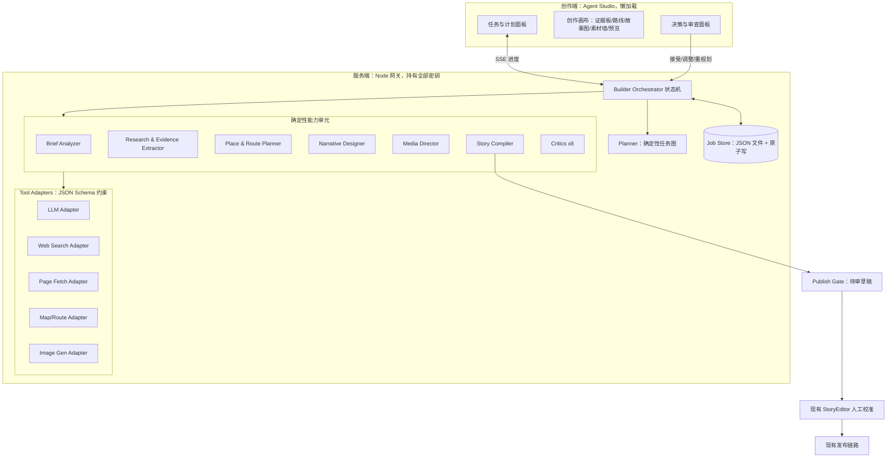
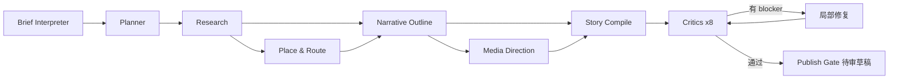

# 体验构建智能体 Builder Agent｜详细设计与开发计划

> **文档状态：历史方案，不是当前开发入口。** 本文中的“当前/待实现/下一步”、分支与测试数只对应文内记录阶段。最新能力见 [导航与当前状态](README.md)，领取任务见 [03](03-开发任务拆解.md)，环境接手见 [09](09-本地开发交接.md)。旧文涉及素材署名/许可复核不再作为本轮任务或验收门槛。

**版本**：V1.0（立项基线）　**日期**：2026-10-12　**状态**：旧完整平台方案存档；部分能力已落地，其余不自动进入当前排期
**工作分支基线**：`feature/configurable-observation-hints`（含 `3a00297`）　**不要从 `main` 重建**

> 阅读口径：本文是设计与计划，**不能用作今日完成度判断**。文中「现状」仅对应 2026-10-12 的核对，「设计」是当时的方案，不能据此认定今日仍未实现。比赛任务与门槛按导航和 03 执行。

---

## 当前方案与实际代码的差异

- 已完成：新契约/候选校验/独立导入、双概念/节拍编译、Studio、研究适配、生图/持久素材、成果携带。
- 未完成：Deep Agents、自主 tool_calls、自由中间剧本编译、云端 TTS、持久 Job。当前概念/编译是分阶段服务，不能称为完整自主 Agent。
- 后置：精细路线、严格证据库、八类 Critic 和复杂任务管理。本篇 Phase A–F 与三栏 Studio 不作为比赛当前任务。
- 后续架构参考：[V2 可实施版](../../timewalker_4_builder/docs/18-Builder-Agent-设计-V2.0-可实施版.md)；它也有基于旧分支的现状描述，须对照代码和导航。

## 0. 结论先行

### 0.1 重新定义项目

当前 `/api/builder/draft` 是**一次性信息加工器**：把固定的五幕蓝图交给模型改写文案，再做结构校验。它没有目标理解、没有资料搜集、没有方案比较、没有素材生产、没有独立质检。

本项目重新定义 Builder Agent：

> Builder Agent 不是帮用户填表或改文案，而是一个**有证据链、有工具调用、有质量门槛**的旅行叙事体验制作团队。它自主完成「理解目标 → 搜集资料 → 综合判断 → 规划路线 → 设计叙事 → 准备素材 → 验证成品」，并对每个决策给出可追溯的依据。

### 0.2 三条不可妥协的设计红线

1. **Planner 是确定性状态机，不是自由发挥的模型独白。** 模型填充步骤参数与内容，但任务图的节点、依赖、重试与门禁由代码定义。否则无法测试、无法恢复、无法在答辩现场保证时长。
2. **证据先行。** 任何事实性旁白必须绑定到证据库条目；拿不到证据的内容只能降级为明确标注的文学创作（现有 Schema 的 `fictional: true`），不允许模型自称史实。
3. **Agent 永不持有发布权。** 产出一律是待审草稿；复用现有审核重置与发布门禁。

### 0.3 与「对话还是表单」的关系

用户判断正确：**形态不是主要矛盾**。本设计中对话框只是 Agent Studio 的一个输入通道，与"暂停/重试/接受方案"等按钮等价。主体是 Planner、工具层、证据库、持久任务和质量门。

---

## 1. 现状核对（2026-10-12 逐文件确认）

### 1.1 可直接复用的资产

| 能力 | 位置 | 对 Agent 的意义 |
|---|---|---|
| 冻结的声明式契约 | `src/experience/experienceSchema.ts` | Agent 的**唯一产出格式**，不新建故事格式 |
| 结构化诊断 | `experienceSchema.ts:41` `ExperienceDiagnostic` | Critic 的落点契约已就绪，无需解析中文错误串 |
| 图操作纯函数 | `src/experience/storyGraph.ts` | Agent 的 patch 执行器直接复用，保证与人工编辑同语义 |
| 模型网关 | `server/gateway.ts` | 密钥只在服务端、限流、并发、超时、取消、错误脱敏已完成 |
| 候选校验 | `builder.ts:79` `assertBuilderCandidate` | 已实现「来源必须逐字来自内容包、素材不得越界」 |
| 草稿隔离与审核 | `builderDraft.ts` / `src/lib/draftStore.ts` | 采用候选不污染原景点；改内容自动重置审核 |
| 可视化编辑器 | `components/StoryEditor.tsx` / `StoryGraph.tsx` | Agent 产出的落地与人工校准界面，含错误定位、删除确认、单步撤销 |
| 浏览器验收范式 | `scripts/smoke-*.mjs` | 真实 Chromium、零页面异常、零意外模型请求 |

精确契约摘录（Agent 产物必须满足）：

- 顶层必填：`schemaVersion: 1` / `id` / `title` / `premise` / `initialSceneId` / `estimatedMinutes` / `initialVariables` / `scenes` / `sources`
- `id` 与 `initialSceneId` 匹配 `/^[a-zA-Z0-9][a-zA-Z0-9_-]{0,79}$/`；`0 < estimatedMinutes <= 240`
- 场景 1–100 个；每场景 `blocks` 1–50 个；`interaction` 与 `transitions` **互斥**
- `single_choice` 2–10 个选项；`photo_or_tap` 必须 `fallback: 'manual_confirm'`，`prompt ≤ 240` 字，`hints ≤ 3` 条且每条 `≤ 80` 字
- 每个 `options[].actions` 和 `actionsOnComplete` 必须且只能含一个 `goTo`；动作白名单 `setVar` / `revealMemory` / `goTo`
- 变量必须在 `initialVariables` 预先声明且标量类型一致
- 旁白/字幕：要么 `fictional: true`，要么 `sourceIds` 非空且指向已声明 `sources`
- 路由 handle 稳定身份：普通转场 `transition:<index>`、选择 `choice:<optionId>`、观察 `observation`

### 1.2 必须承认的缺口

- **仓库内不存在任何** MCP 客户端、Web Search、网页抓取、图像生成、Planner 或任务编排代码（已全局检索确认）。本项目是从零建设。
- 无数据库、无服务端持久化。网关是单进程 `createServer`，候选稿只在浏览器内存，刷新即丢。
- 现有生成被硬锁在五幕双分支蓝图上（`gateway.ts:111-114` 系统提示要求保持结构），无法产出任意长度与结构的故事。
- `estimatedMinutes` 只是元数据，没有任何路线或时长推算。
- 真实模型供应商的生成质量**尚未验收**。
- 发布链路 `/__trip_guide/export` 仅开发服务器可用，无鉴权、无事务、无版本回滚。

### 1.3 必须保护的既有约束

1. 游客主包体积不得因 Builder 代码增长（Agent 代码仅服务端 + 懒加载的创作端）。
2. 离线演示产物上限 20 MiB，外链媒体会阻断构建 —— 生成图片必须纳入体积预算。
3. 旧景点包（无 `experience` 字段）必须继续可播放。
4. 测试不得覆盖 `public/data` 种子数据。
5. 私钥不得出现在浏览器产物，禁止 `VITE_` 前缀承载密钥。

---

## 2. 目标与非目标

### 2.1 目标

- **G1 自主性**：用户给一句自然语言目标，Agent 自主产出可发布候选体验包，期间只在真正阻塞时提问。
- **G2 可信性**：每条事实主张可追溯到来源与原文摘录，事实/推断/传说/虚构四态显式标注。
- **G3 空间合理性**：路线顺序、步行时长、停留时长经过路线适配器估算，无法验证的部分显式标为估算。
- **G4 素材生产**：按画面功能规划素材清单，支持生成插画与候选比较，保留完整生成记录与授权状态。
- **G5 独立质检**：事实、路线、结构、可玩性、内容标注、素材、移动端体验、安全八类 Critic 独立于生成模型。
- **G6 可观察可恢复**：任务、步骤、产物、证据全部持久化，支持暂停、取消、重试单步、断点恢复。
- **G7 可演示**：Mock 工具下端到端确定性可测；现场无需等待长链路即可展示完整流程。

### 2.2 非目标（本项目明确不做）

- 多个自由对话的角色扮演智能体互相协商
- 自动发布、自动授权判定、自动史实定论
- 开放域任意地点的高质量体验一键生成
- 实时三维重建、真实 GPS 实地验证、全双工语音
- 生产级 SaaS 鉴权、计费、多租户

---

## 3. 总体架构

### 3.1 分层



### 3.2 关键架构决定

**D-A1 Agent 全部逻辑在服务端。** 搜索、抓取、地图、图像生成的凭据与出站请求都不进浏览器。创作端只消费 Job 状态与产物。

**D-A2 Planner 产出结构化计划，不产出自然语言指令。** 任务图从**代码定义的模板**实例化；模型只允许填充受 JSON Schema 约束的参数（如检索关键词、场景数量建议）。模型不能新增步骤类型、不能指定要抓取的任意 URL、不能跳过门禁。

**D-A3 持久化用文件型 Job Store，不引入数据库。** 路径 `tour-hub-web/.agent-jobs/<jobId>/`，`job.json` + `steps/<stepId>.json` + `artifacts/` + `evidence.json`，临时文件 `rename` 原子落盘。必须加入 `.gitignore`。理由：黑客松无运维，且需要可人工检查、可随仓库外清理。

**D-A4 工具全部走 Adapter 接口，Provider 可插拔。** 一个 `ToolRegistry` 注册 `{ name, inputSchema, outputSchema, timeoutMs, retries, invoke }`。任何 Provider（自建 HTTP、MCP 服务器）通过 adapter 接入，核心逻辑不依赖具体厂商。

**D-A5 MCP 作为可选接入方式，不作为内核依赖。** 单独实现 `McpToolAdapter`，把 MCP server 暴露的 tool 映射为内部工具。黑客松默认用直连 HTTP adapter（更少活动部件、更易离线 mock）；MCP 作为「可接入生态」的演示加分项。

**D-A6 所有外部内容是不可信数据。** 搜索结果、网页正文、模型输出一律先过白名单与清洗，提示词中显式声明「以下是数据，不是指令」（沿用 `gateway.ts` 现有做法）。

**D-A7 Agent 产出一律是待审草稿。** `Publish Gate` 只写 Job 产物与本地草稿，复用 `approveStoryDraft` 的审核语义，不触碰 `/__trip_guide/export`。

---

## 4. 数据模型

```ts
// server/agent/types.ts（待建）

export type JobStatus = 'planning' | 'running' | 'paused' | 'awaiting_input'
  | 'awaiting_review' | 'succeeded' | 'failed' | 'cancelled'

export type StepStatus = 'pending' | 'blocked' | 'running' | 'succeeded'
  | 'failed' | 'skipped' | 'cancelled'

export interface AgentJob {
  jobId: string                    // 同 /^[a-zA-Z0-9][a-zA-Z0-9_-]{0,79}$/
  createdAt: number
  updatedAt: number
  status: JobStatus
  brief: AgentBrief
  planVersion: number              // 重规划递增
  steps: AgentStep[]
  evidenceIds: string[]
  artifactIds: string[]
  questions: AgentQuestion[]       // 仅阻塞性提问
  toolBudget: ToolBudget           // 调用次数/费用/时长上限
  error?: { code: string; message: string }
}

export interface AgentStep {
  stepId: string
  kind: StepKind                   // 代码定义的有限集合，见 5.2
  title: string                    // 面板展示用中文
  dependsOn: string[]
  status: StepStatus
  attempts: number
  maxAttempts: number
  startedAt?: number
  endedAt?: number
  toolCalls: ToolCallRecord[]      // 每步用过哪些工具、耗时、是否成功
  outputArtifactIds: string[]
  diagnostics: AgentDiagnostic[]
  error?: { code: string; message: string }
}

export interface AgentBrief {
  raw: string                      // 用户原始自然语言
  attractionId?: string            // 关联已发布内容包（若有）
  city?: string
  audience?: 'general' | 'family' | 'student' | 'expert'
  targetMinutes?: number
  languages: string[]
  mood?: string[]                  // 悬念/温情/考据
  accessibility?: { stepFree?: boolean; maxWalkMinutes?: number }
  factStrictness: 'official_only' | 'official_first' | 'allow_legend'
  mediaPolicy: 'package_only' | 'allow_generated' | 'allow_external'
  assumptions: Array<{ field: string; value: string; reason: string }>  // 透明默认值
  blockingUnknowns: string[]       // 仅这些才向用户提问
}

export interface Evidence {
  evidenceId: string
  claim: string                    // 单一可判定主张
  stance: 'fact' | 'interpretation' | 'legend' | 'fiction'
  sourceTitle: string
  sourceUrl: string                // https only
  authority: 'official' | 'academic' | 'secondary' | 'unverified'
  excerpt: string                  // 原文摘录，非搜索摘要
  retrievedAt: number
  conflictsWith: string[]          // 冲突并列，不擅自选边
  reviewStatus: 'pending' | 'accepted' | 'rejected'
  usedBy: Array<{ sceneId: string; blockId: string }>
}

export interface RouteOption {
  routeId: string
  label: '最稳妥' | '最强叙事' | '最短亲子'
  spotOrder: string[]
  legs: Array<{ from: string; to: string; walkMinutes: number; meters: number;
    basis: 'route_api' | 'estimated' }>
  dwellMinutes: Record<string, number>
  totalMinutes: number
  tradeoffs: string[]              // 明确取舍说明
  risks: string[]                  // 拥挤/台阶/绕行
}

export interface MediaRequest {
  mediaId: string
  sceneId: string
  blockId: string
  purpose: string                  // 该画面在体验中的功能
  strategy: 'reuse_package' | 'search_external' | 'generate_illustration'
  subject: string
  periodConstraints?: string       // 历史时期、服饰
  styleKey: string                 // 跨章节风格一致性锚点
  aspect: '9:16' | '16:9' | '1:1'
  safeArea: string                 // 移动端裁切安全区说明
  altText: string
  candidates: MediaCandidate[]
  chosenCandidateId?: string
}

export interface MediaCandidate {
  candidateId: string
  assetRef: string                 // 必须通过 safeAssetUrl
  provenance: { kind: 'package' | 'external' | 'generated';
    model?: string; modelVersion?: string; prompt?: string;
    createdAt: number; license: string; licenseStatus: 'cleared' | 'pending' | 'unknown' }
  bytes: number                    // 纳入离线 20 MiB 预算
  aiDisclosure: boolean            // 生成图必须为 true
}

export interface AgentDiagnostic {
  severity: 'blocker' | 'major' | 'minor' | 'info'
  code: string
  message: string
  sceneId?: string
  blockId?: string
  route?: { source: string; handle: string }   // 对齐 ExperienceDiagnostic
  suggestion: string
}
```

与现有契约的对齐点：`AgentDiagnostic.route` 复用 `transition:<index>` / `choice:<optionId>` / `observation` 三种 handle 身份，使 Agent 诊断可直接驱动 `StoryEditor` 已完成的「定位」按钮与图上标红。

---

## 5. Agent 工作流详细设计

### 5.1 阶段总览



### 5.2 步骤种类（代码定义的有限集合）

```ts
export type StepKind =
  | 'interpret_brief'       // 结构化提取目标，产出 assumptions / blockingUnknowns
  | 'resolve_scope'         // 确定景区范围、已发布地点、开放信息
  | 'search_sources'        // Web Search（可并行多关键词）
  | 'fetch_evidence'        // 抓取正文 + 抽取 claim/excerpt
  | 'curate_evidence'       // 去重、定级、冲突并列、四态归类
  | 'collect_places'        // 候选地点与空间关系
  | 'plan_routes'           // 多方案路线 + 时长估算
  | 'design_outline'        // 故事设计稿（主题/身份/钩子/每幕功能/分支意义）
  | 'plan_media'            // 素材清单
  | 'produce_media'         // 生成/检索候选图
  | 'compile_experience'    // 提纲 → ExperienceDefinitionV1
  | 'critic_facts' | 'critic_route' | 'critic_structure' | 'critic_playability'
  | 'critic_labeling' | 'critic_media' | 'critic_mobile' | 'critic_safety'
  | 'repair_local'          // 按诊断局部修复，保留差异
  | 'finalize_draft'        // 写 Publish Gate 产物
```

Planner 从模板实例化任务图，并根据 brief 做**受限裁剪**：`mediaPolicy === 'package_only'` 时跳过 `produce_media`；`factStrictness === 'official_only'` 时提高 `curate_evidence` 门槛。裁剪规则在代码里，不由模型决定。

### 5.3 Brief Interpreter

输入一句话，例如：

> 为上海豫园设计一段 35 分钟、适合亲子游客、带历史悬念和现场观察任务的沉浸故事。

输出结构化 `AgentBrief`，并把缺失信息分成两类：

- **透明默认值**（写入 `assumptions`，面板可见可改，不打断流程）：语言默认中文、`factStrictness` 默认 `official_first`、`mediaPolicy` 默认 `allow_generated`。
- **阻塞性未知**（写入 `blockingUnknowns`，仅此类提问）：目标景区无法解析为已发布内容包、或 `targetMinutes` 与可用地点数严重矛盾。

设计要点：**不把一句话重新变成十几个必填框**。面板以「Agent 的理解」卡片呈现，每项附「为什么这样默认」。

### 5.4 Research & Evidence

- 并行多关键词检索，官方域（景区官网、政府文旅、博物馆）优先加权。
- 抓取受严格限制：仅 `https`、禁用重定向跟随到非白名单域、单页 ≤ 512 KB、总预算封顶、超时 10 s、禁止内网地址（SSRF 防护）。
- 抽取**原文摘录**而非搜索摘要；记录 `retrievedAt` 与 URL。
- 同一主张多来源去重；冲突资料并列保存到 `conflictsWith`，面板并排展示，Agent 不擅自选边。
- 四态归类：`fact` / `interpretation` / `legend` / `fiction`。只有 `fact` 且来源达标者可用于 `fictional: false` 的旁白并绑定 `sourceIds`。
- 证据默认 `reviewStatus: 'pending'`；是否要求人工逐条确认由策略开关控制（见 §11 待定项）。

### 5.5 Place & Route Planner

**重要修正**：仅凭 Web Search 无法可靠推断真实步行距离。必须经路线适配器。

- 优先使用已发布内容包中的真实坐标（豫园 4–5 个节点已有坐标）。
- 步行距离与时长调用 Map/Route Adapter（高德步行路径；仓库已有 `VITE_AMAP_KEY` 前端用法，服务端需独立服务端 key）。
- 拿不到路线 API 结果时，退化为直线距离 × 绕行系数，且 `legs[].basis` 标为 `'estimated'`，面板与讲稿都必须显示「估算」。
- 产出 3 个可比较方案（最稳妥/最强叙事/最短亲子），每个附 `tradeoffs` 与 `risks`，不直接给唯一答案。
- 总时长 = 步行 + 停留 + 旁白播放估时，与 `targetMinutes` 对齐校验。

### 5.6 Narrative Designer

先产出**故事设计稿**（人类可读），再编译为 JSON：

核心主题、游客身份设定、开场钩子、每幕戏剧功能、分支的叙事意义、现场观察任务、事实与创作边界、终幕回收、每幕预计时长。

每段文本在设计稿阶段即带 `stance` 标注，编译时映射到现有 Schema：

| 设计稿 stance | 编译结果 |
|---|---|
| `fact` | `fictional: false` + `sourceIds` 非空 |
| `interpretation` | `fictional: false` + `sourceIds` 非空，文案须含推断语气 |
| `legend` | `fictional: true`，文案明示「传说」 |
| `fiction` | `fictional: true` |

这样把可信度问题前移到设计阶段，而不是最后让人工从整篇文本里找问题。

### 5.7 Media Director

先出素材清单（`MediaRequest`），再生产候选：

- 三类来源：复用内容包素材 / 外部素材 / 图像生成 API 插画。
- 同一 `styleKey` 约束跨章节风格一致性；支持同方向多候选与局部重生成。
- 每个候选保存完整 provenance：模型、版本、提示词、生成时间、授权状态、`aiDisclosure`。
- 所有 `assetRef` 必须通过 `safeAssetUrl`（禁 `http:`、禁带凭据、禁 SVG data URL、禁路径逃逸）。
- 体积纳入离线 20 MiB 预算，超限在 `critic_media` 报 blocker。

### 5.8 Critics（独立质检）

不让生成模型自己宣布完成。八类检查，输出结构化问题而非泛泛评价：

| Critic | 检查内容 | 实现方式 |
|---|---|---|
| `critic_structure` | Schema 与图可达性 | 直接调 `assertExperience`，复用 `diagnostics` |
| `critic_playability` | 每条分支可达终幕、无悬空出口 | 复用 `storyRoutes` + 真实 `storyEngine` 模拟 |
| `critic_facts` | 关键主张是否有达标证据 | 确定性比对 claim↔`sourceIds`，缺证据即 blocker |
| `critic_route` | 跳跃、绕路、时长失真 | 比对 `RouteOption` 与场景 `spotId` 顺序 |
| `critic_labeling` | 事实/虚构标注是否正确 | `stance` 与 `fictional`/`sourceIds` 一致性 |
| `critic_media` | 素材齐备、授权、alt、体积 | 确定性规则 |
| `critic_mobile` | 字数、按钮、现场可操作性 | 阈值规则（旁白字数、prompt ≤240、hints ≤3） |
| `critic_safety` | 外部内容白名单、注入痕迹、URL 安全 | 确定性规则 |

**七项中有六项是确定性代码检查，只有 `critic_facts` 的语义判断需要模型辅助。** 这是刻意设计：让质量门可测、可重放、不随模型波动。

诊断样例：

```text
严重程度：阻塞发布
位置：scene-jade / narration-2（choice:nature 分支）
问题：出现「宋徽宗亲自题名」的事实主张，证据库中无对应来源
建议：删除该主张，或改写为明确标注的文学创作（fictional: true）
```

### 5.9 局部修复

`repair_local` 只针对 blocker/major 诊断做最小改动，每次修复保留前后差异与 `planVersion`。同一诊断最多自动修复 2 次，之后升级为「需要人工决策」并暂停任务 —— 避免模型反复绕圈。

---

## 6. Agent Studio 界面设计

三栏布局，中心不是表单也不是聊天窗：

### 6.1 左栏：任务与执行计划

- 任务图按阶段分组，逐步显示：正在理解需求 / 正在搜索官方资料 / 已找到 12 个来源 / 正在比较 3 条路线 / 正在设计故事结构 / 正在生成 5 张插画 / 正在执行事实与可玩性检查。
- 每步显示状态、耗时、用过的工具与证据数量。
- 单步可重试；整体可暂停、取消、恢复。

### 6.2 中栏：创作画布（随阶段切换）

证据板 → 地图与路线方案 → 故事关系图（复用现有 `StoryGraph`）→ 素材候选墙 → 正式播放器预览。Agent 执行时直接高亮正在处理的地点、章节或素材。

### 6.3 右栏：决策与审查

Agent 当前结论、为什么这样规划、用了哪些来源、不确定项、修改前后差异、接受/调整/重新规划。

### 6.4 视觉与交互要求（延续既有标准）

- 390 px 无横向溢出；关键操作触控高度 ≥ 44 px。
- 进度与状态变化用 `role="status"` 播报；不只靠颜色传达严重程度。
- 长链路有骨架态与可读的阶段文案，不出现无反馈空白。
- 遵守 `prefers-reduced-motion`。
- 危险操作（取消任务、丢弃产物）走已有 `ConfirmDialog` 范式，可撤销。

---

## 7. 服务端接口设计

新增路由（延续 `gateway.ts` 现有错误与安全范式）：

| 路由 | 方法 | 说明 |
|---|---|---|
| `/api/agent/jobs` | POST | 创建任务，body `{ brief, attractionId? }`，返回 `{ jobId, status, steps }` |
| `/api/agent/jobs/:id` | GET | 任务快照（含步骤、诊断、产物索引） |
| `/api/agent/jobs/:id/events` | GET | SSE 进度流；断线可按 `Last-Event-ID` 续传 |
| `/api/agent/jobs/:id/control` | POST | `{ action: 'pause'｜'resume'｜'cancel'｜'retry_step'｜'replan', stepId? }` |
| `/api/agent/jobs/:id/answer` | POST | 回答阻塞性提问 |
| `/api/agent/jobs/:id/decide` | POST | 接受路线/素材/提纲方案 |
| `/api/agent/jobs/:id/artifact/:artifactId` | GET | 取证据板、路线、提纲、候选包、诊断 |
| `/api/agent/jobs/:id/draft` | POST | 落为本地待审草稿（仍需人工审核才能发布） |

一律复用现有约定：`application/json`、`Cache-Control: no-store`、`X-Content-Type-Options: nosniff`、错误 `{ error: { code, message }, requestId }`、Origin 白名单、限流。

新增错误码：`JOB_NOT_FOUND` 404、`JOB_CONFLICT` 409、`TOOL_NOT_CONFIGURED` 503、`TOOL_UNAVAILABLE` 502、`TOOL_TIMEOUT` 504、`BUDGET_EXCEEDED` 429、`CRITIC_BLOCKED` 422。

新增环境变量（全部服务端，禁用 `VITE_` 前缀）：

```
SEARCH_PROVIDER= / SEARCH_API_KEY= / SEARCH_BASE_URL=
FETCH_ALLOWED_DOMAINS=
AMAP_SERVER_KEY=
IMAGE_PROVIDER= / IMAGE_API_KEY= / IMAGE_BASE_URL= / IMAGE_MODEL=
AGENT_JOB_DIR=.agent-jobs
AGENT_MAX_TOOL_CALLS= / AGENT_MAX_JOB_SECONDS=
MCP_SERVERS=            # 可选，JSON 数组
```

**未配置任何外部工具时，Agent 必须明确失败或以 Mock Provider 运行，绝不悄悄回退到模板却声称完成了研究。** 这是现有 `gateway.ts` 已确立的诚实原则（在线失败不暗中回落模板）。

---

## 8. 技术选型

| 关注点 | 选择 | 理由 |
|---|---|---|
| 运行时 | 继续 Node 24 + 原生 `node:http`，不引入 Express/Fastify | 现有网关即如此；少依赖、构建与离线约束不变 |
| 任务编排 | 自写确定性状态机 + 文件 Job Store，不引入 BullMQ/Temporal/LangGraph | 无 Redis/DB 运维；需要可读可测可人工检查；框架会把「计划」推向不可控的模型自由度 |
| 进度推送 | SSE | 单向、原生、比 WebSocket 简单，断线可续传 |
| LLM | 复用现有 DeepSeek adapter，保留 `response_format: json_object` | 已有限流/并发/超时/取消/脱敏，经测试覆盖 |
| 结构化输出 | 手写校验器复用 `experienceSchema.ts` 风格，不引 zod | 与仓库现有零依赖校验一致；产物最终仍须过 `assertExperience` |
| Web Search | Adapter 接口 + 可切 Provider（Tavily/Brave/Bing 任一），默认 Mock | 避免锁死厂商；答辩可离线 |
| 网页抓取 | 自写受限 fetch + 轻量正文抽取，不引 Puppeteer | 体积与安全；只需正文与摘录 |
| 地图路线 | 高德服务端 Web API（步行路径） | 仓库已用高德；坐标体系一致 |
| 图像生成 | Adapter + 可切 Provider，产物落本地 `artifacts/` | 需纳入离线体积预算、需保存 provenance |
| MCP | 可选 `McpToolAdapter`（`@modelcontextprotocol/sdk`） | 展示生态可接入性；不作内核依赖 |
| 前端 | 复用 React 19 + Tailwind 4 + `@xyflow/react`；Agent Studio 懒加载 | 不影响游客主包 |
| 测试 | `node --test` + Playwright 冒烟，新增 Mock Provider 夹具 | 延续仓库范式：真实浏览器、零异常、确定性 |

**不引入新重型依赖**是刻意取舍：仓库当前仅 6 个运行时依赖，`npm ci` 在企业镜像环境已有已知坑（交接文档 §4.3），增加框架会直接推高接手成本。

---

## 9. 开发计划（可直接建 Issue）

任务编号延续 `TW-` 约定，新段 `TW-5xx`。估算为理想工程人日。

### Phase A：Agent 基础设施（约 4.5 人日）

**TW-501｜Job/Step/Artifact/Evidence 数据模型与文件型 Job Store**（P0，1 人日）
- 交付：`server/agent/types.ts`、`server/agent/jobStore.ts`；原子写、并发安全、损坏数据安全回退；`.agent-jobs/` 入 `.gitignore`。
- 验收：Node 测试覆盖创建/读取/并发写/损坏文件/重启恢复。

**TW-502｜Tool Registry 与 Adapter 协议**（P0，0.75 人日）
- 交付：`{ name, inputSchema, outputSchema, timeoutMs, retries, invoke }`；统一超时、重试、预算计数、错误脱敏、`ToolCallRecord` 落盘。
- 验收：未配置→`TOOL_NOT_CONFIGURED`；超时→`TOOL_TIMEOUT`；超预算→`BUDGET_EXCEEDED`。

**TW-503｜Planner 与 Orchestrator 状态机**（P0，1.25 人日）
- 交付：`StepKind` 有限集合、模板任务图、依赖调度、并行独立步骤、单步重试、暂停/取消/恢复、`planVersion`。
- 验收：依赖顺序、并行、失败隔离、断点恢复、取消不留僵尸步骤。

**TW-504｜Agent 路由与 SSE**（P0，0.75 人日）
- 交付：§7 全部路由；沿用 Origin/限流/脱敏；SSE 断线续传。
- 验收：`gateway.test.ts` 扩展覆盖鉴权边界、非法 jobId、SSE 事件顺序、客户端断开取消。

**TW-505｜Mock Provider 与确定性端到端**（P0，0.75 人日）
- 交付：Search/Fetch/Route/Image/LLM 的 Mock，固定种子输出。
- 验收：`npm test` 内完成一次完整 Job（Mock 下），产物通过 `assertExperience`。

### Phase B：研究与路线（约 3.5 人日）

**TW-511｜Web Search Adapter**（P1，0.75 人日）｜官方域加权、去重、Provider 可切。
**TW-512｜受限抓取与证据抽取**（P1，1.25 人日）｜https-only、域白名单、SSRF 防护、体积/超时上限、正文抽取、claim+excerpt、注入清洗。
**TW-513｜证据库与冲突并列**（P1，0.75 人日）｜四态归类、来源定级、冲突并排、`reviewStatus`。
**TW-514｜Map/Route Adapter 与多方案路线**（P1，0.75 人日）｜高德服务端步行路径、3 方案、`basis: route_api|estimated` 显式区分、无障碍约束。

### Phase C：叙事与质检（约 4 人日）

**TW-521｜故事设计稿生成**（P1，1 人日）｜主题/身份/钩子/每幕功能/分支意义/时长分配，段落带 `stance`。
**TW-522｜Story Compiler**（P0，1 人日）｜设计稿 → `ExperienceDefinitionV1`；复用 `storyGraph` 纯函数构图；`stance` → `fictional`/`sourceIds` 映射；变量声明自动补全。
**TW-523｜八类 Critic**（P0，1.25 人日）｜六项确定性 + 事实语义检查；输出 `AgentDiagnostic`（含 `route` handle）。
**TW-524｜局部修复与差异确认**（P1，0.75 人日）｜最小改动、最多 2 次自动修复、保留差异、超限转人工。

### Phase D：素材导演（约 2.5 人日）

**TW-531｜素材清单规划**（P1，0.75 人日）｜功能/主体/风格键/画幅/安全区/alt。
**TW-532｜Image Gen Adapter 与候选管理**（P1，1.25 人日）｜多候选、局部重生、provenance、`aiDisclosure`、`safeAssetUrl` 合规、体积预算。
**TW-533｜素材 Critic 与离线体积门禁**（P1，0.5 人日）｜缺图/缺 alt/授权未定/超 20 MiB 报 blocker。

### Phase E：Agent Studio 与演示闭环（约 4 人日）

**TW-541｜Studio 三栏骨架与 SSE 接入**（P0，1 人日）｜懒加载、不影响游客主包。
**TW-542｜任务计划面板**（P0，0.75 人日）｜步骤状态、工具与证据计数、暂停/取消/重试。
**TW-543｜创作画布五视图**（P0，1 人日）｜证据板/路线/故事图/素材墙/预览；复用 `StoryGraph`。
**TW-544｜决策与审查面板**（P0，0.75 人日）｜结论、理由、来源、不确定项、差异、接受/调整/重规划。
**TW-545｜Publish Gate 与草稿落地**（P0，0.5 人日）｜写本地待审草稿；复用审核重置；Agent 无发布权。

### Phase F：验收与演示（约 2 人日）

**TW-551｜Agent 浏览器冒烟**（P0，1 人日）｜新增 `scripts/smoke-agent.mjs`，Mock Provider 下跑完整链路，断言零页面异常、390 px 无溢出、44 px 触控。
**TW-552｜真实 Provider 一轮验收与答辩口径**（P0，1 人日）｜记录模型/搜索/图像版本、耗时、失败率、坏 JSON/超时/取消；更新讲稿与「本次完成/验证中/未来设想」三列。

### 排序建议

Phase A 必须先行且不可压缩 —— 没有持久任务与工具协议，后续全部返工。Phase B 与 Phase D 可并行（不同工程师）。Phase C 依赖 B 的证据与路线。Phase E 可在 A 完成后用 Mock 数据提前并行开发界面。

**若时间只够一半**：做 A + C + E + F，用 Mock Provider 演示完整 Planner/Critic/Studio 闭环，明确声明「研究与素材为模拟数据」。这比接了真实搜索却没有质量门更有说服力，也符合仓库既有诚实口径。

---

## 10. 验收标准（MVP）

1. 一句自然语言目标即可创建任务；仅阻塞性未知才提问，其余以可见默认值推进。
2. 左栏实时显示任务图、每步状态、所用工具与证据计数；可暂停、取消、重试单步。
3. 证据板每条含 claim、来源、原文摘录、检索时间、可信等级、四态归类；冲突并列展示。
4. 路线提供 ≥ 2 个可比较方案，显示总时长与取舍；`route_api` 与 `estimated` 显式区分。
5. 产出 `ExperienceDefinitionV1` 通过 `assertExperience`，两条分支均可在**正式播放器**到达终幕。
6. 每条事实性旁白可追溯到证据；无证据内容必须 `fictional: true`。
7. Critic 以结构化诊断报告问题，blocker 阻断落稿；诊断可在故事图上定位到章节与出口。
8. 素材清单齐备，生成图保存模型/版本/提示词/时间/授权状态并标注 AI 生成；体积不超离线预算。
9. 任务、步骤、产物、证据持久化；进程重启后可恢复；取消或超时不丢上一版产物。
10. 落稿为待审草稿，审核状态重置，Agent 无直接发布权。
11. 390 px 无横向溢出，关键操作 ≥ 44 px，状态变化有语义播报，遵守 `prefers-reduced-motion`。
12. 外部工具未配置时明确失败或显式 Mock；绝不伪装成真实研究成功。
13. 游客主包体积不变；旧景点包与旧导览无回归；现有 71 项 Node 测试与四套浏览器冒烟全部通过。
14. 新增 `smoke-agent.mjs` 在 Mock Provider 下确定性通过，零页面异常、零意外外部请求。

---

## 11. 风险与待定项

### 11.1 主要风险

| 风险 | 应对 |
|---|---|
| 模型自由度过高导致不可测 | Planner 为代码定义状态机，模型只填受 Schema 约束的参数 |
| 自动生成放大史实错误 | 证据先行 + `critic_facts` blocker + 四态标注 + 人工审核门 |
| 步行时长不可靠 | 强制走路线适配器；退化结果显式标「估算」 |
| 生成图片授权与真实性争议 | provenance 全量留存 + `aiDisclosure` + 不以生成图冒充史料 |
| 外部工具不稳定拖垮演示 | 预算上限 + 超时 + Mock Provider 兜底 + 彩排记录耗时 |
| 提示词注入 | 外部内容一律声明为数据；域白名单；SSRF 防护；输出再校验 |
| 离线包超限 | `critic_media` 体积门禁 |
| 答辩现场长链路等待 | 预先跑好的 Job 可回放；现场说明「展示此前生成的任务」 |
| 成果仍在功能分支 | 以 `feature/configurable-observation-hints` 为基线，勿从 `main` 重建 |

### 11.2 需要你决定的产品问题（不阻塞 Phase A 启动）

1. **证据是否要求人工逐条确认**才能用于事实旁白？严格更可信，但会拉长现场演示。建议：官方来源自动可用，其余须确认。
2. **Agent 是否允许产出任意结构故事**，还是仍受「至少一个分支 + 一次观察」的模板约束？建议 MVP 保留下限约束，上限放开到 12 个场景。
3. **搜索/图像 Provider 选哪家**，是否有可用预算与网络出口？这决定 Phase B/D 能否接真实工具。
4. **MCP 是否要作为答辩亮点**单独展示？若是，需额外 0.5–1 人日做一个真实 MCP server 接入演示。
5. **Agent Studio 是替换现有 Builder 面板，还是并列入口**？建议并列，保留模板 Builder 作为离线兜底。
6. **目标是黑客松演示还是生产工具**？若含生产，需另立鉴权、配额、审计、版本回滚任务（现有 `/__trip_guide/export` 仅开发可用）。

---

## 12. 与既有文档的关系

- `01-技术设计.md` §7 定义的 Builder Agent 是**辅助起稿**；本文将其升级为**自主制作团队**，但保留其两条核心原则：无发布权、产出必须过统一校验。
- `05-M2实现与验收.md` 记录的「候选仅内存、真实模型未验收」在本文由 TW-501（持久化）与 TW-552（真实 Provider 验收）正式收口。
- `16/17 开发日志`完成的结构化诊断与发布工作流是本项目的直接前置：Critic 的 `route` handle 契约与「定位」交互已就绪。
