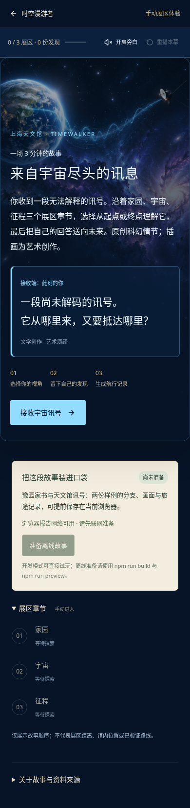
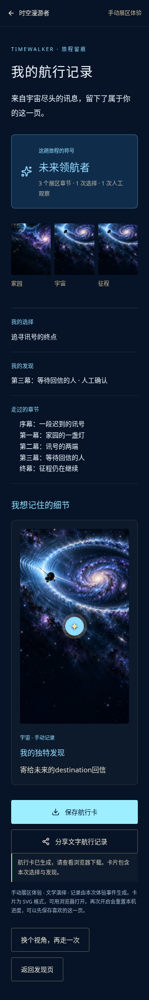

# 双样板落地与开发交接

2026-10-14。开发分支：`feature/timewalker-dual-samples`，起点 `af9d278`。本轮按 [V2 范围](../../timewalker_3_scope/20-双样板创作优先实施方案.md) 推进，阶段分别提交、推送；不覆盖原分支。

## 阶段一：创作链路修复

- 旧导览在地点阶段可「发布原版导览」，不再被不存在的故事卡住。
- 至少三个本机地点可「从当前地点起稿故事」，不用先发布、不调用模型；保持当前草稿 ID，明确待人工审核。不足三个地点仍可发布旧导览。
- 图出口按选项行居中，去掉导致圆点落在卡片外的固定纵向偏移。
- 复制 ID 截断并保留唯一后缀，合法 80 字符 ID 的章节复制不再生成超限场景/块/互动 ID。
- README 开发端口改为 5174；工作流导航简化，消除本环境复现的 refs 警告。

验证：73 项 Node 测试、build、lint 通过。`test:creator` 真实浏览器覆盖旧导览导出、本机未发布地点起稿→审核→导出、出口边界；发布请求拦截，不写种子文件。原引擎与冻结 V1 动作不变。

## 阶段二：主题贯通

- 根包新增可选 `presentation`，严格枚举 `heritage/cosmos`、`letter/transmission`、`outdoor/indoor`；开场标题 100、正文 1000、标签 80 字符上限，无任意 HTML/CSS。旧包默认视觉与按钮保持兼容。
- 草稿、目录、开发态发布都透传展示配置；展示变更会重置审核，非法配置禁止通过审核/打包。
- 编辑器可选预设并改开场、按钮、记录标题。播放器、首页、展区/站点导航、结局、文字分享和 SVG 使用同一配置。
- 室内只显示手动展区顺序，不显示原版地图入口或声称精确位置；引擎事件仍沿用冻结的模拟地点事件，未增加 GPS 能力。
- 76 项 Node 测试、build、lint 通过；Builder 与 Creator 浏览器检查通过，包含主题变更→重审→导出→同一播放器预览。实际发布文件/目录透传在临时 Vite 根目录检查。

阶段一提交：`a417cb9`。阶段二对应随本段提交记录；开发分支持续推送。

## 阶段三：可携带媒体发布

- `materializeMedia` 现在收集场景块图片与音频，替换为包内 assets 引用；与地点图/封面去重，不修改输入草稿。原先仅打包地点图的缺口已关闭。
- 增加有上限的 `audio/mpeg/wav/x-wav/ogg/mp4/aac/webm` Base64 支持；仍禁止脚本/SVG data 引用，单引用维持 3,000,000 字符限制。
- 浏览器发布复制大图（超过 2 MB）时可用原生编码器转为最长边 1600px 的 WebP，保留透明度；原始静态素材不改动。不支持编码或产物仍超限时明确失败，不伪造成功。
- Node 测试验证故事独有图片/音频收入资产、引用替换、扩展名、原草稿不变。实际浏览器新素材导出将在双样例阶段一并验收。

V2-05 的媒体收集子任务已实现；独立 Agent 候选及受控来源/资产注册仍待实现，不能把此子任务称为新 Agent 已完成。

## 后续阶段

1. 上海天文馆第二样例；手动进入展区、双分支、观察、完整结局；双样板离线准备与回归。
2. 独立 Agent 候选、故事块媒体落盘/打包、真实概念→节拍→编译模型链。当前尚未实施，不把模板或人工样例称为模型产物。

资料包的 Seedream/Tavily/高德供应商脚本尚未复制执行。照片授权、真机、模型效果、生产鉴权等继续按各自边界验收；本轮插画使用 image_gen，不能称为 Seedream 已联调。

## 阶段四：天文馆样例与双包离线

游客入口：`/experience/shanghai-planetarium`。首页同时展示两个主题，天文馆在全部景点列表中也进入故事，不导向地图。

### 已交付

- `shanghai-planetarium.json`：6 个场景记录、每次实际进入 5 个章节；序幕→家园→宇宙选择→起点/终点视角→征程，3 个展区、1 次选择、1 次观察。
- 两条分支分别讲述出发的人、等待回信的人，给出不同观察提示；结局按实际选择授予「起源追寻者」「未来领航者」，保留用户的标记与回信。
- 深蓝冷白主题、讯号开场、航行记录与蓝色 SVG 卡。图片失败可留纯文字或直接确认；默认静音，随时手动读完。
- 两张 9:16 AI 艺术插画已保存为仓库静态 PNG，附 SHA-256、大小、来源和待审状态。它们不是场馆实拍、NASA 图像或科学观测，没有使用临时供应商 URL。
- 展区名来自 V2 brief，仍待内容方复核；剧情全部标记文学创作。节点/起点 `0,0` 是结构占位，不能当场馆位置使用。游客与编辑器室内模式不显示坐标、地图、距离或 GPS 到达声称。
- `src/offline/demoStories.ts` 显式允许两个固定样例；生产 manifest 合并 JSON 与共享素材，保持逐文件 SHA-256、完整标记、失败回滚及原 20 MiB 上限。当前约 6.6 MiB、15 个文件；准备一次后可离线打开两包。不缓存用户草稿、模型或地图接口。
- 豫园保持原四站主线、点春堂结局，以保护旧体验。本轮没有按 V2 概念骨架改成玉玲珑终幕；未来剧情精修与答辩节选须按实际包同步。





### 验证与本地复现

使用 Node 24。在 `tour-hub-web`：

```bash
npm run dev:full   # 5174 + 8787；端口已占用时检查并复用本项目服务
npm test
npm run build
npm run lint
```

本轮 78 项 Node 测试通过；build、lint 通过且 lint 无警告。浏览器工具安装方式见 09；云端已安装工具的调用如下（本地替换两个绝对路径）：

```bash
TIMEWALKER_PLAYWRIGHT_MODULE=/opt/codex/cua_node/lib/node_modules/playwright/index.mjs \
TIMEWALKER_CHROMIUM=/usr/bin/chromium npm run test:dual

TIMEWALKER_PLAYWRIGHT_MODULE=/opt/codex/cua_node/lib/node_modules/playwright/index.mjs \
TIMEWALKER_CHROMIUM=/usr/bin/chromium npm run test:creator

# 必须在最新 build 后运行；独立启动测试服务器
TIMEWALKER_PLAYWRIGHT_MODULE=/opt/codex/cua_node/lib/node_modules/playwright/index.mjs \
TIMEWALKER_CHROMIUM=/usr/bin/chromium npm run test:offline
```

- 原 `test:smoke`、`test:builder`、`test:playability` 通过，保留旧故事/编辑/审核/故障/分享回归。
- `test:dual`：320/390px 两种分支、不同正文、画面与缺图、标记/回信、确认后和结局刷新、实际蓝色 SVG 下载及 XML 解析；零模型请求/页面异常。
- `test:creator`：旧导览、本机未发布地点起稿、图出口、主题修改重审、实际天文馆素材打包与预览；每个图片 block 都指向包内数据。发布请求拦截，不覆盖源包。
- `test:offline`：真实 Worker 与最新构建；损坏素材/失败回滚/版本替换/缓存缺失；源站不响应时完成豫园 5 轮及天文馆双分支，刷新/下载成功；模型接口不伪造缓存成功。
- 触摸坐标检查改为数值容差 ±0.5 个百分点，允许浏览器像素取整，仍检查实际标记接近目标位置。

以上为 Chromium 与模拟手机视口。没有替代真实 iOS/Android、系统语音、版权内容复核或人工演示计时。

### 下一位开发者从这里继续

| 范围 | 当前状态 |
|---|---|
| V2-01 主题抽象 | 已实现并贯通编辑、审核、发布与记录 |
| V2-02/03 天文馆包与剧情 | 可运行手工样例已实现；不是模型生成产物 |
| V2-04 美术 | 天文馆两张 AI 艺术插画已保存；豫园沿用旧图，授权复核与美术精修待办 |
| V2-05 Agent 导入 | 媒体收集/引用替换已实现；独立 Agent 候选、来源/资产注册尚待实现 |
| V2-06/07 真实概念→节拍→编译 | 未实现；原在线 Builder 仍是单次受限改写，不是新流水线 |
| V2-08/09 预录音与搜索 | 未接真实供应商；浏览器朗读可用，音频打包已支持 |
| V2-10 Creative Studio | 未实现；现有可视化编辑器不等于 Job 进度面板 |

建议下一条独立纵向任务：

1. 新增 `CreativeBrief/LocationNotes/StoryConcept/BeatSheet/AgentCandidate` 类型与独立验证器，复用冻结 V1 编译校验；不放宽旧 `assertBuilderCandidate`。
2. 从两份 brief、已知展区/景点资料和受控资产开始，模型真实提出两个故事命题；用户选一个，生成节拍并编译。接入现有服务端变量 `DEEPSEEK_*`，不要配置无人读取的 `MODEL_*` 假设成功。
3. 服务端 Job 生命周期、预算、取消、产物落盘与日志脱敏；浏览器采纳成独立待审草稿，不覆写种子、不由服务器直接写 localStorage。
4. 确定新增来源/媒体的受控注册范围、来源版本与审核信息；为 `createAgentDraft` 补跨来源/未知资源/原包隔离测试，再接 Studio 的阶段进度。
5. 有安全凭据与账号权限后，再实测 Tavily/Seedream/TTS；供应商失败明确返回，模板与预制包继续能演示。生成图片的计费调用需按资料包显式预算流程执行。

当前样例文本由本轮人工编写，配图由 image_gen 生成；没有宣称后端 Builder 自动产出了这份成品，也未验证 NASA/Seedream/模型供应商接口。
