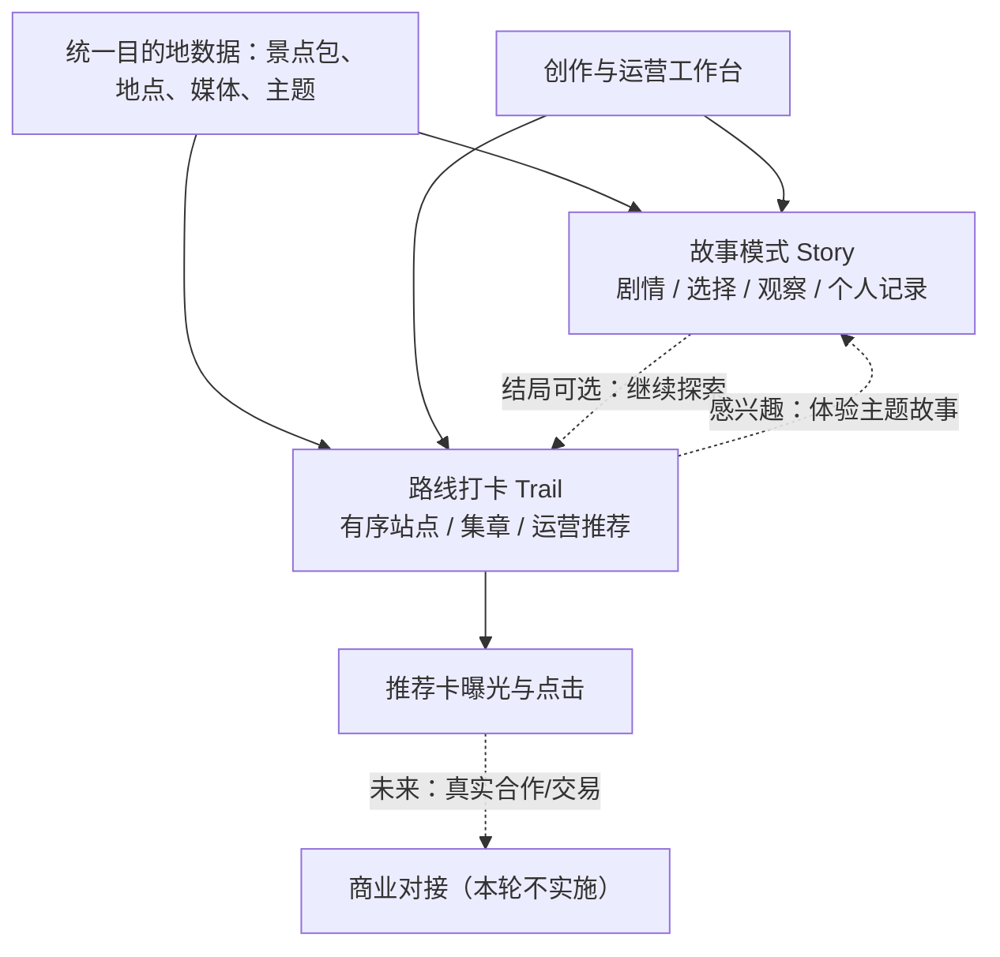

# 时空漫游者 Timewalker｜双模式项目方案与后续开发规划

> **版本**：V1.0｜2026-10-15｜团队方向对齐与开发实施稿  
> **代码基线**：`melxy1997/hackathon-trip-guide` · `feature/timewalker-dual-samples` · `e39dbd39`  
> **产品命题**：让世界成为你的故事（Make the world your story）  
> **技术品牌**：Trip Experience Engine（智能旅行体验引擎）  
> **本阶段成果形式**：可现场演示的 Web 产品、可编辑/发布的体验包、可复现的交互与创作过程。**不以真实商户营收、成交金额或线下人流提升作为黑客松现场验收指标。**

## 0. 执行摘要：我们究竟要做什么

**一句话定义：** 时空漫游者是一套把目的地转化为“可体验、可探索、可运营”的 Web 内容引擎。它向游客提供两种互补但可独立使用的体验：**故事模式（Story）**通过有情节的沉浸叙事激发兴趣，**路线打卡模式（Trail）**通过有序站点、轻量集章与适时推荐承接实地探索；向客服/目的地运营人员提供统一的内容生产、路线配置和发布工具。

**最短价值链：** 景点与地点内容 → 故事吸引兴趣／路线帮助探索 → 用户主动访问节点 → 运营推荐获得展示与点击机会 → *未来*可以连接合作项目与交易履约。此次竞赛只验证链条前端的**产品可用性和技术可行性**，不声称已有真实转化收益。

**交付原则：** 已完成的两份故事样板（豫园、上海天文馆）和 Creative Studio 不推倒重来；新增**一条豫园主题打卡路线**构成第三个完整可用的游客体验，明确其独立价值。双模式共享地点数据、资源与创作后台，但**不强行共用故事状态机**，也**不把商业打卡点作为故事剧情的必经情节**。

**答辩用一句话：** “同一座目的地，不只有景点介绍。我们用故事让人愿意出发，用主题路线让人知道怎么探索，再让客服和运营人员以极低成本制作与分发这样的体验。”

## 1. 为什么值得做：问题、受众与商业逻辑

传统导览提供知识但缺少体验动机；普通攻略告诉游客去哪里，但难以转化为现场可执行的体验；人工设计特色游线、活动任务与讲解素材又较费时。我们的切入点不是取代 Trip.com 的酒店、门票、餐饮或交通交易，而是为这些目的地相关服务增加**体验组织层**。

| 受众 | 遇到的问题 | 产品提供什么 | 是否为首版交付 |
|---|---|---|---|
| 自由行游客 | 不知道如何开始、普通介绍缺少代入感 | 故事入口；有次序的轻量探索路线；完成纪念卡 | 是 |
| 亲子、朋友结伴 | 希望有轻互动但不想玩复杂游戏 | 手动打卡、印章进度、简单发现任务、分享记录 | 是，轻量实现 |
| 客服/目的地运营 | 需要快速为游客组织浏览顺序、推荐内容和活动点 | 选择地点、调整顺序、写说明、配置推荐、生成可访问链接 | 是，演示级 |
| 景区/商户/合作团队 | 期待曝光、导流和可衡量的活动入口 | 带标记的运营推荐、链接点击事件与未来交易对接位 | 演示级接口，不承诺收益 |

### 1.1 商业价值叙述：说清机会，不伪造结果

可讲的价值包括：内容制作成本降低、服务人员能够快速配置推荐线路、合作项目存在自然展示位置、操作事件可被采集。**不可讲成已证明的收入**：提升了多少游客流量、带来多少订单、获得多少佣金、转化率提升多少。这些都需要真实渠道、合作协议、用户样本与统计周期，黑客松 Web 演示无法提供。

推荐位不与剧情强绑定。故事是用户愿意体验的原因；运营推荐通过“故事结束后继续逛”“路线站点的可选周边体验”等显式入口呈现。合作内容需要可辨识，演示数据写明“示例”，避免把假合作说成真实合作。

### 1.2 产品成功如何判断

竞赛验收的指标是**可观察的交互事实**：游客能否完成两部故事、完成一条打卡路线、留下个人记录；运营人员能否配置新路线并在游客页打开；演示推荐卡能否展示并记录一次真实的浏览器点击事件；创作工作台能否保留和采用实际模型生成的候选作品。性能、功能回归和演示时长同样可测。平台营收属于商业假设，不纳入本轮目标。

## 2. 产品形态：双模式、统一地点底座、有限联动



### 2.1 故事模式 Story：情绪与主题差异是优势

首批已完成两个风格迥异的样板，不再把开发时间用在重新做这两套播放器上。豫园《一封穿越四百年的家书》是中式人文与情感叙事，包含自然/匠心双分支与观察记录；上海天文馆《来自宇宙尽头的讯息》围绕家园、宇宙、征程组织深空科幻，包含方向选择、手动展区推进与航行记录。两包使用同一 `ExperienceDefinitionV1`、`storyEngine` 与主题系统，已具备 SVG/文字记录、模拟事件及预制离线体验。

**本轮只做体验打磨而非大规模改写：** 每包选择 90–150 秒可讲清的答辩片段，统一首屏质量、过渡、旁白、结局反馈，必要时补音频。只保留对故事体验有价值的轻互动，不增加图片识别、复杂解谜、精确位置打点等研发负担。

### 2.2 路线打卡 Trail：独立承接探索与运营需求

路线打卡不是故事的附属小游戏，而是游客可以**直接从首页选择**的独立体验。最小交互为：路线介绍 → 有序地点卡 → 手动到站打卡 → 印章/进度反馈 → 全部完成后的纪念卡。用户可以中途退出、刷新后继续；不要求上传照片或开启 GPS。

运营人员能够从已有景点包挑选 3–6 个站点，拖动顺序、填写主题与站点引导语、指定可选推荐位，完成后获得访问链接。首条示范线路建议选豫园：三穗堂 → 大假山 → 玉玲珑 → 点春堂，最大程度复用已存在的四个地点。**不要新建第二套地点内容体系。**

### 2.3 两个模式怎样联系

故事结束页出现可跳过的按钮“沿着故事中的地点继续探索”，链接到关联 Trail。Trail 详情页可出现“换一种方式认识豫园：体验家书故事”的入口。关联由内容配置中的 `relatedExperienceId` / `relatedTrailId` 声明，**不要按景点 ID、标题关键词、路由顺序写隐式判断**。创作者可以关闭联动；没有联动时两个模式仍独立成立。

### 2.4 推荐位出现在哪里

首版只在 Trail 中设置 1 个“运营推荐”卡片：例如在路线中段展示“附近还有一项可选择的体验”。它包含标题、文案、图片（可选）、操作按钮及明确的“演示推荐”标记。点击后打开内部演示详情或已确认存在的合法 HTTPS 目标。**不把赞助或推荐引导写进故事人物的台词。**

## 3. 三个实际演示样板

| Demo | 体验类型 | 目前状态 | 本阶段需完成 |
|---|---|---|---|
| A 豫园家书 | 故事模式，历史与情感 | 已有完整可运行作品 | 统一演示片段、补音效、结局链接 Trail |
| B 上海天文馆讯号 | 故事模式，科幻探索 | 已有完整可运行作品 | 视觉与音效精修；说明室内为手动展区 |
| C 豫园四站主题探索 | 路线打卡 | 尚无 Trail 模块 | 地点顺序、手动集章、完成卡、推荐展示、可发布链接 |

三个 Demo 与一个创作台共同构成答辩素材，不要求第三份故事或第二份 Trail。演示稿按这三种体验的差异组织，不把“豫园故事”和“豫园 Trail”说成两个独立新景点。

## 4. 代码现状与新增开发边界（以当前分支为准）

当前分支 `feature/timewalker-dual-samples` 已具备 React 19 / TypeScript / Vite 应用、旧地图导览、通用故事状态机、双样板与多主题、故事编辑器和发布流程。Creative Studio 已拥有双故事构想、节拍编译与独立候选导入；Tavily Search/Extract、Seedream 逐章生图适配、素材缓存、成果导入导出和 `agent:rehearse` 彩排脚本**均已有代码**，但供应商真实密钥联调仍未完成。Deep Agents 自主工具执行、自动云端配音、服务端持久 Job 还不是已交付能力。

仓库内尚无 `trail/checkin` 独立契约、打卡游客页、路线运营编辑界面。接下来新开发的主量应集中在这里，而不是重复开发已经存在的 Agent 接口。仓库阶段文档最近一次记录为 117 项 Node 自动化测试通过、构建与 lint 通过；该数字是**此前提交的测试记录，不代表本方案编写时重新运行了测试**。

### 4.1 技术决策一：Trail 使用独立内容包，而非修改 Story V1

`ExperienceDefinitionV1` 是给叙事图使用的：选择、动作、变量、观察及故事终幕。Trail 需要的是稳定的站点顺序、完成状态和推荐位。把 Trail 硬改为故事章节会造成“打卡=编一段剧情”的概念混乱，还会为简单操作引入不必要的模型动作。因此建议新增 `TrailDefinitionV1`，但复用 `PublishedAttraction.spots`、图片与 `presentation` 等基础元素。

**选择独立 Trail 文件，而不是景点包单个 `trail` 字段。** 因为一个景区未来应能拥有多条由不同客服/运营人员编写的游线，而且 URL 应独立分享。首版静态数据放在 `public/data/trails/<trailId>.json`，目录索引放在 `public/data/trails/catalog.json`。Trail 引用 `baseAttractionId` 和现有 `spotId`；加载时验证其引用确实存在。

建议契约（最终字段以实际 PR 实现为准）：

```ts
export interface TrailDefinitionV1 {
  schemaVersion: 1
  id: string
  baseAttractionId: string
  title: string
  description: string
  coverImage?: string
  estimatedMinutes?: number          // 运营填写的参考值，不作为实测导航时间
  relatedExperienceId?: string       // 可选故事入口，例如 yuyuan-timewalker
  checkpoints: Array<{
    id: string
    spotId: string                    // 必须引用 baseAttractionId 中已有地点
    heading: string
    instruction: string
    stampLabel: string
  }>
  recommendations?: Array<{
    id: string
    afterCheckpointId: string
    title: string
    description: string
    label: 'editorial' | 'demo_promotion' | 'sponsored'
    href?: string                     // HTTPS 无凭据 URL 或明确的站内演示路由
  }>
}
```

第一版限定 3–6 个不重复站点、1 个可选推荐位；不引入积分、优惠券核销、自动路线优化和用户账户。`label` 为展示属性，不构成真实商户合作或广告合规审核的替代品。

**豫园现有两份包的关系：** `yuyuan` 是五地点的旧地图导览包，`yuyuan-timewalker` 是四地点的家书故事包。推荐 Trail 的 `baseAttractionId='yuyuan'`，四个 `spotId` 均已存在。`relatedExperienceId='yuyuan-timewalker'` 以显式关联链接到家书故事，避免错误假设两个包有同一个 ID。

### 4.2 技术决策二：Trail 有自己的极简进度状态，不复用 StoryEngine

独立 `TrailSession` 只存 `{trailId, completedCheckpointIds, startedAt, updatedAt}`，按 `trailId + schemaVersion` 写入本机 localStorage。支持点击“完成打卡”与“撤销本次打卡”；所有检查点完成时显示总结与纪念卡。只记录用户主动确认，不声称有 GPS、防作弊或真实到店核验。若后期确实需要触发器，再为 Trail 新增可选 Location Adapter，而不是现在改 StoryEngine。

游客页路由建议 `/trail/:id`；运营编辑路由建议 `/publish/trails/new` 与 `/publish/trails/:id`。现有 `/tour/:id`、`/experience/:id` 完全保留。可以复用图标、图片卡、品牌主题和现有景点载入逻辑，但不建议直接复制庞大的 `TourPage.tsx` 来完成一个简单 Check-in 页面。

### 4.3 技术决策三：运营配置的“发布”必须真的被游客页面读到

运营侧先在浏览器编辑 Trail 草稿，再经过现有开发态导出能力或新增小型开发态 `trailExport` 将 JSON 写到 `public/data/trails/`；发布后更新 Trail catalog。**只有文件确实进入静态目录，另一个浏览器才可以按同一 URL 打开它。** 仅把运营配置写进 `localStorage` 不足以演示“客服制作线路，游客打开路线”。

生产静态托管环境不具有直接写入仓库能力：没有服务端 CMS 时，提供“导出 JSON → 加入静态站点/提交代码”的降级方式，并在工作台明确提示发布状态。可分享链接只指向实际已加载的路线资源。第一版不开发用户登录、多人协作、正式鉴权发布及审批后台。

### 4.4 技术决策四：运营推荐与简单事件采集分离

运营推荐应该是配置的内容，不是智能体偷偷植入剧情。可以定义最小事件 `trail_open`、`checkpoint_confirm`、`trail_complete`、`promotion_view`、`promotion_click`，字段限于匿名演示会话 ID、Trail ID、站点/推荐 ID 和时间戳，不记录电话号码、定位轨迹、账号等敏感信息。

**P0 只验证单个浏览器发生了真实事件**，例如在现场打卡和点击后，演示调试面板显示新增事件。如果需要跨浏览器展示运营报表，则作为 P1 新增一个仅开发环境可用的本机聚合端点或 JSONL 事件日志，并清晰标注演示数据；否则不要声称客服能跨设备实时看到真实流量。事件采集证明“可观测”，不是证明“有收益”。

### 4.5 技术决策五：AI 只用在确有收益的创作环节

当前 Studio 已有“模型双概念 → 节拍 → 可执行候选”的链路，且 Tavily/Seedream 的服务端适配已有代码，后续第一步是拿团队凭据跑真实作品，而不是重新搭 Deep Agents Harness。路线打卡第一版的配置全部可以通过确定性表单完成，不要求 Agent。以后可以在运营侧加“根据路线自动起标题、说明、亲子推荐版本”等 AI 辅助，但不能让它成为 Trail 可用的依赖。

若比赛后有时间继续深化自主创作，则先确认模型 `tool_calls` 正常，再接 Deep Agents，封装现有 Search/Image 工具；编译、媒体入库与发布继续是确定性代码负责。此方向在本次规划为 P2，不应挤占 Trail 可发布闭环和答辩彩排。

## 5. 工程模块、目录与接口设计

推荐新增（路径均相对 `tour-hub-web/`）：

```text
src/trail/
  trailSchema.ts            # TrailDefinitionV1 / assertTrail
  trailSession.ts           # 本机进度状态与版本兼容
  trailCatalog.ts           # 加载 /data/trails/* 与景点包
  components/TrailPlayer.tsx
  components/TrailCheckpoint.tsx
  components/TrailFinishCard.tsx
  components/TrailEditor.tsx
  components/PromotionCard.tsx
  __tests__/schema.test.ts
  __tests__/session.test.ts
  __tests__/publish.test.ts
src/pages/TrailPage.tsx
src/pages/TrailEditorPage.tsx
public/data/trails/catalog.json
public/data/trails/yuyuan-four-sights.json
scripts/smoke-trail.mjs
```

变更现有模块的最小集合：`src/App.tsx` 注册两个路线入口；`HomePage.tsx` 增加打卡模式区块；`PublishListPage.tsx` 增加路线创建/列表入口；`ExperiencePlayer.tsx` 或 `EndingJournal.tsx` 支持**数据配置的**结局跳转到关联 Trail；开发态导出插件复用原有安全约束，或为 Trail 单独增加非常小的导出逻辑。保持原故事 V1、Scene Action 白名单及旧地图导览兼容。

数据接口在正式样板阶段优先采用静态 GET：`GET /data/trails/catalog.json`、`GET /data/trails/:id.json`。草稿使用客户端存储；仅开发态导出文件接口需要写操作。推荐点击事件初期无须引入外部分析 SaaS 或后端数据库。

## 6. 关键用户流程与页面清单

### 6.1 游客端

首页呈现三个明确卡片：“沉浸故事 · 豫园家书”“沉浸故事 · 深空讯号”“路线打卡 · 豫园四站探索”；可通过 Story / Trail 分组进行浏览，但不要为了两个入口重构导航系统。

Trail 详情页显示封面、主题、站点数量、参考时长及“开始探索”；进入后展示站点卡、当前位置顺序与已获印章数量。点击站点打开简短讲述和地点照片；用户手动点击打卡，进度立即更新。可选推荐卡清晰显示“运营推荐 · 演示”，点击打开内部演示说明或合法目标。完成全部站点后出现纪念卡、复玩和“体验相关故事”入口。手机竖屏优先，无需高德 Key 即可完整走通。

### 6.2 运营端

客服/运营人员进入“路线管理”，从现有景点内容包选中豫园，勾选四个地点、调整顺序，编辑“园林里的四重风景”的标题、站点引导、印章文案和可选推荐。提交前即时校验；点击“发布演示路线”，开发服务写出静态 JSON 与索引，然后复制 `/trail/:id` URL 给游客，游客页按相同 JSON 渲染。生产静态部署如无写接口则降级导出 JSON，不虚构线上发布成功。

### 6.3 与故事的最小联动

豫园家书体验到达结局后，额外显示“继续沿园林里的四重风景探索”。Trail 结尾显示“走进一封四百年前的家书”。上海天文馆暂无 Trail 需求，也不应自动出现豫园关联。

## 7. 优先级与实施里程碑（推荐一个五日冲刺）

> 人日仅为在现有代码基础上、成员熟悉 React/TS 的粗估，非承诺；多人可并行，真实供应商联调受凭据与配额限制。**任何阶段均应保留可运行的两份故事样板。**

| 里程碑 | 时间建议 | 交付物 | 演示层面的验收 |
|---|---|---|---|
| M0 方案冻结与接口约定 | 第 1 天上午 | Trail 契约、页面路由、独立数据文件路径、分工 | 一个合法 Trail fixture 能通过校验；避免前后端各造格式 |
| M1 游客端 Trail 纵向闭环 | 第 1–2 天 | TrailPlayer、手动打卡、进度恢复、完成纪念卡、固定豫园路线 | 从首页可进入 C 样板，依次打卡四站并完成，刷新不丢进度 |
| M2 运营配置与可发布链接 | 第 2–3 天 | TrailEditor、静态导出/索引、游客跨浏览器打开 | 运营修改顺序并发布；另一浏览器访问同一链接看到新路线 |
| M3 推荐与故事互通 | 第 3–4 天 | 推荐卡、最小点击事件、关联故事/路线入口 | 完成故事后可以跳 Trail；推荐点击有可见事件，不假装订单 |
| M4 真实创作与答辩完成 | 第 1–5 天并行，第 5 天收口 | 使用现有 CLI 彩排实际模型、两样板音效/界面微调、完整回归、五分钟演示 | 三份体验可用；至少一份有真实模型来源的候选可导入/展示，或如实降级 |

若只剩两天：**优先 M0 + M1 + 固定推荐卡 + 结局联动，M2 可简化为种子 JSON + 页面只读预览；不要为了多一个编辑后台牺牲可玩的 Trail。** 但此时对外只能说“可配置契约与开发者发布”，不能说“客服已能自主发布”。

## 8. 可直接创建 Issue 的开发任务

| ID | 优先级 | 主要改动文件 | 验收条件 | 建议归属 |
|---|---|---|---|---|
| TW-TR-01 Trail 契约与样板数据 | P0 | `src/trail/trailSchema.ts`、`public/data/trails/*` | 地点引用、重复节点、推荐引用、URL 均校验；豫园四站合法 | 数据/架构 |
| TW-TR-02 Trail 进度状态与单测 | P0 | `src/trail/trailSession.ts` | 打卡、撤销、刷新、重新开始；换路线不串状态 | 游客前端 |
| TW-TR-03 TrailPlayer 与完成纪念卡 | P0 | `TrailPlayer`、`TrailPage`、样式 | 手机 390px 完整四站；缺图不阻塞；有视觉上明显的印章反馈 | 游客前端 |
| TW-TR-04 路线编辑器 | P0 | `TrailEditor`、`TrailEditorPage` | 选择景点节点、修改顺序、实时预览，非法配置不能发布 | 运营前端 |
| TW-TR-05 静态导出与分享链接 | P0 | 现有开发态导出插件适配或单独导出工具 | 发布后 GET 新 JSON，第二浏览器打开成功；无服务端时明确导出模式 | 数据/架构 |
| TW-TR-06 推荐卡与可观察事件 | P1 | `PromotionCard`、演示事件面板 | 卡片标明示例；点击有真实事件，刷新后保留本机演示记录 | 游客前端 |
| TW-TR-07 Story ↔ Trail 关联 | P1 | `EndingJournal`、Trail 详情、关联数据 | 豫园互跳，天文馆不误跳，旧故事无回归 | 游客前端 |
| TW-TR-08 Trail 浏览器冒烟 | P0 | `scripts/smoke-trail.mjs` | 四站打卡、恢复、跨浏览器打开、错误/空状态、320/390px | 测试/整合 |
| TW-AI-01 真实供应商彩排与成果保留 | P0 | 配置 + `npm run agent:rehearse`（已有） | 两题材至少各尝试一次真实模型；记录实际成功/失败，不改 mock 为真 | Agent 负责人 |
| TW-AI-02 生图真实调用验证 | P1 | 现有 `server/agent/media`（已有） | 一张实际生成图进入候选、导出、再导入及发布；失败可用旧图 | Agent 负责人 |
| TW-DEMO-01 双故事及 Trail 视觉/声音收口 | P0 | 样板、MP3、体验 UI | 三入口标题一致、视觉对比明显、手机音频可控 | 内容/设计 |
| TW-DEMO-02 五分钟答辩与降级 | P0 | `docs/08`、README、新截图/录屏 | 产品演示可在五分钟内完成；断网/无凭据仍能完成主要展示 | PM/整合 |

建议分工：A 负责 Trail 数据与运营发布（TR-01/04/05）；B 负责游客打卡、推荐与模式联动（TR-02/03/06/07）；C 负责现有 AI 真实联调和媒体效果（AI-01/02）；D 负责内容、UI 与答辩（DEMO-01/02），冒烟和集成由 A/B 共同完成。只有两名工程师时优先保留 A/B，AI 采用已保存成果作演示，不为框架迁移停下 Trail 开发。

**协作与集成要求：** 从 `feature/timewalker-dual-samples` 最新 HEAD 切任务分支；先合并 `trailSchema` 与种子数据，再分别开发编辑器/播放器。避免多人同时修改 `App.tsx`、`HomePage.tsx`、`gateway.ts`；功能一小段就 PR。每个 PR 描述新增行为、实际运行的测试以及未验证的环节，不强推覆盖并行提交。

## 9. 测试、验收与门禁

### 9.1 Trail 功能验收（新增）

1. 根目录首页可访问两个故事和一条豫园打卡路线，不混淆入口。
2. 四站路线在无地图 Key、无模型 Key 的浏览器环境中完整跑通；每次手动打卡立即增加印章数，刷新保留；撤销和重置有明确反馈。
3. 运营人员更改站点顺序后，导出或发布的路线文件可由另一个浏览器读取；若只是本机草稿，页面明确标为未发布。
4. 推广推荐是可选卡片，明确标注“演示推荐/合作推广”；无推荐位的 Trail 也能完成。
5. 点击推荐发生真实 UI 事件。开发环境可以显示本机会话事件；没有真实商户、订单和结算时不展示虚构收入报表。
6. 豫园 Story 结尾可选进入 Trail，Trail 可返回相关故事；天文馆没有错误关联。
7. 数据缺失、非法站点引用、无法加载图片、缓存不可用均给出退路，不出现空白或运行时崩溃。

### 9.2 原有系统回归（保留）

依次运行 `npm test`、`npm run lint`、`npm run build`；按变更范围运行 `test:dual`、`test:creator`、`test:studio`、`test:builder`、`test:smoke`、`test:playability`，最后使用最新构建运行 `test:offline`。新增 `test:trail` 不等于可以跳过原有的故事和发布流程测试。自动化结果需标明 mock/真实；终端退出码与网页效果不一致时按实际缺陷处理。

### 9.3 真机与演示验收

最少在一台 Android 和一台 iPhone（若团队具备设备）手动体验：首屏布局、弹窗、触控按钮、声效开启、分享、保存卡片。核对 320px/390px 宽度；无横向滚动；关键触控区域约 44px。使用人工计时完成五分钟连续串讲，至少留一份事先录制的完整演示视频。

## 10. 答辩剧本：Web 能证明什么

| 时间 | 现场操作 | 评委应得到的认识 |
|---|---|---|
| 0:00–0:30 | 用一句话提出问题，展示首页 Story 与 Trail 两种入口 | 项目不只是 AI 景点介绍，而是可选择的目的地体验 |
| 0:30–1:20 | 演示豫园家书开场、一次选择与情绪回收 | 故事创造差异化与情绪吸引 |
| 1:20–1:55 | 切换天文馆深空讯号，快速展示不同视觉与结局 | 同一引擎不受古风题材限制，可跨场景复用 |
| 1:55–2:55 | 打开豫园四站 Trail，完成 1–2 个站点后用演示进度进入结局，展示印章与推荐卡 | 打卡路线可以把内容转化为有顺序的线下探索 |
| 2:55–3:35 | 从运营编辑器改变一处站点或推荐信息，重新加载游客页并看到变化 | 创作/运营人员能真正配置并交付 Web 体验 |
| 3:35–4:30 | Creative Studio 展示真实保存的概念→节拍→候选、可选生成插画，采用进入编辑器 | AI 降低故事制作成本；产物不是不可控聊天文本 |
| 4:30–5:00 | 展示统一架构图，说明推荐/事件到未来合作的接口、产品边界 | 技术复用和商业化路径成立，但未虚构交易证据 |

**答辩前必须处理的事实：** 在没有凭据或外部服务慢时，使用两份预制故事、Trail 与已经保存且来源标明的成果。预先生成的真实模型文件可以直接导入展示，但必须明说“预先生成”；自动化 fixture 不能包装成真实模型成功。路线完成的演示进度也要明确是测试/演示交互，不宣称实地到站。

一句回应商业化的答辩话术：“我们今天没有声称获得真实交易收入，也没必要在五分钟里伪造它。我们交付的是可配置的线下体验入口、可发布的路线、可展示的推荐位和可观察的用户行为；真实商业收益需要在与景区、客服运营和商户合作后继续验证。”

## 11. 风险、取舍与兜底

| 风险 | 处理策略 |
|---|---|
| 三条开发线并行造成大量返工 | 提前冻结 Trail 契约、路由、静态发布位置，再拆人；所有旧样板保留 |
| 打卡模式做成另一套大系统 | 独立极简 TrailSession，不新建复杂地图引擎/积分后台 |
| 运营编辑器只能本地保存 | 必须配静态 JSON 导出或开发态真实写入、二次浏览器可读验证 |
| 收益故事过于强势影响游客体验 | 商业推荐可跳过，故事剧情不受商业卡强制影响 |
| 真实 AI 服务不可用 | 两份固定样板 + 本地 Builder + 已导出成果仍可演示；不可谎称调用成功 |
| Seedream 图片链接过期 | 沿用已实现下载到 AssetStore、导出内嵌媒体的路径，非临时 URL |
| 离线新路线不自动可用 | 第一版离线承诺仍仅限两份固定故事；若要 Trail 离线必须单独纳入 manifest 并实测 |
| 室内位置不可靠 | 天文馆保持手动进入展区；不做室内 GPS 测试 |
| 商业收入无法现场证明 | 用用户流程、配置效率、点击事件证明能力，收入仍是后续验证目标 |
| 比赛时间不足 | 砍报表、AI 自动推荐、第二条 Trail 和复杂任务编排，守住一条完整的路线闭环 |

## 12. 非目标与明确延期项

**不做：** 支付与佣金分成、假设性的 ROI 看板、真实商户/广告管理后台、积分兑换、GPS 防作弊、扫码核销、精确室内导航、现场图像识别、路线最短路优化、八类 Critic 与逐句历史考据、跨租户 CMS/账号权限、重新开发故事引擎、为 Trail 引入 Deep Agents 自主规划。

**有价值但延期：** 把真实门票/当地玩乐商品连接到运营推荐、跨设备转化归因、真实到店/核销效果评估、客服模板库、不同游客的个性化主题 Trail、Agent 辅助生成运营游线、服务端 Job/历史版本管理。这些是未来产品化选项，不是当前可被现场证实的成果。

## 13. 团队待确认决策（建议当天冻结）

| 问题 | 建议直接采用的默认决定 |
|---|---|
| 两种模式谁是首页主角？ | 故事优先，Trail 与故事并列可进入，不做两个应用 |
| 打卡必须 GPS / 上传照片吗？ | 不需要，手动确认与可视化印章足够 |
| 打卡需要第二个目的地吗？ | 不需要，两份跨题材故事 + 一份豫园 Trail 已证明范围与价值 |
| 打卡数据和故事 JSON 怎么放？ | Trail 独立文件、引用同一景点 ID 与现有 `spotId` |
| 有商户合作吗？ | 未确认即使用“演示推荐”，不展示假合作或订单 |
| 运营路线必须可真正发布吗？ | 是。开发态静态导出/写文件必须成功；生产 CMS 不做 |
| AI 要不要先升级 Deep Agents？ | 暂缓。先做真实供应商联调和 Trail P0，框架不是比赛成果本身 |
| 是否要求额外独立审核后台？ | 不需要；沿用现有编辑审核与基本输入验证 |

## 14. 今天就可以分工的启动顺序

1. **所有人同一基线：** 从 `feature/timewalker-dual-samples` 最新提交拉取代码；确认项目在 `tour-hub-web/`，Node 24、`npm ci`、`npm run dev:full` 可以起。不要从 `main` 重建旧导览。
2. **合同先行：** 数据负责人合并 `TrailDefinitionV1`、`assertTrail`、豫园固定样例与 `/trail/:id` 路由空壳；其他人约定好接口再并行开发。
3. **P0 用户闭环：** 游客前端完成四站打卡与完成卡；运营前端完成地点配置与可导出文件。新功能不用等 DeepSeek、Tavily 和 Seedream。
4. **AI 并行证据：** 有凭据成员执行既有 `npm run agent:rehearse`，保存一份实际成功的 `*.studio.json`；需要新图片再使用 Studio 已有逐章配图接口。
5. **同步验收：** 新 Trail 用 Chromium 浏览器脚本覆盖；原故事与发布测试按影响范围回归。内容负责人同日开始五分钟讲稿和演示录屏。

---

**最终边界：** 我们能在答辩当场证明的是：一个故事化目的地入口、两份题材完全不同的沉浸式体验、一条可配置的主题打卡路线、可编辑的创作工作台，以及推荐和行为事件的前端链路。**我们不需要证明还没有发生的商业收益，亦不应为了商业愿景牺牲已经有辨识度的故事体验。**